# Activity view: reading order, one Maps control, one scroll area

Status: November 19, 2026. Built and checked locally with synthetic data; not
deployed. No data, schema, API or access change. Follows
[tap to read, Edit to change](activity-view.md).

## What was wrong, and where it came from

People trying the live site reported that the view which opens when an activity
is tapped was mostly map buttons, that it would not scroll on a short laptop
window, and that on an iPhone the description and the Close/Edit buttons could
not be seen. All of it was reproduced locally before anything was changed
(`scripts/check-activity-view-layout-browser.cjs`: 65 of its checks fail on the
old code).

**Where the map links came from.** Pull request #25, "Maps: links from text,
directions, plans with no place, tappable markers, guest map" (commit
`045ab42`, November 17). The view was built the day before (#18, `9372e95`) with
a fixed top block for "where": meeting point, place, address, and at most one
reviewed map link. #24 added a row of address searches to that block, and #25
replaced it with the Map panel's link rows: a labelled search row and a labelled
directions row, each with Apple Maps and Google Maps. They landed at the top
because the "where" block was already there, above the notes. In the Map panel
those rows sit in a wide list; in the view's narrow column each 44 px pill
wrapped onto its own line, so one address became four stacked buttons. The
picture (#19, in the merge that combined pictures with the new view,
`129bd1d`) and the "Last edited by" line (#26) were each added to the
only other place available, the scrolling notes area at the bottom. Each change
was checked on its own, at 1440 × 900 and with shorter sample content; nobody
looked at the three together at a short height.

**Why the top did not scroll.** The dialog was a flex column with
`overflow: hidden` and a height limit, and only its last content block
(`.view-body`: picture, description, notes, last edited) had `overflow-y: auto`.
The labels, title, time and the whole "where" block were ordinary flex items,
which do not shrink below their content. So:

- Laptop, short window (1280 × 600): the fixed part took about 420 px of a
  568 px dialog. The scroll area was squeezed to its 72 px minimum. The wheel
  scrolls whatever scroll area is under the pointer; over the fixed part there
  was none, so nothing moved.
- iPhone upright with Safari's toolbars showing (about 390 × 664): the fixed
  part plus the 72 px minimum was taller than the sheet's limit. The dialog
  clipped the overflow, which was the bottom: the picture was cut off and the
  Close/Edit row was pushed out of sight.
- iPhone sideways: a second layout put the top block in a left column and the
  scroll area on the right, with the place block in a row that could collapse
  to nothing. That made three nested scroll areas, and the place and map links
  ended up in a strip a few pixels tall.
- A large window or an iPad had room for all of it, which is why it looked fine
  there.

## What it does now

- **Order**: who it is for and the title; when; the description; the picture;
  meeting point and place; Maps; private planning notes and links; last edited.
  On a phone held upright the description is on screen as soon as the view
  opens.
- **Maps** is one small control after the place line. Opened, it shows two
  short rows, Search and Directions, each with Apple Maps and Google Maps (and
  the place's checked link first, when it has one). All four destinations are
  still there; nothing is shown at all when the activity has no usable
  location, and never to guests.
- **One scroll area.** Everything is inside `.view-body`. Only the × and the
  Close/Edit row stay put, and a wheel or trackpad over those scrolls the body
  too. The view is never taller than the visible window: heights use `dvh`
  (with `vh` as a fallback for old browsers) and the footer keeps clear of the
  home indicator with `env(safe-area-inset-bottom)`.
- **The page behind does not scroll** while any dialog is open
  (`html:has(dialog:modal) { overflow: hidden }`).
- **Swipe down** still closes the phone sheet, but only for a touch that starts
  with the content at its top and moves down. A touch that starts by scrolling,
  or that scrolls the content part-way, never moves the sheet.
- **Phone sideways**: the view uses nearly the full height; title, time and
  description on the left with the picture beside them, then place, Maps and
  the rest underneath in the same scroll area.
- **The editor** was measured at the same sizes and did not have the problem:
  it is a single scroll area (the dialog itself) that fits the window, and Save
  can be reached. It is unchanged, apart from the page behind no longer
  scrolling.
- Offline shell cache is `waypoint-shell-v51`.

Not changed: what guests are sent, authorization, drag and drop, the editor's
fields, and the sideways phone board (Ideas column fixed, days two at a time).

## Join: not built, owner to choose

A "Join" button under the description was asked for. It is not built, because
the planner has no way to know which traveler a signed-in person is:

- An activity's `participants` is a list of ids, each a group (a family, or the
  whole-trip "Everyone" group) or a person from the roster. Optional is a
  separate flag. So the model does support adding and removing one person.
- A roster person is `id`, `name`, `familyId`, `showOnGuest`. Editors are a
  separate list of sign-in emails on the trip. Nothing links the two, and
  [travelers.md](travelers.md) says a roster entry "does not … create an account,
  or grant editing access". Many travelers (children, for a start) will never
  sign in.

Guessing the link (matching a display name to an email, say) would put the wrong
person on a plan, so it was left alone. Options:

1. **"I am …" chosen once per device.** The first time someone taps Join they
   pick their name from the roster; the choice is remembered in that browser
   only. No schema change. Join/Leave is then an ordinary activity edit through
   `commit()`, logged in History under the signed-in editor. Weakness: nothing
   stops someone picking another name, though History shows who did it, and any
   editor can already tick anyone in the editor.
2. **Organizer links editors to travelers.** A new optional field on the editor
   list or the roster, set by the organizer in "Manage travelers". Reliable, and
   also useful for a "my plans" filter, but it is a schema and API change and
   needs the organizer to fill it in before the trip.
3. **"Add someone…" instead of Join.** A small picker in the view that ticks any
   traveler on or off without opening the editor. No identity needed, works for
   a parent adding children, but it is two taps and is not what was asked for.

Questions to settle whichever is chosen: what Leave means for a person who is
only included through their family group (the saved list keeps the group, so
leaving would mean replacing the family with its other members); whether Join is
offered only on Optional activities; and that it is never shown on "Everyone"
activities or to guests. Recommendation: option 1 now, since it needs no data
change before November 22, with option 2 later if a "my plans" view is wanted.

## Checks

- `npm test`: 233 pass, 7 of them new in `tests/activity-view.test.mjs`
  (order with the description before Maps; one Maps control with all four
  links; no Maps control without a location; the body as the single scroll
  container with a fixed footer and dynamic heights; swipe down against
  scrolling; wheel over the footer; no Join control). `npm run typecheck`,
  `npm run lint` (no new warnings) and `npm run build` pass.
- `scripts/check-activity-view-layout-browser.cjs` (headless Chromium, local dev
  server, synthetic trip): 155 checks pass at 1280 × 600, 1440 × 900, 390 × 844,
  390 × 664, 844 × 390, 844 × 340, 820 × 1180 and 1180 × 820, for an activity
  with a picture, an address and a description, one with a long description, and
  one with none of them: the view fits the window; × and Close/Edit on screen;
  title, time and description on screen without scrolling; wheel over the title
  and over the footer; finger drag from the title; swipe down at the top and
  while scrolled; the last line reachable above the footer; the editor.
- The earlier `check-activity-view-browser.cjs` (65) and
  `check-last-edited-browser.cjs` (75) still pass.
  `check-map-features-browser.cjs` and `check-map-location-browser.cjs` each
  fail one check, "nothing was requested from another site", because the page
  now asks the weather service for a forecast ([weather.md](weather.md)); that
  was already so before this change.

**Not verified.** No real iPhone or iPad was used. Safari was stood in for by
Chromium at the window sizes Safari leaves (390 × 664 with both toolbars,
844 × 340 sideways). What that cannot show: Safari's toolbars sliding while the
sheet is open, rubber-band scrolling at the top of the sheet during a swipe
down, whether `overflow: hidden` on the page fully stops the page moving under
a finger on the dimmed area in every iOS version, and the home-indicator inset
(the page does not use `viewport-fit=cover`, so the inset is expected to be
zero). Also not checked: a screen reader, the hosted Site, and real trip data.

## Before and after

All sample data is invented. Left is before, right is after.

| Size | Picture, address and description | None of them |
| --- | --- | --- |
| Laptop, short window 1280 × 600 | 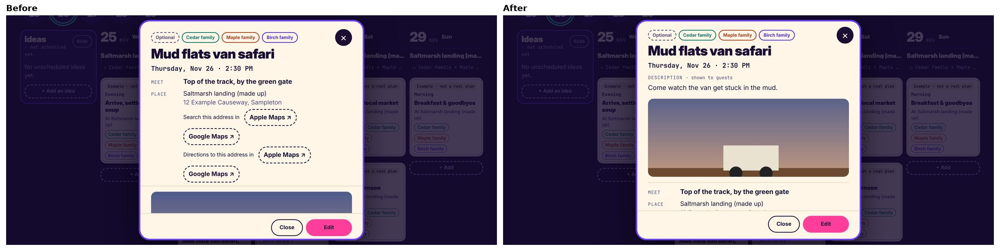 | 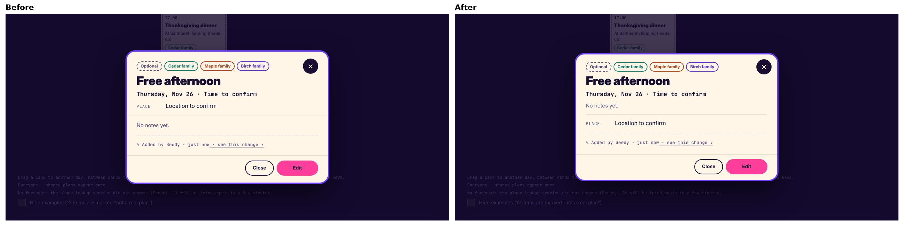 |
| Desktop 1440 × 900 | 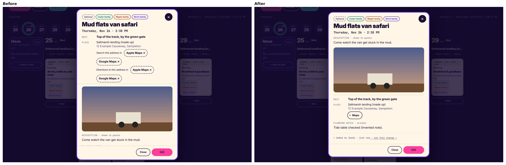 | 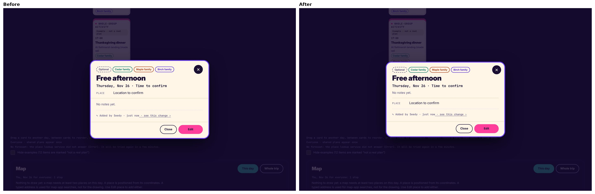 |
| iPhone upright, toolbars showing 390 × 664 | 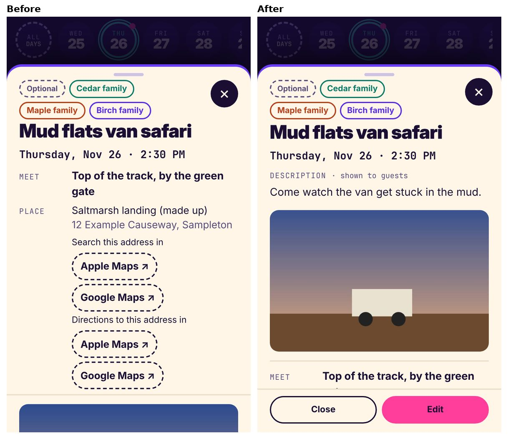 | 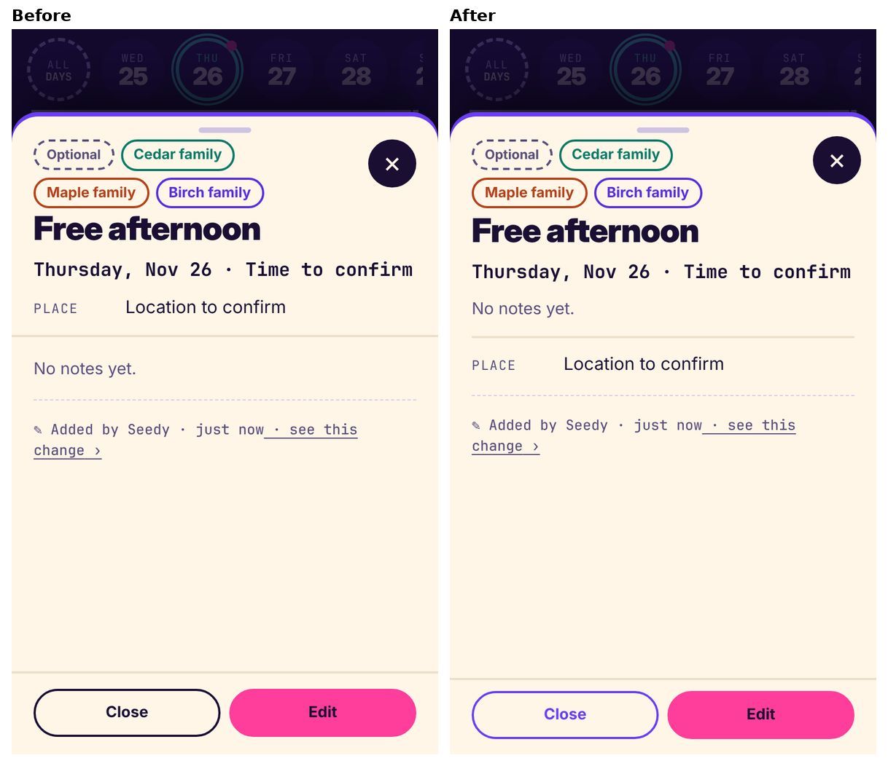 |
| iPhone upright, full height 390 × 844 | 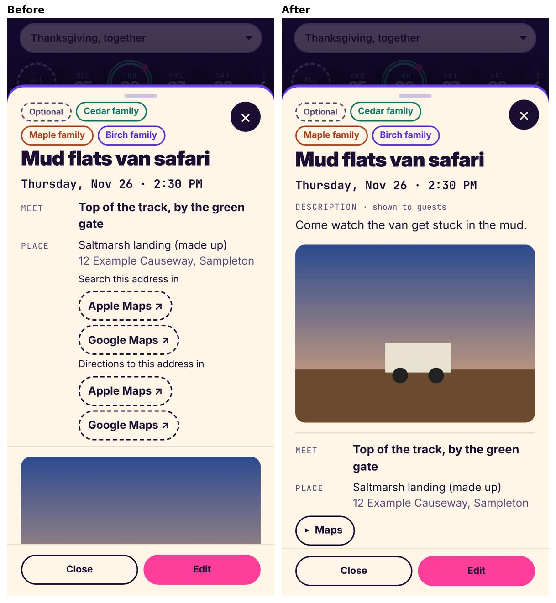 | 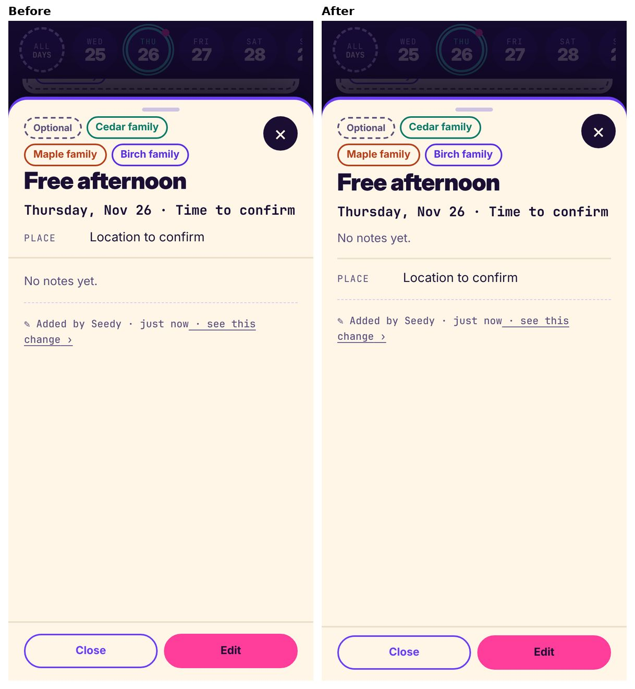 |
| iPhone sideways 844 × 390 | 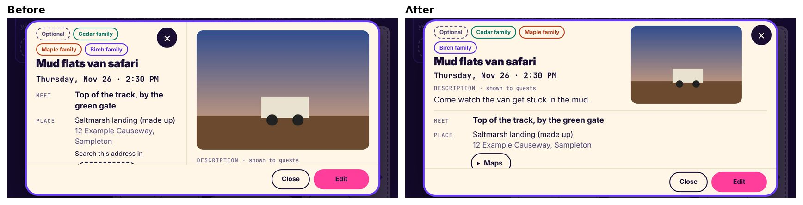 | 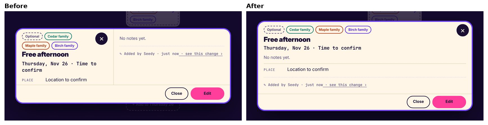 |
| iPhone sideways, toolbar showing 844 × 340 | 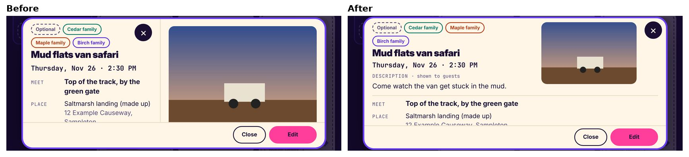 | 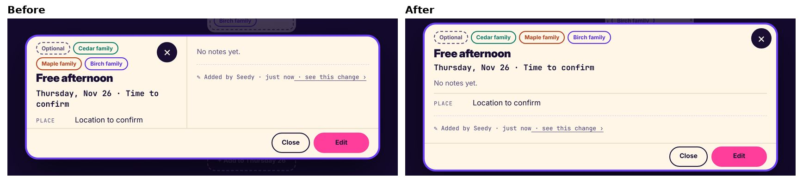 |
| iPad upright 820 × 1180 | 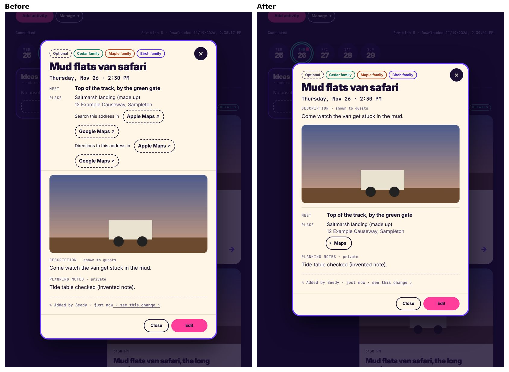 | 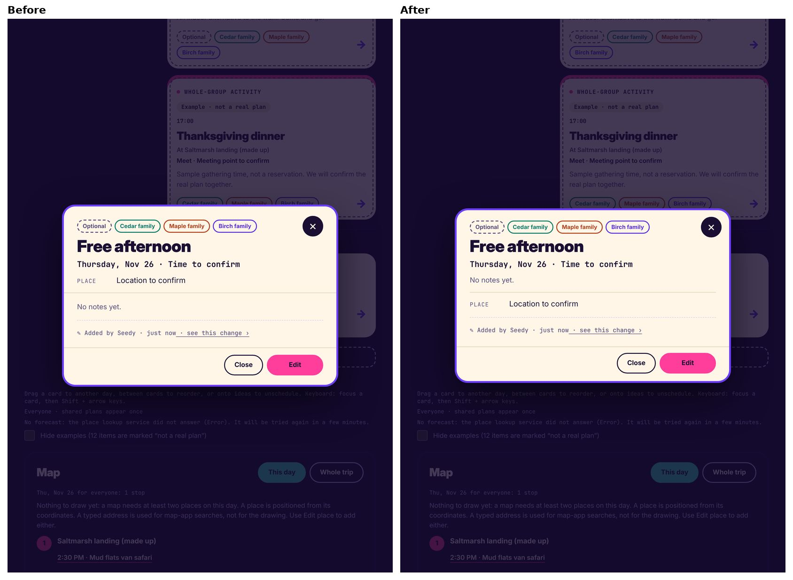 |
| iPad sideways 1180 × 820 | 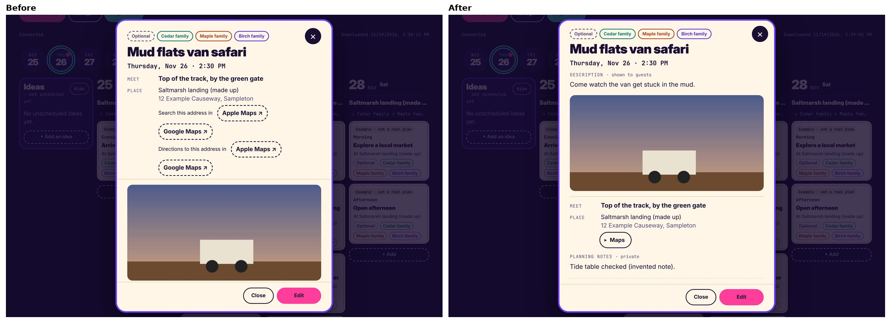 | 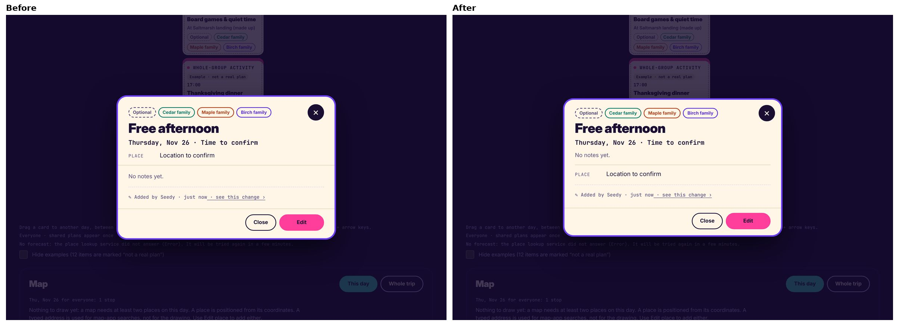 |

After, with Maps opened and scrolled to the end:

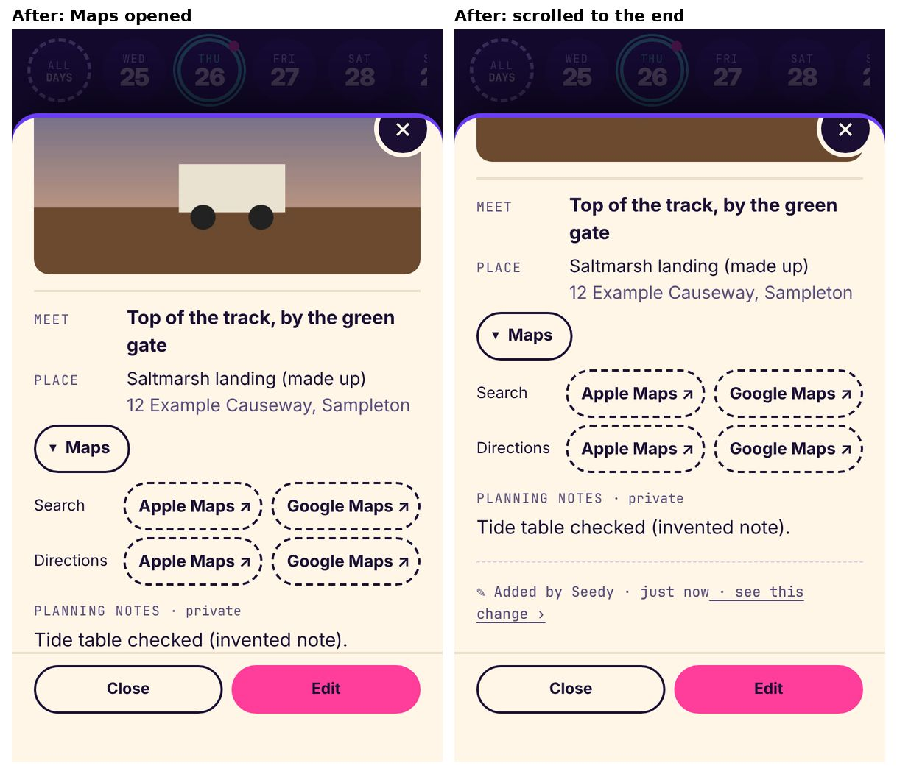
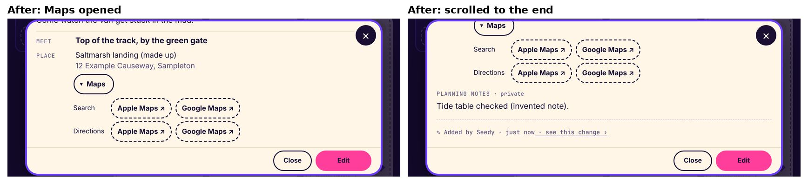
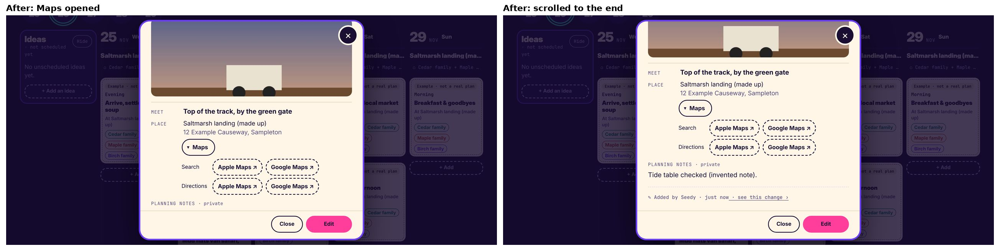

## Release

Published November 19, 2026 to the existing Waypoint Site.

### Provenance and scope

- GitHub main: `d80fd0a9f662bf3e253f45050b3f016b1b7e6e5e`, verified as main's head before checks and publication.
- Previous production: saved version 24, Sites source `eca3ee467861b7f667c21a91b8d61d318fb5025a`, matching GitHub `a78e4e8103f000f89f6fb653b958a99dabefdee4` app tree `df6b188fe0a0da3cafb6d52270ecb190217f21cf`; offline shell v50.
- Every merged PR since that baseline: #41, weather remains through card moves and refreshes; #40, description-first activity view, one Maps control and one scroll area. PR #38 was already in version 24.
- Sites source commit: `00b2bf71c7e89a013820db247de3aff7632da7b0`.
- Matching GitHub app-subtree and Sites repository tree: `a489329e0ed488bec2850ac22b45a62775bdf9c0`. The trees match file for file.
- Saved version 25: `appgprj_6af3ef55c4f48191940aa66a59771eb3~appgver_5bb2f8f0bea881919b3cae03ce6fb718`.
- Deployment: `appgdep_6aff11daf130819195ad0f06d2c23a00`, succeeded.
- Runtime environment revision: 2, unchanged. Offline shell: `waypoint-shell-v51`.
- No migration changes (0000–0004 unchanged); none generated or manually run. No runtime configuration, ownership, audience, editors, guest tokens, guest-map setting or stored trip was changed. No invitations or emails sent.

### Checks performed

- Standard Node 22.16.0 used after earlier environment-only installation/build failures. No application changes were made to get checks to pass.
- `npm ci` and `npm run install:ci`: passed.
- `npm test`: 234 total, 231 passed, 0 failed, 3 skipped because Playwright is not installed. This is the observed count rather than the deployment prompts' older expected counts.
- `npm run typecheck`: passed.
- `npm run lint`: 0 errors, 5 warnings.
- `npm run build` and the Sites build helper: passed. Sites source helper built, pushed and packaged the matching source.
- Published `/sw.js`, `/planner.js`, `/guest.mjs`, `/weather.mjs`, `/maps.mjs` and `/map-panel.mjs`: 200, JavaScript content types, exact bytes matching the pinned source, no `AIza` prefix. Published service worker contains shell v51.
- `/view.html` source is byte-identical to the prior release. The served HTML preserves the required `connect-src 'self' https://www.google.com https://api.open-meteo.com; frame-src https://www.google.com;` policy. Cloudflare appends a challenge-platform script to served HTML, so served HTML is not byte-identical to the source file.
- Direct command-line requests were rejected at the hosting edge with 403. Retried with the Sites-supported service access header, which dispatch consumes and which supplies no visitor identity: `/api/trips`, `/api/trip?id=x` and `/api/weather?id=x` returned 401; `/api/shared-weather` without an Authorization header returned 404. No response contained `mapsEmbedKey`.
- Existing owner session opened the current trip without edits: an activity with a loaded photo has description before photo before place, one collapsed Maps control, and visible Close/Edit controls. Maps expands into Search and Directions; the view was closed without saving. Trip revision remained unchanged through verification.
- Weather lines appeared under the dates. Tooltip text starts with the full weather line, then the forecast place, update time and weather-service credit.
- Site access policy and owner role were compared before/after and remained unchanged. No rollback performed.

### Verification limits and owner follow-up

- Existing guest link is enabled, but its saved URL/token was not available in the current browser. It was not replaced or regenerated. Hosted guest activity absence of Edit/Maps remains unverified in this release session; unit coverage passed.
- Browser viewport override and zoom controls did not change the observed viewport. The chosen activity fit without overflow, so wheel scrolling with the pointer over its title could not be demonstrated. No claim is made that the short-window browser check passed.
- The Google day-map iframe/control was present, but its rendered contents were not inspectable, so actual map rendering remains unverified.
- No live card was moved. Owner should drag a card to another day, confirm weather stays filled, drag it back and confirm again without reloading; report if any line goes blank.
- No real iPhone was used. Check on a phone that the sheet scrolls, swipe-down closes only from the top, and the page behind stays still. Screen-reader behavior and China readiness are not established.
- Rollback target retained: saved version 24, `appgprj_6af3ef55c4f48191940aa66a59771eb3~appgver_1a68234d5cf0819194e09c0c5cc0e04d`. No database or runtime configuration rollback is needed for this release.
