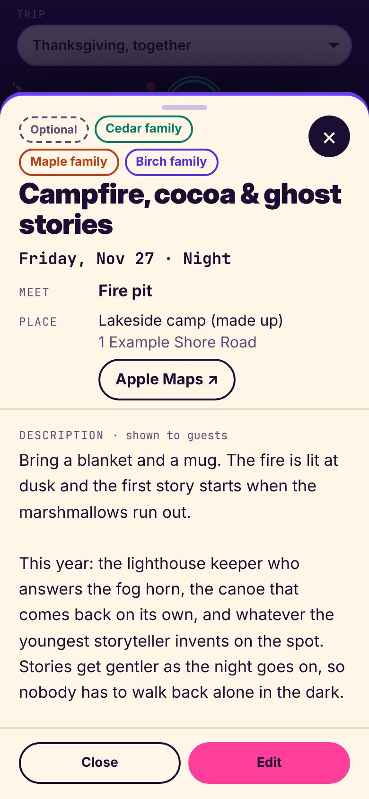
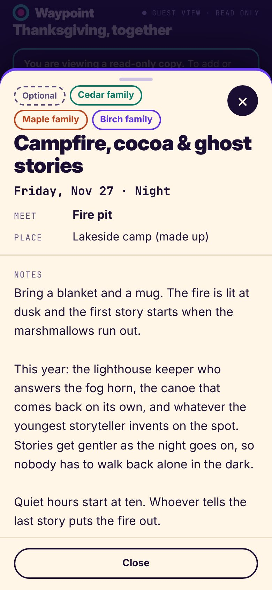
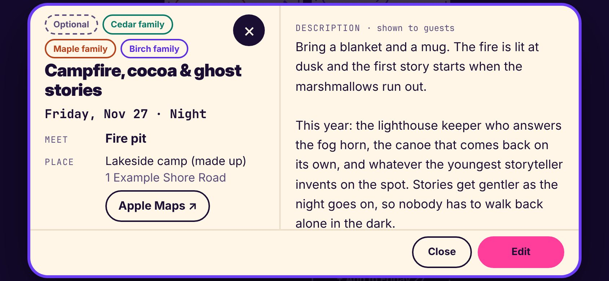
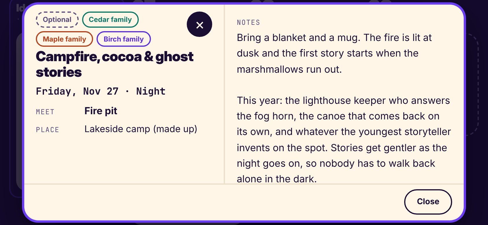
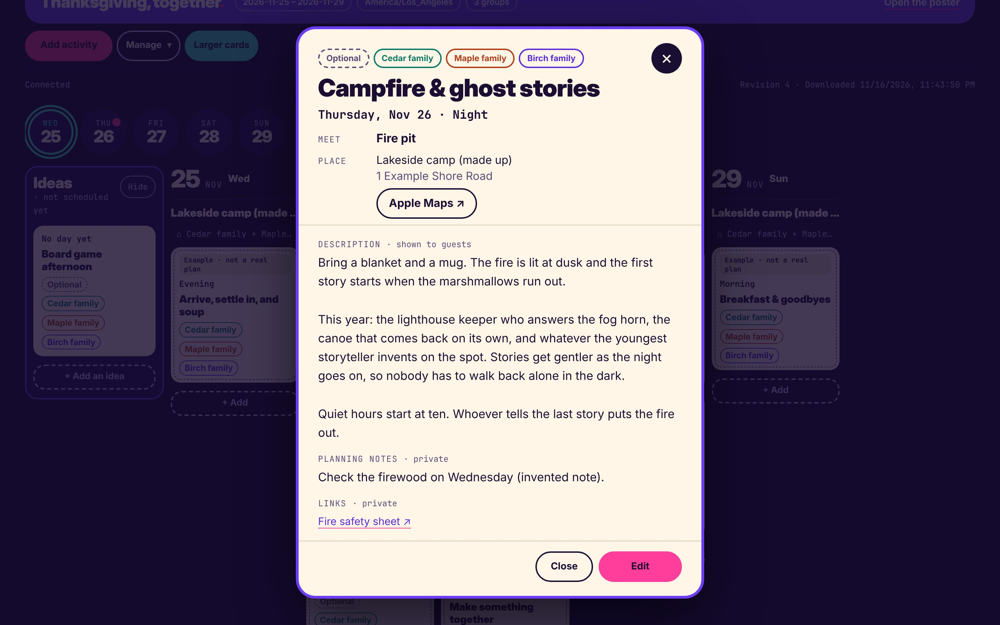
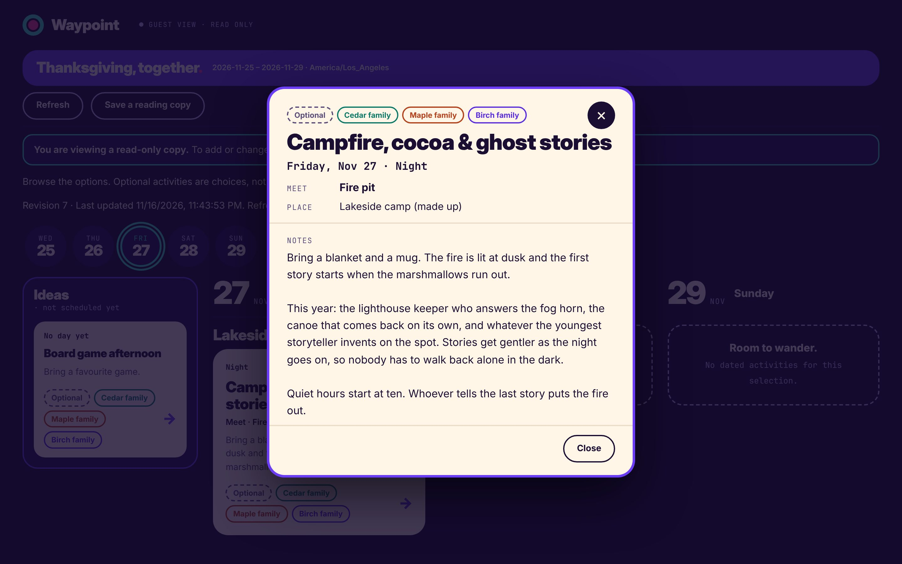

# Tap to read, Edit to change

Status: November 16, 2026. Built and checked locally with synthetic data; not
deployed. No data, schema, API or access change.

Tapping (or clicking) an activity used to open the full editing form straight
away. On a phone that was heavy for people who only wanted to read the plan, it
made accidental edits easy, and a long description was clipped both on the card
and in the form's small text box.

## What happens now

- **A tap opens a read-only view of the activity.** Large title; day and time;
  meeting point, place, address and the place's reviewed map link; then the
  description and notes, which scroll inside the view however long they are.
  Who it is for, Optional, Whole-group activity, Set time and Example labels
  are shown in words, as on the card.
- **Phones (upright): a sheet from the bottom edge.** Close it with Close, the
  ×, a tap on the dimmed schedule above it, or a swipe down. Scrolling the
  notes never closes it.
- **Wider screens: the cream dialog** already used for stay details. On a phone
  held sideways the title, time and place sit on the left and the notes scroll
  on the right.
- **Edit** is in the view for people who sign in to the planner. It opens the
  existing editor for the same activity. Saving or cancelling the editor comes
  back to the view, showing the saved values. Delete, and everything else that
  changes the plan, stays in the editor.
- **Guests (the read-only guest link) get the same view with no Edit button.**
  It shows only what the guest link already sends: the guest description and
  meeting point, never private notes, the private address, links or map links.
  The guest preview inside the Guest link dialog opens this guests' version too.
- **Add activity**, "+ Add to (day)" and "+ Add an idea" still open the editor
  directly and return to the schedule.
- It is the same everywhere a card appears: the phone day list and all-days
  list, the sideways multi-column view, the desktop board, and Ideas.
- In the editor, the Guest description and Private planning notes boxes now
  grow to show all of their text.

## Not changed

- **Authorization.** Hiding Edit is a convenience only. Every save is still
  checked on the server (`lib/trip-store.ts`), and the guest link still receives
  only the guest projection (`publicTrip` in `lib/trips.mjs`). Neither was touched.
- **Drag and drop.** A tap opens the view; press-and-hold (touch) or
  press-and-move (mouse) still moves the card, and the release of a drag opens
  nothing. Shift + arrow keys still move a focused card.
- **Links.** Activities have no deep links or URL state (only `?trip=` selects
  the trip), so nothing needed deciding there.

## Keyboard and screen readers

Cards are buttons: Enter or Space opens the view. Focus moves to the activity's
title; Tab reaches the notes (so they can be scrolled with the keyboard), Close
and Edit; Escape closes. Closing returns focus to the card it was opened from,
including after an edit has redrawn the board.

## How it works

- `public/activity-view.mjs` is the one view for planner and guest page:
  `activityViewHtml()` (pure), `showActivityView()`, and
  `enableViewDismiss()` for the backdrop tap and swipe down. It reuses the
  existing dialog, chip, label and map-link styles; its own rules are at the
  end of `planner.css`.
- `planner.js` keeps two small pieces of state: `viewing` (the open view, put
  back after a redraw) and `returnTo` (the editor was opened from the view).
- The offline shell cache is `waypoint-shell-v35` and includes the new module.

## Checks

- `npm test`: 142 pass (7 new in `tests/activity-view.test.mjs`: tap opens the
  view and not the editor, Edit opens the editor and returns, a read-only user
  sees no Edit control or private field, ending a mouse or touch drag does not
  open the view, sheet and offline wiring). `npm run typecheck`, `npm run lint`
  (no new warnings) and `npm run build` pass.
- `scripts/check-activity-view-browser.cjs` (headless Chromium, local dev
  server, synthetic trip): 65 checks at 1440 × 900, 390 × 844 and 844 × 390
  with mouse, keyboard and touch events, signed in and through a local guest
  link, including a refused save attempt with a guest token.
  `scripts/check-drag-browser.cjs` still passes.

Not verified: a physical phone (iOS Safari's own swipe, rubber-band scrolling
and the on-screen keyboard), a screen reader, the hosted Site, and real trip
data. The growing text boxes rely on `field-sizing` where the browser has it
and a script fallback elsewhere; only Chromium was run.

| | Signed-in editor | Read-only guest |
| --- | --- | --- |
| Phone, upright |  |  |
| Phone, sideways |  |  |
| Desktop |  |  |
