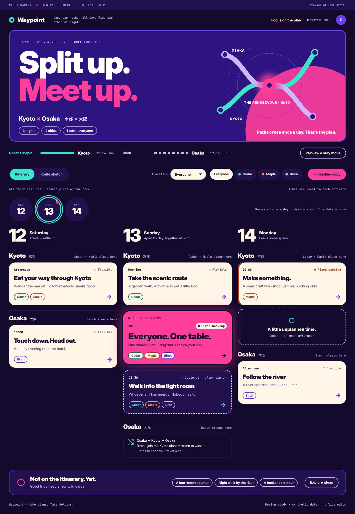
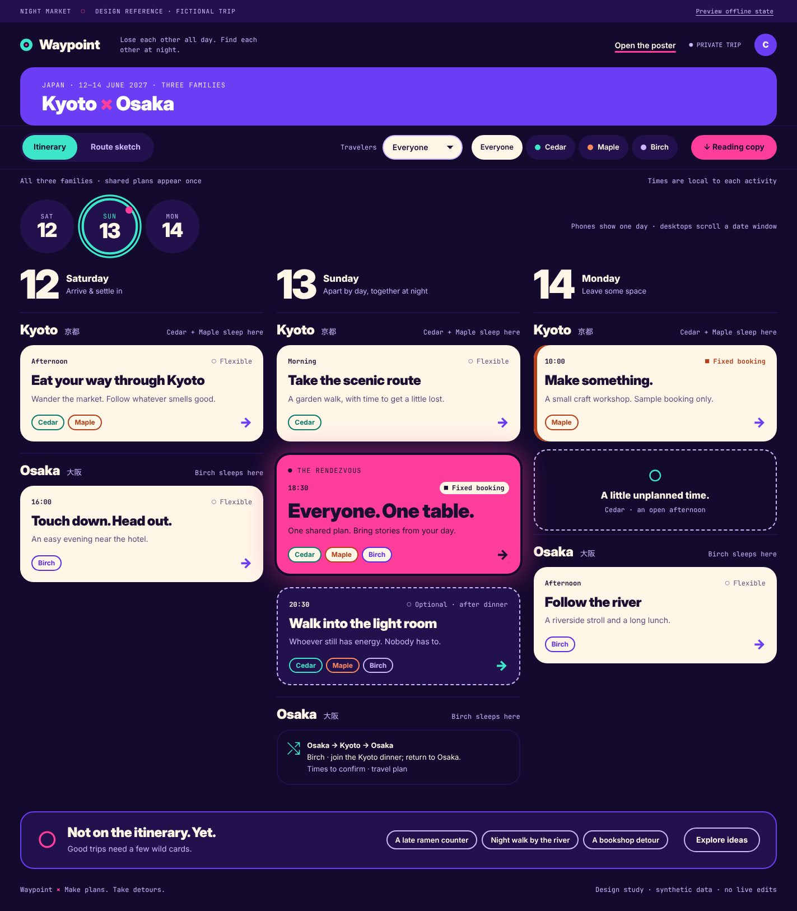
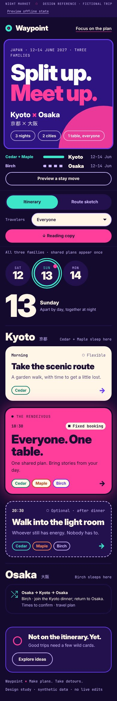
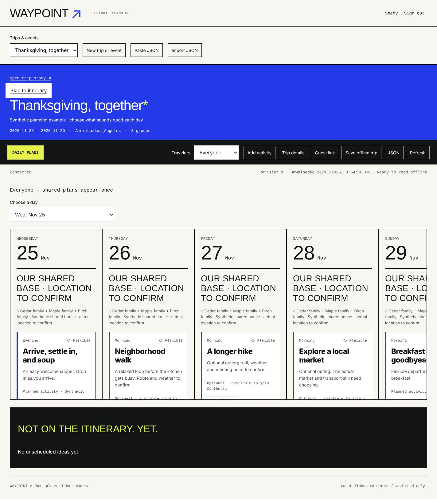
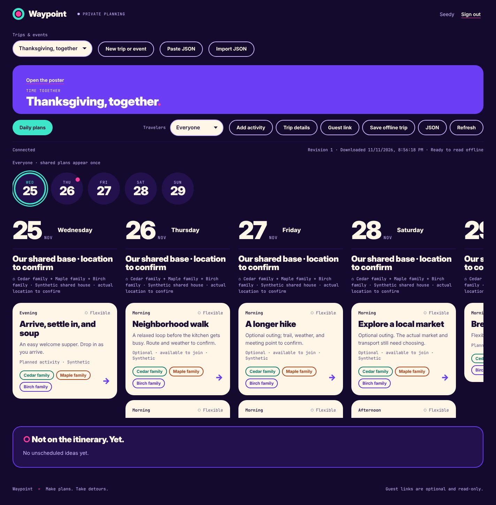
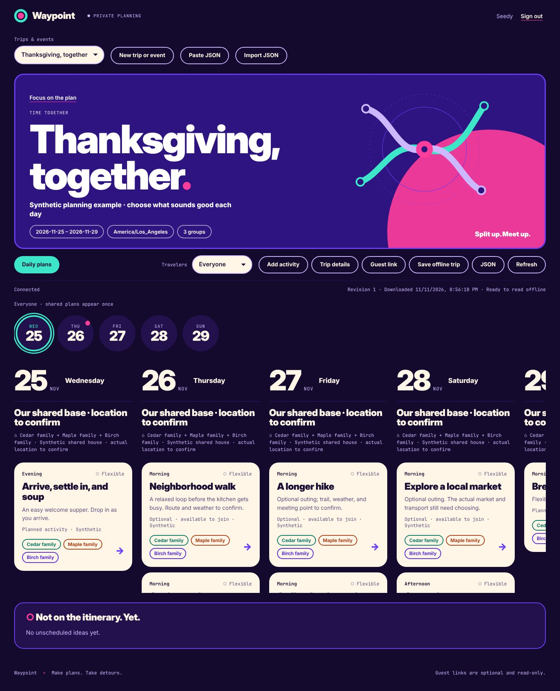
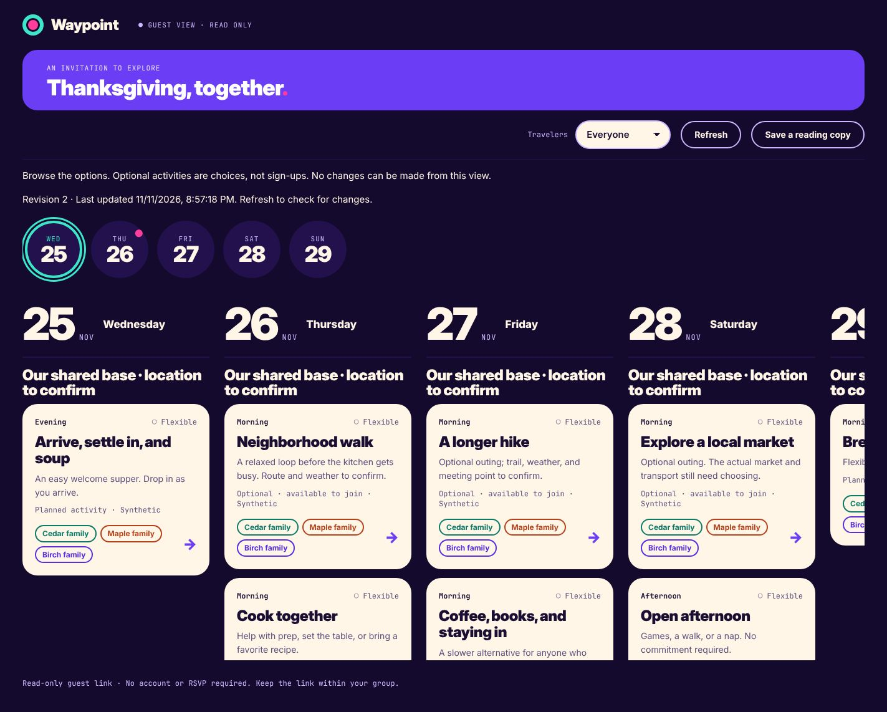
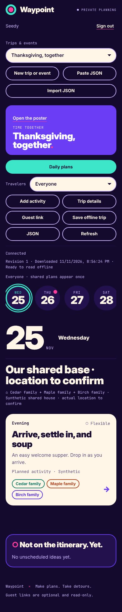

# Waypoint — Night Market

**Direction 03 · November 11, 2026 · adopted for implementation.** The organizer asked for a third, bolder direction with purple at its heart, chose it over [Departure Board](design.md) (now superseded) and the archived [Field Atlas](design-field-atlas.md), and approved applying it to the production app the same day. The visual study below remains the reference; the application pass is recorded under *Applied to the app*. Schema, records, authentication, and deployment access are unchanged. [The product plan](plan.md) governs requirements; [prototype status](prototype.md) records what is implemented.

## The point of view

**Lose each other all day. Find each other at night.** A planner that looks like the evening does: a deep violet ground, one hot magenta light where everyone meets, a lagoon-teal ribbon for the way there, and cream cards you can actually read. Big rounded date medallions, pill controls, heavy wide type, and two ribbons that cross exactly once.

Where Departure Board is a transit poster on white paper, Night Market is the walk back after dinner: dark, glowing, a little loud, still legible. Families split by day; the single shared moment is the brightest thing on the page.

## See and run it

- [Interactive reference](design/night-market/reference.html) — GitHub shows source; serve locally to interact.
- [Desktop overview](design/night-market/desktop.jpg), [compact planner](design/night-market/planning.jpg), [phone agenda](design/night-market/mobile.jpg).
- [Tokens](design/night-market/tokens.css), [styles](design/night-market/reference.css), [behavior](design/night-market/reference.js).







From the repository root:

```sh
python3 -m http.server 5190 --bind 127.0.0.1 --directory docs/design/night-market
```

Open `http://127.0.0.1:5190/reference.html`. No installation or external assets. Try **Focus on the plan**, the traveler pills and select, the day medallions, activity details, **Route sketch**, **Preview a stay move**, and **Preview offline state**. Synthetic families and itinerary only; no live writes. Reading-copy and ideas buttons explain their production behavior rather than pretending to create files or records.

## The process, repeated

1. Generated a fresh 240-character random alphanumeric seed with a shell-invoked Python script using `secrets.choice`. The seed is omitted from every saved file and image.
2. Defined the direction from the seed before looking at the photos, reading its sub-patterns as creative prompts rather than a deterministic encoding:

   | Pattern in the seed | Design consequence |
   | --- | --- |
   | The most frequent letters were crossbar and crossing shapes (T, X, Z) | Two routes that cross at one point. The crossing, not the route, is the hero: an X of ribbons on the poster, a ringed stop in the route sketch, and `×` between the city names. |
   | Long shouting runs of capitals broke up rounded lowercase runs (`oo`, `OoU`) | Loud blocks of color against round geometry: circular date medallions, pill controls and chips, 24 px card corners, a ringed wordmark. |
   | Doubled pairs (`88`, `77`, `WW`, `PP`) and an `ABA` palindrome | Paired, repeating structures: two cities, two ribbons, go-out-and-come-back. The page itself reads A–B–A: poster, board, poster-colored ideas tray. |
   | 240 = 12 × 20; the digits summed to 143 | A 12 px spacing unit with 36 px gutters, and a 1.43 type ratio (12 / 17 / 24 / 35 / 50 / 71 / 102 / 146). |
   | Digits were rare bursts inside long alphabetic stretches | Mostly deep ground with a few saturated lights: one magenta rendezvous, teal selected states, ember booking marks. |

3. Unlocked and reviewed both SmugMug folders from this session with the organizer's public-access password (the folder listings are hidden, so the four albums named in the earlier studies were opened directly). Photos were viewed only in a session scratch area and are not copied into GitHub.
4. Built a separate design with new composition, palette, type, and original vector artwork, keeping the same synthetic itinerary semantics so the three directions compare fairly.

| Photo source | Visible cue | Translation |
| --- | --- | --- |
| [Tokyo](https://ericwilhelm.smugmug.com/2025/2025-06-Japan-and-Korean/2025-06-08-14-19-Tokyo-Japan-1) | Immersive light rooms in magenta, violet, and electric blue; orange safety glasses on a train; purple hoodies and tees; a scarlet bridge in a green garden; a dark aquarium hall of lit tanks | The violet ground and the magenta glow; one bright crossing against a dark room; cream cards as the lit surfaces |
| [Seoul and DMZ](https://ericwilhelm.smugmug.com/2025/2025-06-Japan-and-Korean/2025-06-15-17-Seoul-and-DMZ-Korea) | Painted palace brackets in green, red, and blue; patterned brick walls; grey roof tiles; a whole family lined up at a gate | Saturated accents on structural dark surfaces; families named side by side; repeated round and rectangular rhythm |
| [Santa Lucía](https://ericwilhelm.smugmug.com/2026/2026-06-South-America/2026-06-20-Santa-Lucia) | A night walk with a flashlight on wet green leaves; frogs and insects lit from one side; teal lichen; a cock-of-the-rock in the canopy | Lagoon teal as the ribbon and selected state; the idea that one lit thing on a dark ground is enough |
| [Rábida and Bartholomew](https://ericwilhelm.smugmug.com/2026/2026-06-South-America/2026-06-25-Rabida-and-Bartholomew-Island) | Rust-red earth, a lavender sun hat, blue and red starfish, turquoise snorkeling water, a hot tub full of people, a white flower with a purple throat | Ember booking labels; orchid supporting text; teal and purple as a natural pair; the shared, slightly chaotic group moment as the anchor |

Color values are designed interpretations, not pixel samples. No protected photos, gallery screenshots, signed URLs, passwords, or real itinerary records are in the repository. The ribbon crossing is original vector art, not a map.

## The system

| Token | Value | Use |
| --- | --- | --- |
| `--night` | `#140A2E` | Page ground |
| `--dusk` | `#22114D` | Raised dark surfaces: toolbar pills, medallions, optional cards, ideas tray |
| `--grape` | `#2D1480` | Poster ground, deep enough to carry magenta display type |
| `--violet` | `#6B3DF5` | Identity, poster border, compact trip bar, arrows, dialog ring |
| `--magenta` | `#FF3D9A` | The one shared moment, the primary action, the poster interruption |
| `--lagoon` | `#3EE6C9` | Selected states, focus rings, ribbons, flexible marks |
| `--ember` / `--ember-ink` | `#FF8A5B` / `#B5401A` | Fixed-booking labels on dark / on cream |
| `--cream` | `#FFF6E8` | Reading surfaces: activity cards, dialogs, selects |
| `--ink` | `#1A0F33` | Text on cream and on bright accents |
| `--orchid` | `#CDB8FF` | Supporting text on dark |
| `--muted` | `#5A4D7A` | Supporting text on cream |
| `--family-cedar` / `-ink` | `#3EE6C9` / `#0B7A68` | Cedar labels on dark / on cream |
| `--family-maple` / `-ink` | `#FF8A5B` / `#B5401A` | Maple labels on dark / on cream |
| `--family-birch` / `-ink` | `#CDB8FF` / `#5A2DE0` | Birch labels on dark / on cream |

Every family color is paired with a visible name. Booking state uses words and a mark (`○ Flexible`, `■ Fixed booking`), never color alone. Long reading stays on cream. The glow (`--glow`) belongs to the shared card only; hover uses a flat teal ring.

Display stack: **Avenir Next → Inter Display → Helvetica Neue → Arial**, weight 900, tight tracking. Use it for the masthead, date numerals, city headings, activity titles, and the ideas headline. System sans for descriptions and reading panels; system monospace for times, lodging context, and status lines; system CJK for local-script names. No font download is required; the reference renders with Inter Display locally and should be rechecked on systems that fall back to Arial Black-weight substitutes.

Scale: masthead 72–146 px at .9 line height; day numerals 71 px (102 px on phone); card titles 24 px (28 px on phone); shared headline 35–40 px; detail reading 15 px; metadata 12–13 px.

- 12 px rhythm, 36 px gutters, 24 px card radius, pill controls, circular medallions.
- Ribbons are 8–22 px rounded strokes. Birch's ribbon is dashed as well as a different color.
- One glowing card per trip. Optional add-ons are dusk cards with a dashed orchid border, not a second highlight.
- No gradients other than the single blurred glow; no textures; no all-caps paragraphs.

## Layout and behavior

The poster introduces the trip with the crossing artwork. **Focus on the plan** collapses it to a violet trip bar and hides the stays strip; daily use should default to compact mode and remember the preference locally.

The day rail of round medallions is the date navigator. On desktop it scrolls a window across a long trip; on phones it selects the single day shown. The medallion for a day with the shared moment carries a magenta mark. A native labeled select mirrors the rail for assistive technology.

Dates run across the board with city sections inside each date, as in Departure Board. Families sleep in different cities and meet once. A two-week production trip needs the horizontal date window rather than fourteen squeezed columns; the study shows three synthetic days.

At 760 px and below the artwork is hidden rather than shrunk, the quick family pills collapse into the select, and the board shows one selected day. The traveler filter persists between views. Detail dialogs show date, local time, participants, editing responsibility, and notes.

The family filter removes unrelated activities while keeping every attendee label on shared plans. The route sketch keeps trip context and describes the selected family in text. The stay-move preview lists shifts, protected bookings, mixed-family plans, and connected travel; it has no Apply action. Offline preview shows an illustrative download time and revision, disables writing entry points, and keeps saved details readable.

## Accessibility and implementation boundaries

Native labeled selects, keyboard focus with a lagoon ring, a skip link, descriptive dialogs, Escape with focus restoration, reduced-motion handling, explicit state words, and at least 44 px targets are kept. Families and booking state are never color alone. `color-scheme: dark` is declared; the print stylesheet flattens to black on white.

Calculated text contrast: cream/night 17.6:1; orchid/night 10.7:1; lagoon/night 12.0:1; white/grape 13.8:1; magenta/grape 4.2:1 (display sizes only); ink/cream 16.9:1; muted/cream 7.1:1; ember-ink/cream 5.3:1; cedar-ink/cream 4.9:1; birch-ink/cream 6.8:1; ink/magenta 5.5:1; ink/lagoon 11.5:1; white/violet 5.8:1. Magenta is never a small-text color on violet.

Authentication, concurrency, exports, offline/session clearing, navigation provenance, and China-use gates are unaffected by this design.

## Applied to the app — November 11, 2026

`apps/sites-prototype/public/planner.css` now carries these tokens and styles for the planner, guest view, parallel-stay study, and offline shell. The poster artwork, labels, and booking marks in `planner.js`, `board.mjs`, and `guest.mjs` follow the study; the self-contained reading copy in `offline-export.mjs` uses a cream, print-friendly version of the system; the offline shell cache is version 11. The day select is now mirrored by a round medallion rail (the select stays as the labeled native control; medallions are buttons with `aria-pressed`, and a day with a highlighted shared moment carries a magenta mark).

| Before (Departure Board) | After (Night Market) |
| --- | --- |
|  |  |







Verification of the application pass: 18 Node tests, `tsc --noEmit`, the production build, and the loopback API checks pass. Headless Chromium at 1423 × 742 and 390 × 844 showed no horizontal overflow and no script errors on the planner (compact and poster), the activity editor, the share dialog, the guest view and its detail dialog, the parallel-stay study with its move preview, and the rendered offline reading copy. Physical phones, hosted deployment, and real network loss were not tested in this pass; see [prototype status](prototype.md) for the outstanding checks.

## Amendment — November 16, 2026

After the November 15 family test sessions the organizer approved these changes
to the system above ([feedback plan](feedback-2026-11-15-plan.md),
[what was built](plain-words.md)). Where this section and the text above
differ, this section is current.

- **The whole-group card is no longer solid magenta and has no glow.** It is a
  cream card like the others with an 8 px magenta band across the top and the
  words "● Whole-group activity". Magenta remains the primary action and the
  mark on the day rail. `--glow` is unused by cards.
- **Functional labels.** "Whole-group activity" replaces "The rendezvous" and
  "Highlight a shared moment". "Ideas · not scheduled yet" replaces "Not on the
  itinerary. Yet." The activity form has no eyebrow line.
- **Booking state.** `■ Fixed booking` stays, in words. `○ Flexible` is no
  longer shown: a card with no booking mark is simply not fixed.
- **Optional** is a dashed chip beside the people labels. An ordinary planned
  activity carries no label.
- **Examples.** An invented item carries "Example · not a real plan" and a
  dashed inner outline in every density, and is never sent to the guest link.
- **Forms go dark; reading dialogs stay cream** (approved, not yet built).

Still true: state is never colour alone, long reading stays on cream cards, and
the contrast pairs listed above are the ones in use (ink on cream for all new
labels; muted on cream, 7.1:1, for the Optional chip).

## Verification

Rendered in headless Chromium at 1423 × 742 CSS pixels and 390 × 844, with no horizontal overflow and no script errors. Birch filtering shows arrival, the dinner, the optional light-room card, and the river walk; exactly one shared card exists and keeps all three participant labels. Route text matches Birch's Osaka base and Kyoto dinner visit. Offline preview disables all three online actions. No visible button is under 44 px. Phone day selection shows only the chosen day; the shared detail opens and Escape returns focus to the card. Physical-phone, real network-loss, and production deployment testing are not implied.
