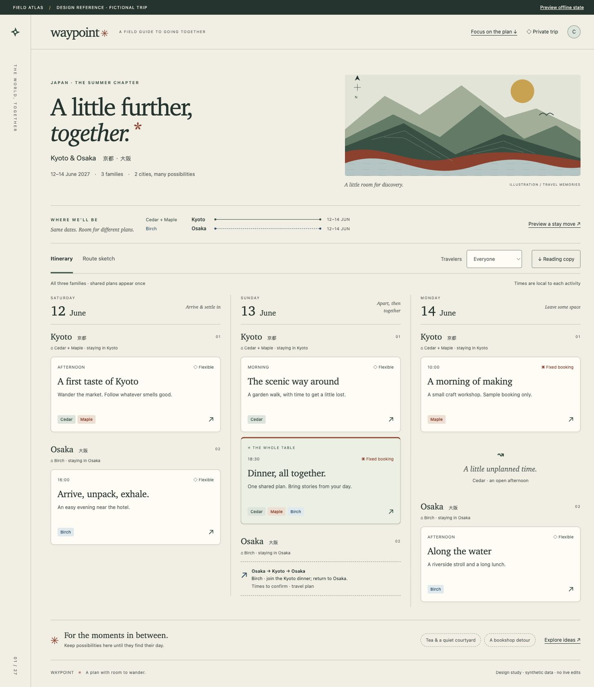
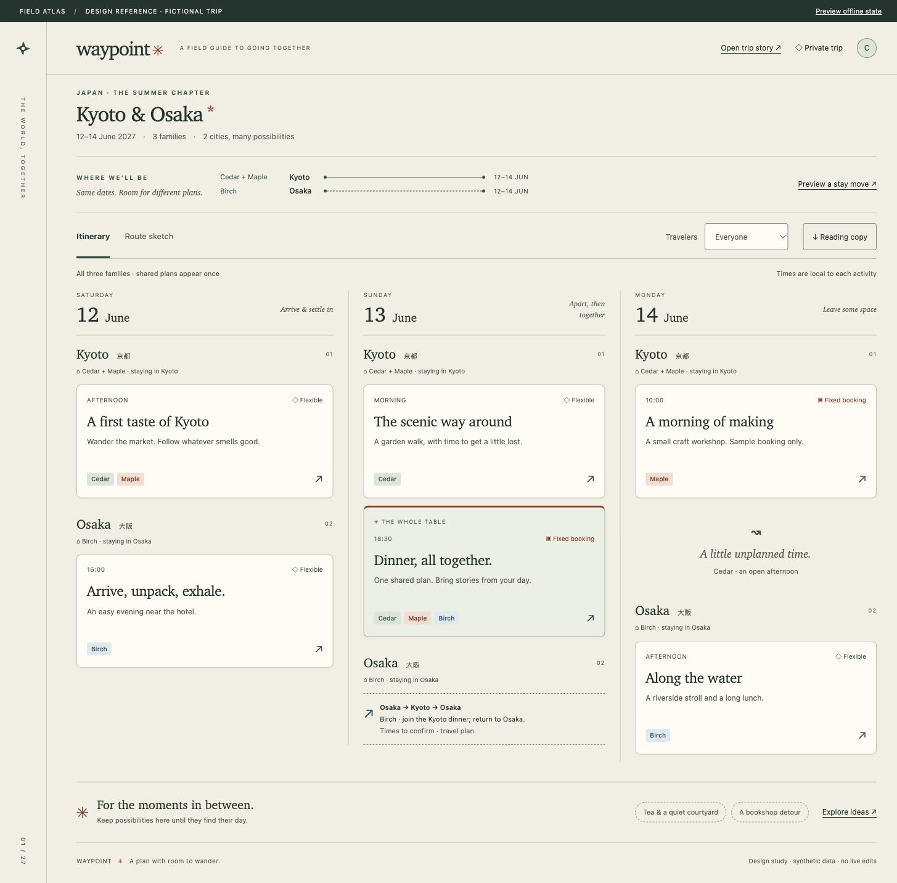
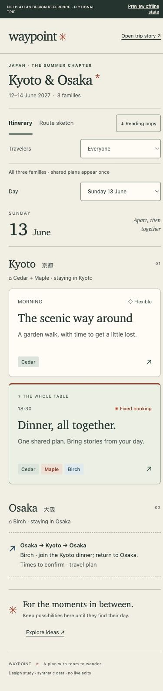

# Waypoint — Field Atlas

Design direction recorded November 10, 2026. **Start here for visual design work on the travel planner.**

This is the proposed visual system and interaction direction, commissioned by the organizer. It is a design reference, not evidence that the full planner is implemented or that the group has validated the layout. The working name **Waypoint** remains provisional. [The product plan](plan.md) governs requirements and data behavior; this document governs visual decisions. Keep unresolved product decisions explicit.

## The direction

**A field atlas for people traveling together.** Warm paper, botanical ink, an editorial serif, measured rules, and a few vivid marks. The photos carry a sense of curiosity: family tables, architecture, small natural details, and places discovered on foot. The planner should feel personal and observant, with enough structure to coordinate several families.

The signature is the relationship between calm space and a few meaningful marks: a rust asterisk for a shared moment, a branching route, an understated date, a clear booking label. Make the actual itinerary the main event. Use the expansive trip story as an optional overview; use the compact header for repeated planning and daily reference.

## See and run the reference

- [Interactive visual reference](design/reference.html): open locally, or serve the directory with the command below. GitHub displays its source rather than running the HTML.
- [Desktop overview](design/desktop-overview.jpg), [focused planning view](design/desktop-planning.jpg), and [phone agenda](design/mobile-agenda.jpg): rendered reference images.
- [Reusable CSS tokens](design/tokens.css), [reference styles](design/reference.css), and [reference behavior](design/reference.js).
- [Original coast illustration](design/coast.svg): a graphic inspired by the photo palette, not a photograph or geographical map.

From the repository root:

```sh
python3 -m http.server 5188 --bind 127.0.0.1 --directory docs/design
```

Open `http://127.0.0.1:5188/reference.html`. No installation, external fonts, network assets, account, or database is required. The local study is intentionally separate from the private Sites app and does not edit trip data. Stop the server with Ctrl-C.

Try **Focus on the plan**, the traveler filter, **Route sketch**, activity details, **Preview a stay move**, and **Preview offline state**. On a narrow viewport, choose a day. Reading-copy and ideas buttons explain their intended production behavior; they do not create files or records in this study.







## Creative process

The requested sequence was followed: generate a long random alphanumeric string in a shell script, derive a direction, then inspect the travel photos and refine the direction.

The seed was generated with Python's `secrets.choice` over ASCII letters and digits, invoked from the shell. It contained 192 characters. It is intentionally omitted from all design assets and documentation. It is not a product identifier, password, visual texture, or content to reproduce later.

The interpretation was associative, not a deterministic algorithm:

| Pattern in the seed | Design consequence |
| --- | --- |
| 192 characters can be read as 64 groups of three | A modular system: 4/8 px spacing units, 24 px gutters, and 64 px major separations. Three date columns in the study, with the count allowed to change for real trips. |
| Repeated letters and adjacent pairs interrupt irregular runs | Repeated date rails and family labels, with irregular activity lengths. Shared experiences get one recognizably different card. |
| Curved letterforms recur among upright strokes | Soft editorial type, circular waypoints, and asterisk marks balanced by precise rules and a clear UI sans. |
| Digits arrive in bursts amid longer alphabetic passages | Mostly quiet paper and ink, punctuated by warm rust and amber. Numbers organize dates and times without becoming the visual identity. |

These patterns established the field-atlas direction before browsing. The photos refined its palette, imagery, and emphasis on family participation. The seed should never appear in the interface, and there is no requirement to regenerate it to continue the design.

## Photo research and translation

Both requested folders were inspected through the organizer's signed-in Chrome session because the web fetcher could not access them. The folders show password-based access. The evidence below describes visible photographs; color values are designed interpretations, not claimed pixel samples. Gallery dates come from their titles.

| Viewed source | Visible observations | Translation into the planner |
| --- | --- | --- |
| [Japan and Korea folder](https://ericwilhelm.smugmug.com/2025/2025-06-Japan-and-Korean) | Travel with family, food on dark ceramic/stone, warm wood, layered roofs, and city/landscape contrasts in the gallery covers. | A personal travel notebook; quiet surfaces, warm marks, and people present on every activity. |
| [Tokyo, June 8–14 and 19](https://ericwilhelm.smugmug.com/2025/2025-06-Japan-and-Korean/2025-06-08-14-19-Tokyo-Japan-1) | Amber glasses against cooler transit surroundings; green and red temple details; pale stone and museum objects. | Warm accents against deep ink; generous breathing room around rich details. Avoid a neon tourist-board treatment. |
| [Seoul and DMZ, June 15–17](https://ericwilhelm.smugmug.com/2025/2025-06-Japan-and-Korean/2025-06-15-17-Seoul-and-DMZ-Korea) | Family portraits at a roofed gate, repeated roof tiles, grey masonry, green pond and pines, muted red walls. | Horizontal rules, framed date groups, forest ink, and disciplined spacing. Borrow the composition rather than decorative cultural motifs. |
| [South America folder](https://ericwilhelm.smugmug.com/2026/2026-06-South-America) | Cloud forest, wildlife, food, boat excursions, family groups, volcanic coast, and water. | Small, varied experiences belong together; photos can make the trip personal without becoming a wall of image cards. |
| [Santa Lucía, June 20](https://ericwilhelm.smugmug.com/2026/2026-06-South-America/2026-06-20-Santa-Lucia) | Layered leaves, dark branches, pale backlight, a bright red bird, and family on forest paths. | Deep forest primary color, mist-green shared surfaces, and rare rust accents. Quiet depth rather than artificial gradients. |
| [Rábida and Bartholomew Island, June 25](https://ericwilhelm.smugmug.com/2026/2026-06-South-America/2026-06-25-Rabida-and-Bartholomew-Island) | Rust-red earth, muted olive slopes, pale sky and water, boats, shore walks, finches, and underwater detail. | Rust/sea/forest secondary palette and an original coast illustration. Parallel routes and small discoveries become part of the visual language. |

The strongest recurring theme is people exploring together, sometimes doing different things. This supports prominent participants, a single shared dinner card, and family routes that can split and meet again.

No protected photos, gallery screenshots, authentication material, or real trip records are copied into GitHub. The reference uses synthetic Cedar, Maple, and Birch families and a fictional June 2027 itinerary. A future real trip cover may use an organizer-selected photo stored with the private app; do not hotlink authenticated SmugMug assets or make the itinerary depend on them. Preserve people and subjects when cropping. Render operational text on a solid surface beside imagery.

## Color

Use the named tokens in [tokens.css](design/tokens.css), rather than introducing unrelated near-matching values in each component.

| Token | Value | Use |
| --- | --- | --- |
| `--paper` | `#F4F0E7` | Main page, a warm uncoated-paper impression |
| `--surface` | `#FFFCF6` | Activity cards, forms, detail panel |
| `--ink` | `#233C37` | Primary text and the deepest structural marks |
| `--muted` | `#5D6864` | Supporting text, still readable |
| `--line` | `#C8CCC1` | Decorative dividers; use stronger borders for controls |
| `--forest` | `#345B4C` | Primary actions and Cedar |
| `--mist` | `#DFE8DF` | Shared surfaces and Cedar chips |
| `--rust` | `#A84232` | Fixed-booking marks, Maple, and restrained identity accents |
| `--blush` | `#F4E2D9` | Maple chips and attention-panel background |
| `--amber` | `#D8A952` | Illustration and ornamental highlights; not small text |
| `--sand` | `#F1E4C8` | Offline/informational band with ink text |
| `--sea` | `#275C72` | Birch, focus ring, and route detail |
| `--sea-wash` | `#E1EDF1` | Birch chips |

Aim for roughly 80% paper/surface, 15% ink/forest, and 5% other accents. Treat that as a compositional guide. Do not mute text by reducing opacity until it becomes hard to read.

Calculated sRGB contrast: ink/paper **10.41:1**, muted/paper **5.09:1**, muted/surface **5.65:1**, forest/mist **6.10:1**, rust/blush **4.79:1**, sea/sea-wash **6.15:1**, surface/forest **7.47:1**, ink/sand **9.40:1**. Decorative lines and illustration fills are not text colors. Family labels and booking words must remain present; color is supplementary.

## Typography and shape

Use a bookish serif for the trip story, city names, and activity titles. The reference uses **Charter → Iowan Old Style → Palatino → Georgia** from local system fonts. Use the native UI sans for dates, notes, controls, and metadata. Local-script names use the system CJK stack, allowing Chinese, Japanese, and Korean names to remain intact. No remote font request is required.

| Element | Desktop reference | Phone/production guidance |
| --- | --- | --- |
| Expanded trip story | 46–66 px serif, line height 1.04 | Optional overview; hide image and offer compact header |
| Compact trip name | 34 px serif | 32 px serif |
| City | 21 px serif | 25 px serif |
| Activity title | 21–23 px serif | 27 px in the roomy reference; production can use 22–26 px |
| Body/notes | 12–14 px sans in the desktop study | 14–16 px; detail reading text should be 16 px in production |
| Chips/metadata | 10–12 px in the study | At least 11–12 px; never use tiny text for an essential instruction |
| Controls | 12–14 px sans | 14–16 px production controls; at least 44 px tap target |

The desktop reference deliberately explores a relatively dense board. Its smallest metadata and uppercase eyebrows are a reference detail, not a license to shrink critical production copy. The earlier prototype's 8–10 px labels should be increased when the system is applied.

Use a 4/8 px spacing scale, 16–24 px card padding, 24–32 px column gaps, and 32–64 px section space. Cards have an 8 px radius; compact controls 4 px; panels 12 px. Hairline rules do most of the organizing. Use shallow shadows on cards and a stronger shadow only for modal elevation. Keep corners and typography consistent. Do not add paper textures, fake handwriting, random passport stamps, or decorative interface noise.

The asterisk is a small, original typographic mark for shared possibility. It is not a booking status. Booking state always gets explicit words and a distinct icon. The compass/waypoint illustration can decorate the outer rail; the rail is optional and must not consume phone space.

## Layout and information hierarchy

### Desktop

1. A quiet wordmark/account bar, with the private-trip state.
2. Optional trip story with a restrained personal photo or illustration. **Focus on the plan** collapses it to the trip name and dates. The production planner should remember the compact preference locally.
3. Parallel stay routes: who is sleeping in which city, over which dates. This is context, not a requirement that every activity belong to that stay.
4. Itinerary/route controls, participant filter, and reading-copy action.
5. A date-aligned board. Each date contains city lanes, lodging context, independent activities, and participant-specific journeys. A shared activity is rendered once in its actual city with all participants.
6. An unscheduled ideas tray and a light footer.

The study shows three dates to communicate the visual rhythm. For a real two-week itinerary, use a horizontal date board with sensible minimum day widths and a persistent date navigator/scroll controls. Do not squeeze fourteen days into one viewport. Keep the date header and controls accessible while scrolling; preserve the selected date and participant filter across views. Validate the scrolling and sticky behavior with real users before finalizing it.

Date alignment is the recommended evolution of the current stay-grouped prototype. It remains subject to the parallel-stay layout review in the product plan. Grouping by stay can remain a secondary focused view. The reference does not migrate the app schema or change the previous study's implementation status.

### Tablet and phone

- Above 820 px: date columns. Between 541 and 820 px: stacked dates with adjacent city lanes where space permits.
- At 540 px and below: one selected date, then its city sections in a vertical agenda. No sideways card carousel is required to find today's plan.
- A day chooser sits above the agenda; remember the selected date. The study defaults to the first synthetic date. Production should prefer the local current trip day, or the last viewed day outside the trip dates.
- Keep the family filter visible and retain its value between itinerary and map. Collapse the cover and decorative rail. Use the compact trip header for daily reading.
- In the compact phone agenda, collapse the trip-level stay summary as well. Lodging remains visible in each city section; **Open trip story** restores the broader route context.
- Activity details become a comfortable full-height panel or page. Place notes, local-script address, participants, and reviewed directions near the top. Preserve useful text selection.
- Full rearrangement belongs on desktop; phone edits should be small and deliberate. Expose “Move to day” and reorder buttons alongside any drag interaction.
- Respect browser zoom and safe-area insets. Never require hover to discover booking state or attendance.

## Component and interaction rules

| Component | Required behavior and appearance |
| --- | --- |
| Activity card | Day period or local time; readable title; brief note; participants; flexibility/booking status. Clicking opens details. Permit an activity without an exact time or confirmed coordinates. |
| Shared activity | One stable record. Mist surface and all participant chips. Filter it into each attending family's view without making copies. Keep nonselected attendee labels visible. |
| Fixed booking | Rust rule plus explicit “Fixed booking” and a booking icon. Retain date/time on a stay move. Do not infer a booking from a precise time. |
| Flexible plan | Explicit “Flexible”; no false promise that it will move automatically. A day period is sufficient. |
| Family chip | Name plus color. Cedar/Maple/Birch are synthetic examples; actual family identities are data, not hard-coded visual semantics. Assign a stable accessible accent and provide selected-person controls later. |
| Stay route | City, date range, participants, lodging context. Parallel routes may overlap in time and differ in city. Repeat a city as a new stay on a return visit. |
| Travel leg | Mode, participants, from/to, departure/arrival dates and local times when known. Dashed connector and arrow; never imply routing or travel times that were not calculated or confirmed. Overnight dates need explicit labels. |
| Open time | Intentional breathing room with a useful “Add an idea” action in production. Avoid an empty/error appearance. |
| Ideas | Independent, unscheduled activities. Keep collecting an idea lighter than completing a booking form. |
| Detail panel | Notes, responsibility, attendees, dates/time zones, English/local-script address, and reviewed navigation links. Attendance and editing responsibility remain separate. |
| Primary action | Forest fill, light text, plain verb. One dominant action per panel. Secondary actions use a border or text underline. |

**Stay move:** first display the old/new dates and moving people. Offer a clearly scoped shift for flexible activities whose participants are all moving. Keep fixed bookings unchanged. Flag mixed-participant plans and connected travel for manual review. Never silently move another family's plan. The reference only previews this behavior and has no Apply action.

**Collaboration:** show editing responsibility near the save action; a soft deliberate override can protect another family's plan. On a stale revision, retain the draft, explain that another change arrived, and offer refresh/compare/copy. Never overwrite newer work. Undo must respect intervening edits. These are production patterns, not implemented study features.

**Map:** use the same activities and participant selection as the board. Default to a schematic trip/day map without required background tiles; describe arrows as planned connections. The study's diagram is conceptual and keeps whole-trip context, with text reflecting the selected family. Actual map filtering, points, local navigation providers, coordinate provenance, and unlocated-activity handling still need implementation under the product plan.

## Offline and exceptional states

| State | Visual/interaction contract |
| --- | --- |
| Online, saved | Quiet confirmation with last confirmed revision and synchronization/download times where relevant. Never imply a note is saved before server confirmation. |
| Saving | Show progress beside the edit action, preserve the draft, prevent duplicate submission. |
| Offline reading | Persistent sand band with explicit “Offline · reading copy,” actual last download time and revision. Details and filters remain usable; writing is disabled. |
| Expired session | Pause editing and offer sign-in while preserving the reading copy, according to the existing authentication lifecycle. |
| Explicit sign-out or access denial | Follow the existing clearing policy; do not keep showing another account's private trip. |
| No downloaded copy | Explain that no itinerary has been saved on this device. Give a retry/sign-in path without inventing cached data. |
| Downloaded file | Self-contained HTML: dates, lodging, travel, notes, participants, useful addresses, revision, and export/download timestamps. No required external fonts, imagery, scripts, login, or map tiles. |
| Conflict or affected booking | An inline attention message near the relevant plan plus a review panel. Include people and dates, not just a red indicator. |
| Unknown place/time | State “Location to confirm” or “Time to confirm”; no fabricated coordinates, addresses, or travel estimates. |

The design reference's timestamp and revision are visibly illustrative. Its offline button changes only the displayed state; it is not a service-worker or offline-lifecycle test. China connectivity, target-phone file opening, and invited-account checks remain the product gates recorded in the project plan.

## Accessibility and motion

Keep an orderly heading hierarchy, landmark regions, a skip link, labeled native selects, visible keyboard focus, and readable contrast. Use names and words alongside color. Activity details use the native modal dialog pattern with Escape and focus restoration. Filtering updates a polite status region. Provide keyboard/button alternatives to drag-and-drop. Respect reduced motion; any ordinary transitions should be brief and should not move the surrounding board. Production success/error/save announcements need appropriate live-region behavior without excessive chatter.

## Applying this to the project

1. Read [plan.md](plan.md), [prototype.md](prototype.md), and the current parallel-stay study before changing behavior. Preserve other work in progress.
2. Treat this document as the visual source of truth and import/adapt the tokens. The live app currently uses different values in `apps/sites-prototype/public/planner.css`; this documentation does not replace that file.
3. First apply color, type, card, chip, control, and offline-band styles to the existing prototype, increasing tiny critical text. Preserve working auth, shared edits, concurrency, and export behavior.
4. Review the date-aligned layout with staggered arrivals, a shared dinner, parallel stays, split activities, and a return to a city. Then migrate the view using independent activity identities rather than requiring a `stayId`.
5. Add production move/edit/history/map interactions within the agreed product scope. Do not copy the study's constant HTML detail content or synthetic families into the data model.
6. Check a realistic two-week itinerary, keyboard-only use, 200% zoom, a 390 px phone layout, and the target devices. Retest the existing offline file and session lifecycle after UI changes.
7. Update this document, tokens, and rendered references together when a design decision changes. Keep the README link so a new Codex chat can find the direction immediately.

## Verification of this reference

The reference is dependency-free and contains no external network requests or persistent storage. Browser QA was performed in Chrome on November 10, 2026. Production feasibility tests remain in [prototype.md](prototype.md).

| Check | Observed result |
| --- | --- |
| Desktop overview and compact mode | Visually checked at a 1470 × 970 CSS-pixel viewport; no horizontal overflow. Compact mode brings the date board forward. Full-page screenshots are included above. |
| Phone agenda | Visually checked at 390 × 844 CSS pixels; no horizontal overflow. Selecting Sunday shows only June 13. The compact layout removes the overview image and trip-level stay summary. This is browser emulation, not a physical-phone trial. |
| Family filtering | Birch shows arrival, shared dinner, and riverside activity; Cedar/Maple-only cards are excluded. Exactly one shared-dinner element remains in the document. |
| Route selection | The schematic opens, the board hides, and the Birch text describes its Osaka base and Kyoto dinner visit. |
| Move preview | Lists the Cedar-only flexible shift, unchanged fixed dinner, mixed-participant market review, and unaffected other-family plans. There is no mutation action. |
| Offline-state preview | Shows the illustrative timestamp/revision band and disables move, ideas, and reading-copy entry points. Returning online restores them. This does not test real network loss. |
| Phone detail panel | Shared dinner opens with all participants and lodging context; Escape closes it and restores focus to the card. |
| Core colors | Contrast ratios calculated from the committed hex values; each listed normal-text pair exceeds 4.5:1. |
| Reference scope | No application files, database records, deployment identity, or real itinerary data are changed. This is a documentation package with a runnable visual study. |
