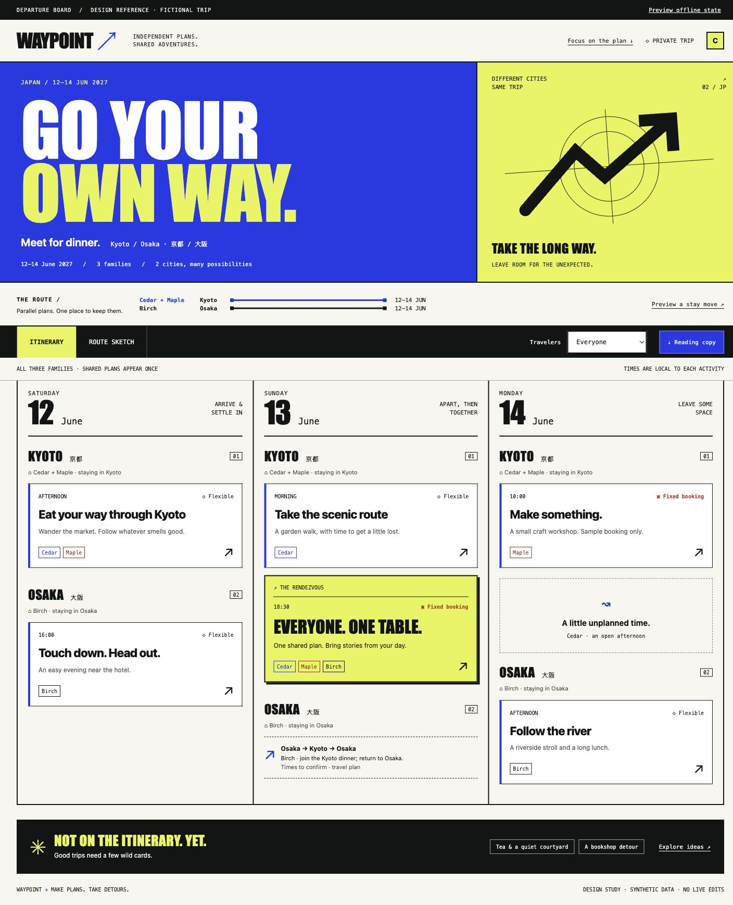
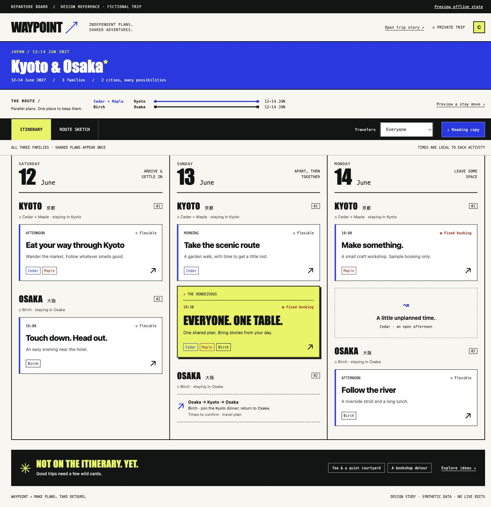
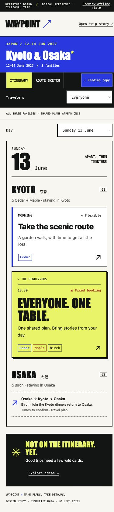

# Waypoint — Departure Board

**Direction 02 · November 11, 2026 · adopted for implementation.** The organizer requested a bolder point of view after reviewing Field Atlas. The organizer approved applying this direction to the production app on November 11, 2026. The reference remains a visual study; implemented product behavior is recorded separately. [The first direction is archived here](design-field-atlas.md). A third, purple-led alternative, [Night Market](design-night-market.md), was studied on November 11, 2026 for comparison and is not adopted.

## The point of view

**Go your own way. Meet for dinner.** A planner for independent people sharing an adventure. The confidence of a graphic travel poster meets the clarity of transit signage: electric blue, acid yellow, huge condensed type, sharp geometry, and a route that changes direction.

The blue/acid poster introduces the trip. Underneath, a precise black-and-white itinerary lets the details breathe. The shared dinner becomes the loudest card. The identity is energetic, slightly irreverent, and practical. Hard rules, square corners, oversized dates, and an angular arrow establish a different visual grammar from the first study's serif notebook.

## See and run it

- [Interactive reference](design/departure/reference.html) — GitHub shows source; serve locally to interact.
- [Desktop overview](design/departure/desktop.jpg), [compact planner](design/departure/planning.jpg), [phone agenda](design/departure/mobile.jpg).
- [Tokens](design/departure/tokens.css), [styles](design/departure/reference.css), [behavior](design/departure/reference.js).







From the repository root:

```sh
python3 -m http.server 5189 --bind 127.0.0.1 --directory docs/design/departure
```

Open `http://127.0.0.1:5189/reference.html`. No installation or external assets. Try compact mode, family filtering, phone date selection, activity details, route sketch, stay-move preview, and offline-state preview. This is a local study with synthetic families and itinerary data. It makes no live writes. Reading-copy and ideas buttons explain their production behavior rather than pretending to create files or records.

## The process, repeated

1. Generated a fresh 240-character random alphanumeric seed with a shell-invoked Python script using `secrets.choice`. The seed is omitted from all saved files and visual assets.
2. Defined the direction before revisiting the photos. Repeated angular capitals suggested cuts and routes; a doubled digit suggested oversized paired date numerals. A frequent rounded letter with a diagonal tail suggested a plotting circle interrupted by an arrow. The 240-character length suggested 24 px gutters on an 8 px rhythm. Uneven bursts suggested abrupt color changes. These are creative associations, not a deterministic encoding.
3. Reopened the Tokyo and Rábida galleries in signed-in Chrome and inspected their photographs again, with the broader first-pass research as context.
4. Built a separate design with new composition, palette, type, and original vector artwork. Kept itinerary semantics consistent so the alternatives can be compared.

| Photo source | Visible cue | Translation |
| --- | --- | --- |
| [Tokyo](https://ericwilhelm.smugmug.com/2025/2025-06-Japan-and-Korean/2025-06-08-14-19-Tokyo-Japan-1) | Amber glasses against cool transit surroundings, graphic signage, red temple details against dark roofs | Abrupt warm/cool contrasts, confident labels, a strong directional mark |
| [Rábida and Bartholomew](https://ericwilhelm.smugmug.com/2026/2026-06-South-America/2026-06-25-Rabida-and-Bartholomew-Island) | Yellow-green foliage behind a finch, red earth, family excursions on shore and by boat | Amplified acid-yellow emphasis, volcanic-red booking marks, separate explorations meeting again |
| [Japan/Korea folder](https://ericwilhelm.smugmug.com/2025/2025-06-Japan-and-Korean) and [South America folder](https://ericwilhelm.smugmug.com/2026/2026-06-South-America) | Meals, family groups, varied destinations and small discoveries, observed in the first pass | Shared dinner as the visual anchor; visible participation without forcing everyone onto one route |

Electric blue is a deliberate interpretation of cooler travel imagery, not a claimed pixel sample. The acid tone amplifies natural foliage. No protected photos, gallery screenshots, signed URLs, or real itinerary records are copied into GitHub. The route graphic is original vector art, not a geographic map.

## The system

| Token | Value | Use |
| --- | --- | --- |
| `--blue` | `#243AE8` | Identity, primary actions, Cedar |
| `--acid` | `#E6F449` | Poster interruption, selected view, shared rendezvous |
| `--ink` | `#131514` | Rules, text, Birch, hard shadows |
| `--paper` | `#F7F6F0` | Reading surface |
| `--surface` | `#FFFFFF` | Ordinary cards and controls |
| `--muted` | `#515550` | Supporting text |
| `--red` | `#B52D22` | Explicit fixed-booking labels |
| `--family-maple` | `#9A251D` | Maple participant labels |

Keep long reading on white or paper. Reserve saturated blocks for the trip identity and shared moments; ordinary activities remain quieter. Family names and booking words must remain visible. Acid yellow is not a small-text color on white.

Display stack: **Impact → Haettenschweiler → Arial Narrow → sans-serif**. Use it for the masthead, dates, city headings, shared-event headline, and ideas tray. Use native system sans for activity titles, notes, and reading panels; system monospace for time and route metadata; system CJK for local-script names. No font download is required. Recheck wrapping on systems without Impact. Any future bundled font requires license review and offline packaging.

The masthead is 100–160 px with .87 line height on desktop. Compact title 46 px. Activity title 23–26 px bold sans. Shared headline 34–42 px condensed. Detail reading 15–16 px. Small poster annotations are decorative. Raise critical production metadata to 12–14 px and phone descriptions to 14–16 px rather than copying every small reference label literally.

- Zero-radius cards and controls. Structural 2 px ink rules; internal 1 px rules; 4 px activity edges.
- 24 px structural gutters on an 8 px spacing rhythm. Reduce carefully on phone.
- Hard 4–5 px offset shadows for the shared dinner and hover, not every component.
- Asymmetric poster split above aligned date columns. No soft gradients, glass effects, or paper textures.
- Angular route with square stops and an arrow: splitting and meeting, not navigation.
- Large dates, small precise local times. Overnight journeys must show both dates and time zones.
- One acid shared dinner card, all participants, one stable record.
- Natural sentence-case notes. Avoid all-caps paragraphs, animated marquees, fake tickets, or random stamps.

## Layout and behavior

The expanded poster sets the tone. **Focus on the plan** reduces it to a short blue trip bar and brings the itinerary forward. Production daily use should default to compact mode or remember the preference locally. Phone compact mode also hides the trip-level stay summary; each city's lodging context stays visible.

Desktop dates align, with city sections inside each date. Families can sleep in different places and meet for one activity. A two-week production trip needs a horizontal date window and date navigator, not fourteen squeezed columns. The study demonstrates three synthetic days only.

At 760 px and below, select one date and read city sections vertically. Hide the illustration rather than shrinking it. Preserve the traveler filter between views. Detail panels show date/local time, participants, editing responsibility, and notes. Production directions need reviewed local-script addresses and the provenance rules in the product plan.

The family filter removes unrelated activities while preserving every attendee label on shared plans. The schematic retains trip context and describes the selected family's route in text. Production maps must use the same underlying records and participant selection as the board.

The move preview offers to shift flexible activities whose participants are all moving, preserves fixed bookings, flags mixed-family plans and connected travel, and leaves other families alone. It has no Apply action. A production save must protect newer revisions and preserve rejected drafts. Attendance and editing responsibility remain separate.

Offline preview shows a visibly illustrative download time and revision, disables writing entry points, and leaves saved details readable. It does not test actual network loss or the app's offline lifecycle. Reading-copy downloads remain self-contained HTML without required fonts, scripts, images, authentication, or map tiles.

## Accessibility and implementation boundaries

Keep native labeled selects, keyboard focus, skip link, descriptive dialogs, Escape/focus restoration, reduced motion, and explicit state words. At least 44 px phone targets. Use a contrasting light ring on dark/blue controls and a blue ring on light surfaces. Do not communicate families or booking state with color alone. Test 200% zoom and font fallback during production implementation.

[The product plan](plan.md) governs requirements and [prototype status](prototype.md) records implemented features. Authentication, concurrency, exports, offline/session clearing, navigation provenance, and China-use gates remain intact. This task changes documentation and a separate visual study, not application files, schema, records, or deployment access. Preserve other work in progress.

Start implementation with tokens, type, controls, and card states. Review the date-aligned layout before replacing the current board. Keep both alternatives available. Update this guide and screenshots together when decisions change. This direction is now adopted. Continue validating production layouts and interactions against the product plan rather than treating the study as proof of implementation.

## Verification

Browser checks and rendered images accompany the package. Physical-phone, real network-loss, and production deployment testing are not implied.

Verified in Chrome at 1423 × 742 CSS pixels on desktop and 390 × 844 on phone, with no horizontal overflow. Phone date selection shows only the selected day. Birch filtering shows arrival, dinner, and riverside activity; exactly one shared dinner exists. Route text matches Birch's Osaka base and Kyoto dinner visit. Offline preview disables all three online actions. The shared detail opens on phone and Escape returns to the card. Screenshots record the overview, compact planner, and Sunday phone agenda.

Calculated text contrast: white/blue: 7.38:1; acid/blue: 6.12:1; ink/acid: 15.20:1; muted/white: 7.59:1; red/white: 6.24:1; red/acid: 5.17:1; maple/acid: 6.55:1; blue/acid: 6.12:1. Decorative fills are not text colors.
