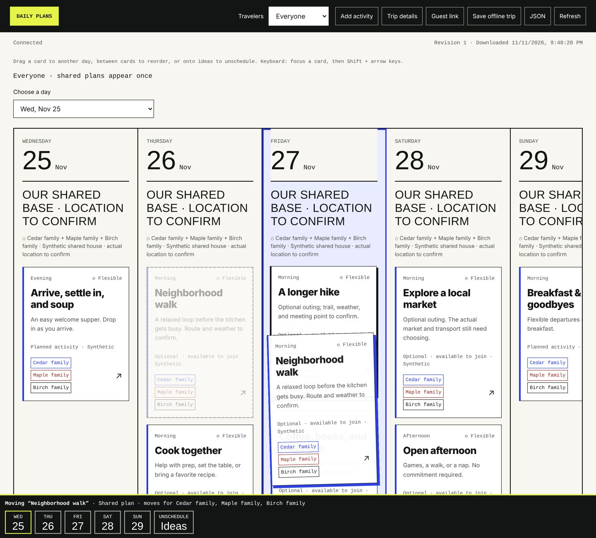
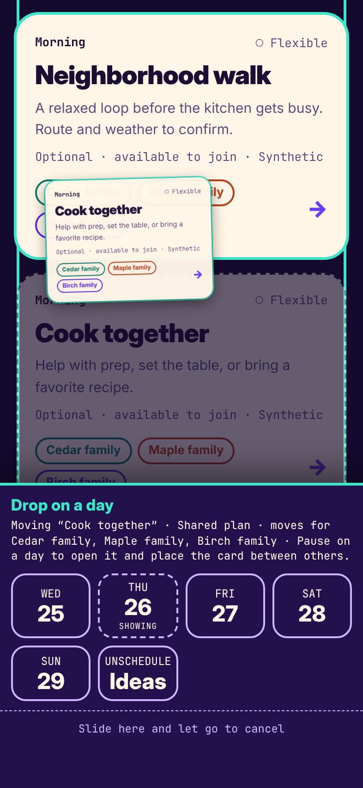
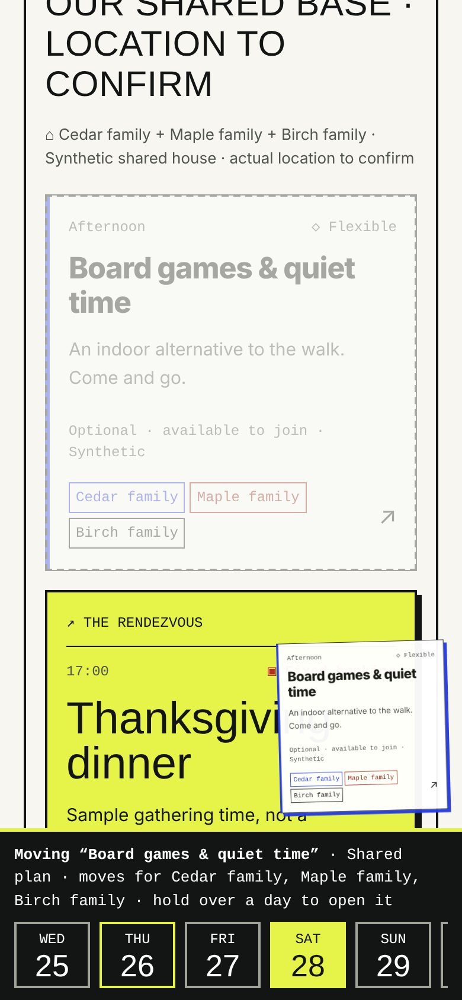
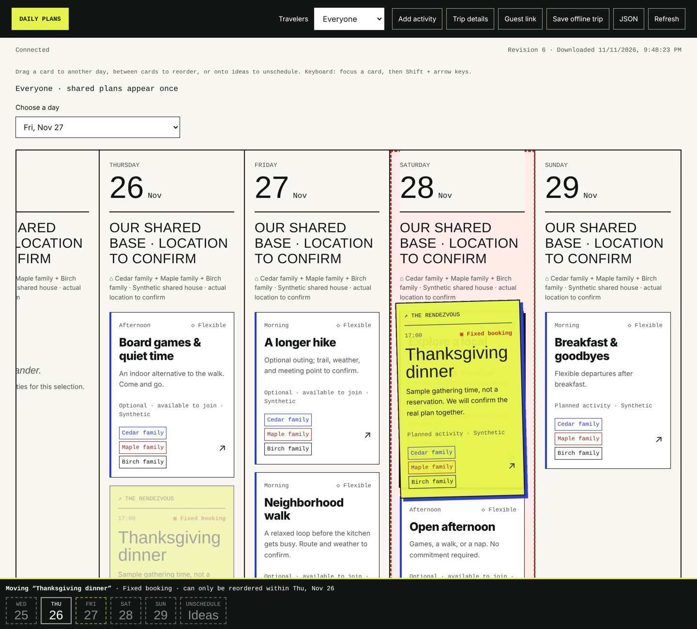
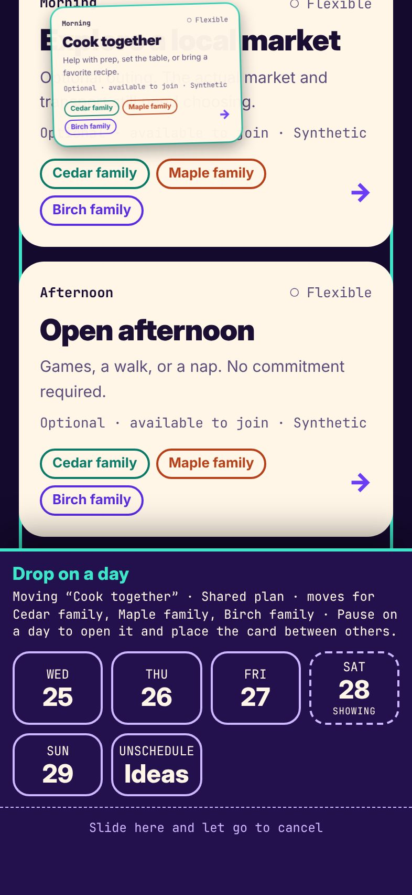
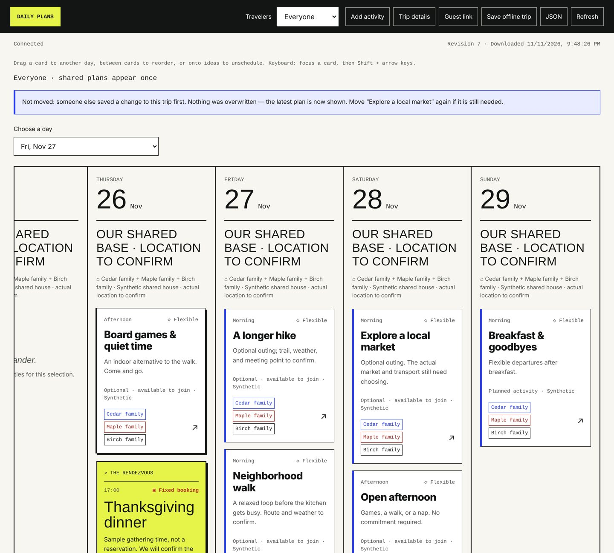

# Moving activities by drag-and-drop

Status: November 12, 2026. Phone pickup and drop panel reworked after the first hosted trial.

Activities can be moved between days, reordered within a day, and moved to or
from **Not on the itinerary. Yet.** (unscheduled ideas) by direct manipulation.
Every move is one `PATCH /api/trip` with `action: "move"` and goes through the
same atomic revision check as every other edit. The editor's **Day** field remains
the non-drag alternative.

## Desktop

Press and drag a card. The card being moved is dimmed with a dashed outline and a
floating copy follows the pointer. The day under the pointer is outlined in lagoon
and a lagoon bar shows where the card will land. Dropping on **Ideas** in the bar at
the bottom unschedules it. Days beyond the visible board scroll into view when the
pointer nears an edge, or when you hover over a day chip in the bottom bar.
Escape cancels. A moved card briefly flashes lagoon.

Keyboard: focus a card, then **Shift + ←/→** moves it to the previous/next day and
**Shift + ↑/↓** reorders it within the day. Focus stays on the moved card.

## Phone

The phone shows one day, so a **Drop on a day** panel slides up from the bottom
while dragging, with every day (and **Ideas**) as a large chip.

1. **Press and hold** a card for about a third of a second until it lifts. A
   quick swipe still scrolls and a tap still opens the activity.
2. A small copy of the card rides just above your fingertip, so neither the
   finger nor the card hides the target.
3. Slide onto a day chip and let go to move the card to the end of that day.
   Pause on a chip to show that day, then drop between its cards to place it.
4. Slide to the strip at the bottom of the panel and let go to cancel.

The drag styles ship inside `public/drag.mjs` rather than `planner.css`. On the
first hosted trial a phone paired the new script with an older cached stylesheet,
which left the floating card and the day panel unstyled; bundling them prevents
that mismatch. The cancel strip also keeps the chips clear of Safari's floating
toolbar.

## Rules

- **Fixed bookings** cannot change day by drag. Their bar note says so, other
  days show a red dashed outline, and a drop shakes the card back and explains how
  to make it flexible first. Reordering within its own day is allowed because
  order does not change date or time. The server enforces the same rule.
- **Shared activities** stay one record. The bar and confirmation message name every
  participating group. With a Travelers filter active, the message notes that
  hidden groups are moved as well.
- Only `date` and the destination day's `order` values change. Place, time,
  participants, and notes are untouched. Dropping into a different city lane
  does not change the place; use the editor for that.
- **Optimistic with rollback:** the card moves immediately. If the save fails, it
  returns. On a stale-revision conflict (409), the latest plan is loaded and the
  message says nothing was overwritten.
- Guests, offline reading copies, expired sign-in, and open dialogs have no drag
  behavior.

## Implementation notes

- `public/move.mjs`: pure move/reorder rules shared by the browser and the server.
- `public/drag.mjs`: small pointer/touch controller. The board is plain JavaScript
  rendering HTML strings, so a React drag library (dnd-kit) does not fit, and the
  phone day-chip pattern needed custom behavior anyway.
- The offline shell cache (`waypoint-shell-v20` as of maps) includes the traveler, move, and drag modules.
- On the phone the day rail is pinned while scrolling; it un-pins during a drag so it cannot cover a drop position.
- Tests: `tests/move.test.mjs`, the move checks in `scripts/check-api.mjs`, and the
  browser walkthrough `scripts/check-drag-browser.cjs`.

Follow-ups: undo for the last move, moving between city lanes (place change),
ordering inside the ideas tray, and testing on a physical phone.

| Desktop | Phone |
| --- | --- |
|  |  |
| |  |
|  |  |
|  |  |
