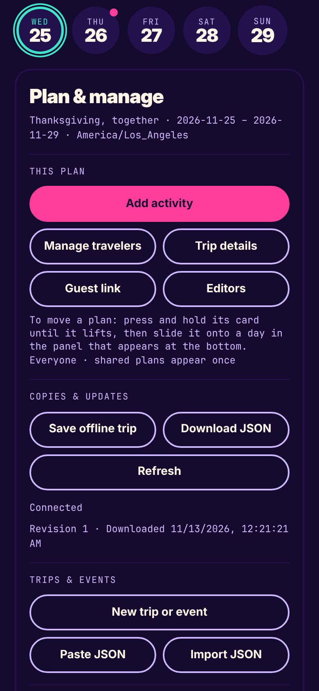
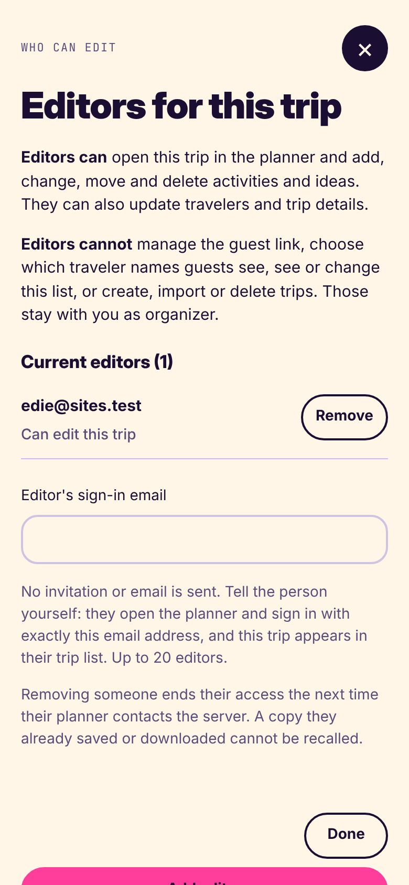
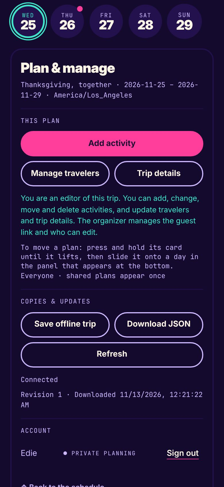
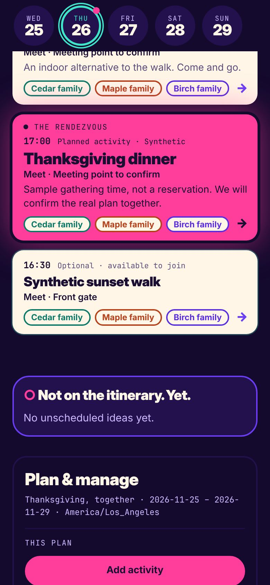
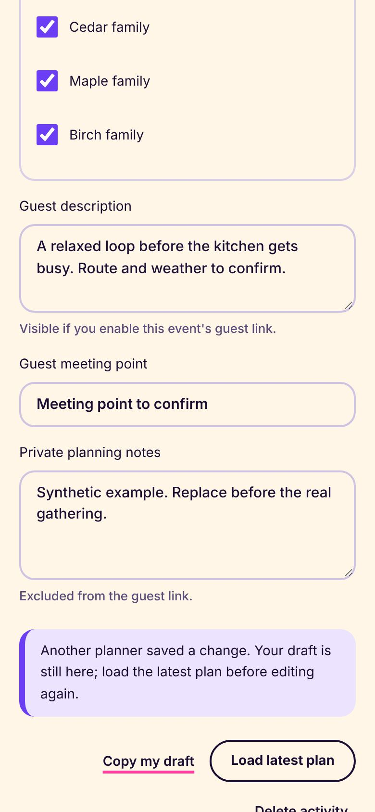
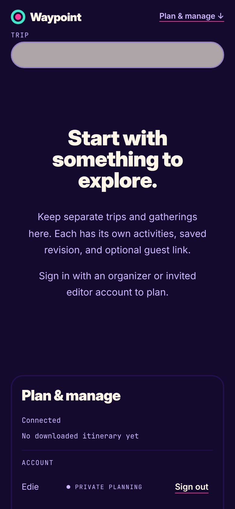

# Editors: letting someone else edit a trip

Status: November 13, 2026. Built and checked locally with synthetic data and
local test accounts; not yet deployed, and not yet tried with a second real
account on the hosted Site.

## For the organizer

Open a trip, then **Editors** (on a phone: **Plan & manage ↓ → Editors**). Type the
person's sign-in email and choose **Add editor**. **Remove** takes them off.

- **No invitation or email is sent.** The address is only stored with the trip.
  Tell the person yourself. They open the planner, sign in with exactly that
  email address, and the trip appears in their trip list.
- Removing someone ends their access the next time their planner contacts the
  server; their device's saved copy is cleared at that point. A file they already
  downloaded cannot be recalled.
- Up to 20 editors per trip. The list is visible only to the organizer.

| An editor can | Only the organizer can |
| --- | --- |
| Open the trip in the planner | Enable, replace or disable the guest link |
| Add, change, move and delete activities and ideas | Choose which traveler names guests see |
| Update travelers, groups and trip details | See, add or remove editors |
| Save an offline copy or JSON of the trip | Create or import trips |

There is no delete-trip feature for anyone. Editors do not see the **Guest link**,
**Editors**, **New trip or event**, **Paste JSON** or **Import JSON** controls, and
the server refuses those requests from them regardless of what the page shows.

Letting editors update travelers and trip details follows the existing behavior
of the shared save path. If editors should be limited to activities only, that
is a small server rule to add in `editorRestriction` (`lib/trips.mjs`).

## How access is decided

- The **organizer** of a trip is the account that created it (`owner_id`).
  **Editors** are the lower-cased emails in that trip's `editor_emails`. Anyone
  else, signed in or not, gets "This trip is unavailable to this account" (403)
  for reads and writes, and the trip is absent from their list.
- Every editor save goes through the same `PATCH /api/trip` revision check as the
  organizer's. A stale revision returns 409 and keeps the draft in the form.
- `GET/POST /api/editors?id=…` is organizer-only. Adding and removing are single
  atomic database statements and do not change the trip's revision, so they
  never invalidate someone's open draft.
- `/api/share` stays organizer-only. `POST /api/trips` (create/import) still
  requires an address in `PLANNER_CREATOR_EMAILS`.
- An editor's traveler save is refused if it changes **Show display name on guest
  link**; the checkbox is disabled for them.
- Trip responses never include the editor list or anyone's email.

What was already there and what changed: the server already authorized reads and
writes by membership, and that held up under test. This change added the
organizer's list management, the role in responses, case-insensitive matching of
stored addresses, the guest-name rule, and the planner controls.

## Local test accounts

The dev server's simulated sign-in gained two loopback-only accounts beside
Seedy (the configured organizer), so membership can be exercised locally:

- `/signin-with-chatgpt?return_to=/&local_user=edie` → Edie, `edie@sites.test`
- `/signin-with-chatgpt?return_to=/&local_user=otto` → Otto, `otto@sites.test`

`.test` addresses cannot belong to anyone. These accounts do not exist in hosted
builds.

## Verification

- `npm test`: 44 pass, 8 new in `tests/editors.test.mjs` (roles, non-members,
  removal, editor changes, guest-name rule, email validation, and the organizer-only
  guards in the routes and the page).
- `npm run test:access -- http://127.0.0.1:5173` (`scripts/check-access.mjs`),
  over HTTP with three signed-in local accounts against the local database:
  - an editor adds, edits, moves and deletes an activity;
  - a non-member cannot read, write, or see the trip listed;
  - an editor gets 403 from the guest link and editor-list endpoints and from
    trip creation/import, and cannot publish a traveler name;
  - removing the editor makes their next read and write 403;
  - a stale editor save returns 409, and an organizer/editor race on one
    revision yields exactly one 200 and one 409.
- `npm run test:api`, type check, lint (0 errors) and production build pass.
- Headless Chromium, desktop and 390 px phone: the organizer adds and removes an
  editor; the editor sees the trip without organizer controls, adds an activity
  that the organizer then sees, gets the conflict message with the draft kept
  after a competing save, and loses the trip and the device copy after removal.

Not verified: a second **real** ChatGPT account on the hosted Site (including
that the email the Site reports for that person is the one typed here), and
physical phones. Nothing was deployed, no invitation or email was sent, and no
real address or trip data is in the repository.

## Screenshots (synthetic data, local test accounts)

| Organizer: Plan & manage | Organizer: Editors | Editor: Plan & manage |
| --- | --- | --- |
|  |  |  |

| Editor adds an activity | Editor's stale save | After removal |
| --- | --- | --- |
|  |  |  |

Desktop: [organizer's Editors dialog](design/editors/desktop-editors-added.jpg) ·
[editor's view](design/editors/desktop-editor.jpg).
