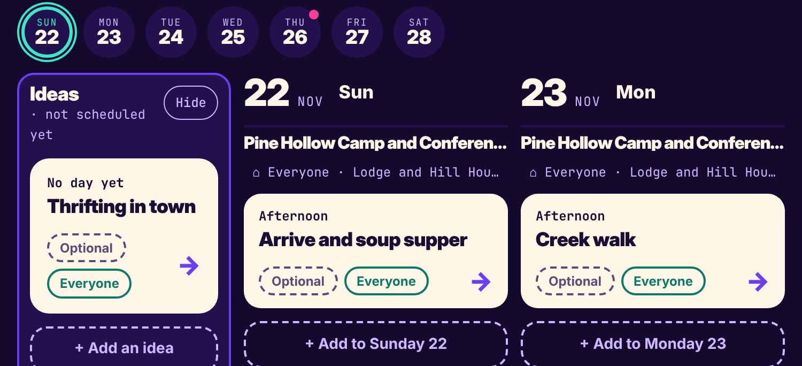
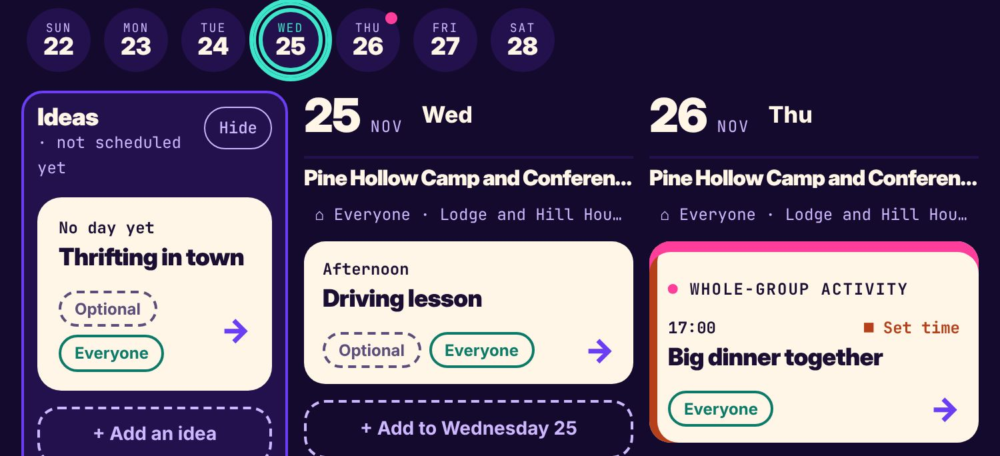
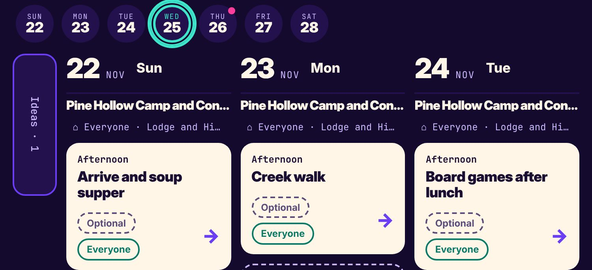
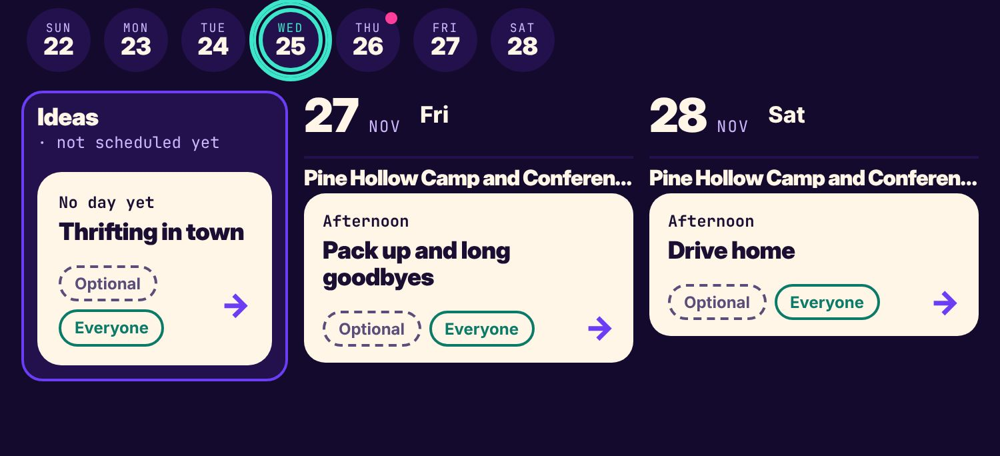

# Even day columns

Status: November 17, 2026. Built and checked locally with synthetic data; not
deployed. Display only: no data, saving or access change.

## The problem

With days side by side on a phone held sideways, "Wednesday" was too long to
sit beside the date and wrapped under it, while "Tuesday" fitted. That column's
stay line and cards then sat lower than its neighbours. The right-most column
was also cut off wherever the screen happened to end, sometimes mid-word.

## What changed

- **The day header is always one line.** A column narrower than 260 px shows
  the short weekday (Sun, Mon, Tue, Wed, Thu, Fri, Sat); a wider one shows the
  full name. The choice follows the width of the column itself, not the screen,
  so it is right in the week view on a laptop as well. Every column in a view
  uses the same form, because the columns are the same width.
- **The place name and the stay line are one line each**, ending in "…" when
  too long. The full place name shows on hover; the full stay text is in the
  stay details view that the line opens. With the header, place and stay line
  all a fixed height, **the first card starts at the same height in every
  column**.
- **No column is cut off.** A whole number of columns now fills the board: two
  beside Ideas on most sideways phones, three or four with Ideas folded, and so
  on up to seven in the week view. Scrolling sideways settles on a column edge.
  This is the "snap" option rather than a deliberate peek: on a short sideways
  screen a sliver of a third column was not worth the width.
- While a card is being dragged, the settling is switched off so the board can
  scroll smoothly under the card.

The upright phone layout (one day, or all days in one scroll) is unchanged and
keeps the full weekday name.

One consequence at the narrowest laptop width (761 px): beside an open Ideas
column there is room for one day; with Ideas folded there are two.

## Checked

Measured in headless Chromium with a synthetic trip running
Sunday to Saturday, one activity a day, a long place name and a long stay
description. For each size below, at the start of the trip, with Wednesday
selected, after an uneven sideways scroll, and at the end of the trip, with
Ideas open and folded:

| Size (as the browser reports it) | Days shown, Ideas open / folded | Weekday form |
| --- | --- | --- |
| 660 × 330 | 2 / 2 | short / full |
| 667 × 375 | 2 / 2 | short / full |
| 724 × 327 | 2 / 3 | short |
| 750 × 342 | 2 / 3 | short |
| 780 × 360 | 2 / 3 | full / short |
| 812 × 375 | 2 / 3 | full / short |
| 844 × 390 | 3 / 3 | short |
| 896 × 414 | 3 / 4 | short |
| 930 × 430 | 3 / 4 | short |
| 761 × 900 (narrowest laptop layout) | 1 / 2 | full |
| 1000 × 800 week view / larger cards | 4 / 4, and 2 | short, and full |
| 1440 × 900 week view / larger cards | 6 / 7, and 4 | short, and full |

In every case: all seven headers the same height and on one line, no weekday
clipped, the stay line at the same height in every column, the first card at
the same height in every column, no column partly visible, and no sideways
page overflow. The guest page was measured at 667, 750, 930 and 761 wide with
the same result (it has no stay line).

Also: `npm test` 135 pass (3 new in `tests/even-columns.test.mjs`); type check,
lint (0 errors) and production build pass; `scripts/check-drag-browser.cjs`
passes, including desktop drag with the new settling behaviour.

Not verified: a physical phone. Sideways scrolling that settles on a column
should be felt on a real device, and Safari's own toolbar changes the height.

## Screenshots (synthetic data)

Sideways phone, 750 × 342, Ideas open, start of the trip and at Wednesday:

Ideas folded (three days), and the guest page:

Small phone, 667 × 375: [Ideas open](design/even-columns/667x375-ideas-open.jpg) ·
[at Wednesday](design/even-columns/667x375-wednesday.jpg) ·
[Ideas folded](design/even-columns/667x375-ideas-folded.jpg).

Large phone, 930 × 430: [Ideas open](design/even-columns/930x430-ideas-open.jpg) ·
[at Wednesday](design/even-columns/930x430-wednesday.jpg) ·
[Ideas folded](design/even-columns/930x430-ideas-folded.jpg).

Narrowest laptop layout, 761 × 900: [Ideas open](design/even-columns/761x900-ideas-open.jpg) ·
[Ideas folded](design/even-columns/761x900-ideas-folded.jpg).

Laptop, larger cards: [1000 × 800](design/even-columns/1000x800-other-density.jpg) ·
[1440 × 900](design/even-columns/1440x900-other-density.jpg).

## How it works

- `board()` writes both weekday forms; a container query on the day column
  picks one. The hidden form is not read by screen readers; the short form
  carries the full name as its title.
- `fitColumns()` in `public/board.mjs` sets how many columns fit, from the
  board's width, the narrowest acceptable column (`--col-min`: 280 px, 190 px
  on a short wide screen, 172 px in the week view) and the gap. It runs after
  each draw, when Ideas is folded or opened, and when the window changes size.
  Without it the stylesheet falls back to three, two or seven columns.
- The offline shell cache is `waypoint-shell-v34`.
