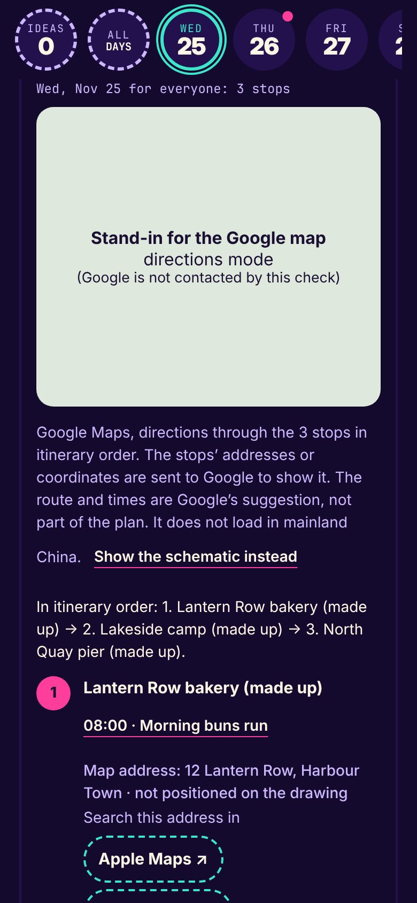
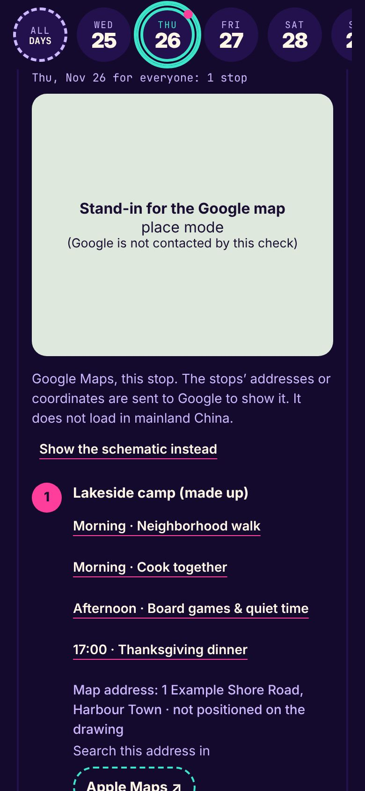
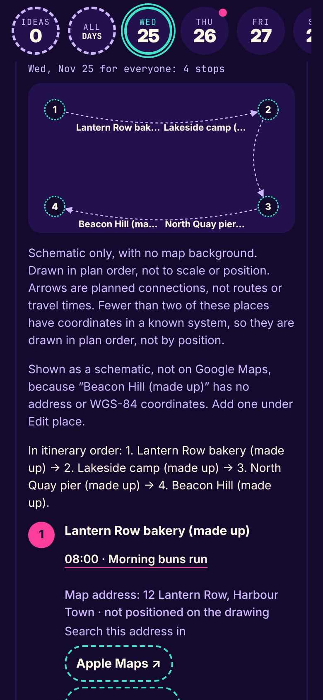
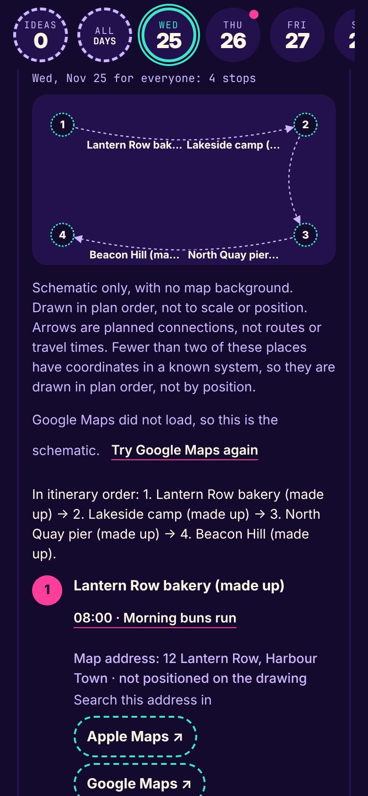

# Google Maps for the day map

Status: November 17, 2026. Owner decision the same day: use the Google Maps
Embed API for the day map. Built and checked locally with synthetic data and
with Google stubbed out; not deployed, and **not yet seen with a real key**.
No database migration.

**Stop locations are sent to Google.** When the Google day map is shown, the
addresses or coordinates of that day's stops go to Google in the map's address,
together with the Site's domain. **It does not work in mainland China**, where
Google is not reachable; there the schematic is shown instead.

## What people see

With a key configured, signed-in planners get a Google map in the Map panel's
**This day** view:

- **One stop:** place mode, showing that place.
- **Several stops:** directions mode: the first stop as origin, the last as
  destination, the ones between as waypoints, in itinerary order.
- Under it, unchanged: the route in words, the numbered stop list, the
  activities, the map-app links and "Location to confirm".
- The caption says the locations are sent to Google, that the route and times
  are Google's suggestion and not part of the plan, and that it does not load in
  mainland China. **Show the schematic instead** switches back; the choice is
  remembered on that device.

The schematic is drawn instead, as before, when:

- no key is configured (nothing about Google is mentioned at all);
- a stop has no usable location; the panel names the stop and says why;
- the day has more than 22 stops (the embed takes 20 waypoints);
- Google cannot be reached, or the frame has not loaded after 12 seconds: the
  panel says "Google Maps did not load, so this is the schematic" and offers
  **Try Google Maps again**;
- the device is offline or the sign-in has expired;
- the person chose the schematic.

**Whole trip** is always the schematic. **Guests never get the Google map or
the key**: the guest link carries no address or coordinates to give Google.

## What is sent, exactly

For each stop, the first of these that exists:

1. the address or place name typed in "Location for the map", as typed;
2. the coordinates entered there, **only if recorded as WGS-84**, as
   `latitude,longitude`;
3. the place's address (local-script address first).

Coordinates recorded as GCJ-02, BD-09 or Unknown are never sent: Google's embed
expects WGS-84, would draw the others some hundreds of metres off, and
converting them would be guesswork. A place with only a name is not sent
either. In both cases the day stays on the schematic.

Nothing is sent until the map scrolls into view. First the page asks Google's
embed address whether it can be reached at all, with no key, no location, no
cookie and no referrer; only then is the map loaded. The map request carries
the key, the locations and the Site's domain as referrer (never the trip's
address or id). Planning notes, traveler names and everything else stay in the
planner. What Google does inside its own frame (its cookies, its logging) is
Google's.

## Setting it up

### Create and restrict the key (Google Cloud console)

1. In the project, **APIs & Services → Library**: enable **Maps Embed API**.
2. **APIs & Services → Credentials → Create credentials → API key**. Name it,
   for example "Waypoint Maps Embed".
3. **API restrictions → Restrict key**: select **Maps Embed API** only.
4. **Application restrictions → Websites**: add the Site's address as an HTTP
   referrer, in the form `https://<the site's domain>/*`. Add nothing else. The
   page sends only its domain to Google, which this pattern matches.
5. Save. Restrictions can take a few minutes to apply.

An embed key is used in the browser and is visible to anyone who can open the
planner, by Google's design. The two restrictions are what protect it: it then
works only for Maps Embed and only from the Site. An unrestricted key should
not be used.

Cost: Google has listed the Maps Embed API as free of charge with no usage
limit. That was not rechecked here; confirm it on the project's billing page.
The project may still need a billing account attached.

### Give it to the Site

Set `GOOGLE_MAPS_EMBED_KEY` in **Sites runtime configuration**, next to
`PLANNER_CREATOR_EMAILS`. Never put it in the repository, a trip, a PR or a
document. Removing the variable turns the Google map off; the schematic
returns with no other change.

For local preview, add the same line to the ignored `.dev.vars` file. A key
restricted to the Site's domain will be refused by Google from `127.0.0.1`
unless that referrer is added to it; a separate local-only key is safer.

The server sends the key only in `GET /api/trip`, after the trip-membership
check. It is not in the trip list, the guest API, any stored trip, the offline
HTML file or the copy kept on the device. `tests/google-embed.test.mjs` fails
if a string shaped like a Google key appears anywhere in the repository.

## Limits to know about

- **A wrong or wrongly restricted key shows Google's own error inside the
  frame**, and the page cannot see that. "Show the schematic instead" is the
  way out. Check the map once after deploying.
- The route is Google's choice of route and travel mode. It is not stored and
  does not change the plan.
- Unlike the schematic, the Google map cannot be filtered to hide a stop, and
  markers on it do not jump to the list.
- A day that mixes an address and WGS-84 coordinates is fine. A day where one
  stop has only GCJ-02 coordinates is not shown on Google at all.

## Checks

- `npm test`: 207 pass (9 new in `tests/google-embed.test.mjs`): what is sent
  for a place, place mode, directions order and encoding, every fallback, the
  list kept under the map, no Google for the whole trip or guests, where the
  key comes from and goes, no key in the repository, and the automatic
  fallback.
- `npm run test:api`: the key reaches trip members only.
- `scripts/check-google-embed-browser.cjs` (headless Chromium, local dev
  server, synthetic trip, **Google answered by the script, not contacted**):
  75 checks at 1440 × 900, 390 × 844 and 844 × 390.
- Type check, lint (0 errors) and production build pass; the earlier browser
  checks still pass with and without a key.

## Not verified

- **A real Google map.** Google could not be reached from the build
  environment, so the supplied key was never accepted or refused by Google
  here, and the frame in the screenshots is a stand-in. The link formats follow
  Google's published Embed API from memory.
- That the referrer restriction accepts the Site once deployed.
- Behaviour from mainland China. The fallback is built for an unreachable
  Google, but was only exercised by simulating one.
- A physical phone, a screen reader and real trip data.

## Screenshots (synthetic data; the grey panel is a stand-in for Google's map)

| Phone: several stops | Phone: one stop | Phone: no usable location | Phone: Google unreachable |
| --- | --- | --- | --- |
|  |  |  |  |

Desktop: [several stops](design/google-embed/desktop-directions.jpg) ·
[one stop](design/google-embed/desktop-place.jpg) ·
[no usable location](design/google-embed/desktop-no-usable-location.jpg) ·
[unreachable](design/google-embed/desktop-unreachable.jpg).
Phone sideways: [several stops](design/google-embed/landscape-directions.jpg) ·
[one stop](design/google-embed/landscape-place.jpg).
