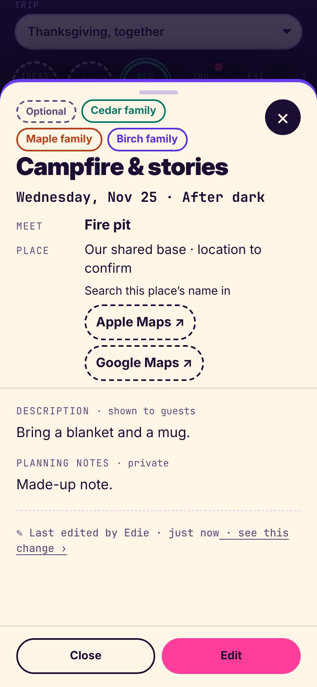
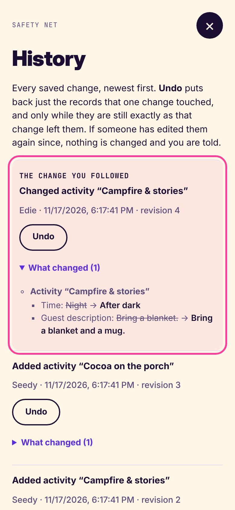
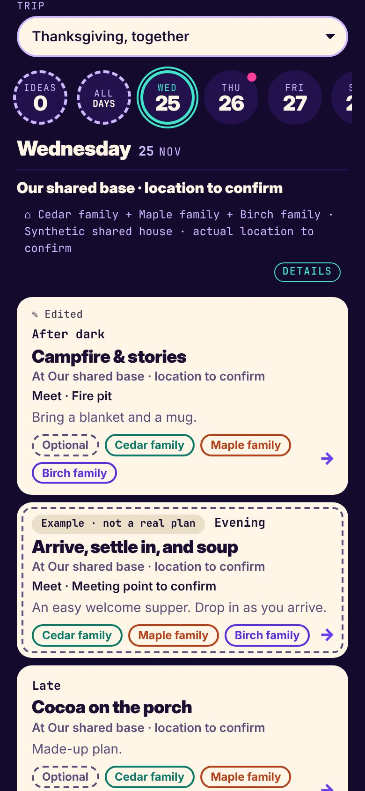
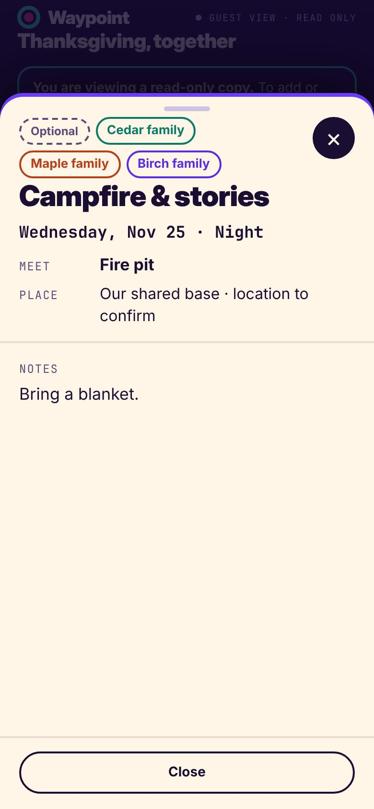

# "Last edited by" on an activity

Status: November 17, 2026. Built and checked locally with synthetic data; not
deployed. No database migration and no new stored data.

History lists every change, but most people want to see an edit where they are
looking: on the activity. This adds a short note there that leads to the exact
entry in History, where the details and Undo already are.

## What people see

- **In the activity's read-only view**, under the notes: `✎ Last edited by Edie ·
  2 hours ago · see this change ›`. The whole line is a link.
- **In the editor**, above the buttons: the same line, opening **in a new tab**,
  so what is being typed is not lost.
- **On a card**, only a small `✎ Edited` when someone changed it in the last 24
  hours. Who and when are one tap away; screen readers hear them on the card.
- **If it was never edited since it was added:** `Added by Seedy · 3 days ago`.
  If it came with the trip (a template, an import, a restore) and nobody has
  touched it: `Added with this trip by Seedy · on Nov 8`, linking to "Created
  this trip". If the log does not reach back that far, nothing is shown.
- Times read as "just now", minutes, hours, "yesterday", days, then the date.
  The exact time is the link's tooltip and is in the History entry.

## The link

`/?trip=<trip>&history=<entry>` opens History with that entry scrolled into
view, outlined, labelled "The change you followed", its details open and
keyboard focus on it. It can be pasted, bookmarked and reloaded. Following it
from the view changes the address without reloading; closing History returns
the address to the trip; Back and Forward move between the two. An entry older
than the newest hundred is fetched and shown after them. A link to an entry
that is not in this trip says so and highlights nothing.

## Where it comes from

Only the change log (`planner_changes`), which History reads. One read-only
query (`lib/last-edits.mjs`) finds, for each activity, the newest log entry
that really changed it, and returns that entry's id, display name and time: the
same name History shows. Nothing is written, and activities gain no field.

- A card that someone else's drag merely renumbered is not "edited" by that
  drag. Entries written since per-record revisions mark those; in older entries
  the same is recognised by comparing before and after without the position.
- Moving a card to another day, and an undo, are changes to that card.
- The answer is kept for one saved revision of the trip. After any save it is
  asked for again, and until it arrives nothing is shown rather than something
  out of date. If the request fails (offline, signed out) there is no note and
  nothing else changes.

## Guests

Guests see nothing of History today, and still see nothing: no note, no mark,
no History control. The guest page has no code for it and never asks; the
guest projection names no editor; and `/api/history` refuses anyone who is not
a member of the trip, with or without a guest link's token. Members (organizer
and editors) see the note, exactly as they can already open History.

## Checks

- `npm test`: 198 pass (10 new in `tests/last-edited.test.mjs`). The query is
  run against an in-memory SQLite copy of the log table: the newest real edit
  wins, renumbering by a drag does not count (new and older log rows), added
  and came-with-the-trip cases, nothing when unknown, deleted activities and
  other trips ignored, the link's address, and what a guest gets.
- `npm run test:api` against the local database: the note matches History's
  entry, name and time; links stay within their trip; signed-out visitors and
  guest tokens are refused.
- `scripts/check-last-edited-browser.cjs` (headless Chromium, local dev
  server, two local test accounts and a local guest link): 75 checks at
  1440 × 900, 390 × 844 and 844 × 390, including reload, a pasted link, Back
  and Forward, undo from the linked entry, the editor's new-tab link, History
  unreachable, and the guest page.
- Type check, lint (0 errors) and production build pass.

## Not verified

- The query on the hosted database. It uses SQLite's `json_each`, which the
  local D1 runs; cost on a long log was not measured (it reads the trip's whole
  log once per saved revision per open page).
- Real accounts' display names, a physical phone, a screen reader, and the
  hosted Site.

## Screenshots (synthetic data and test accounts)

| Phone: the note | Phone: History at the entry | Phone: card mark | Phone: guest |
| --- | --- | --- | --- |
|  |  |  |  |

Desktop: [note](design/last-edited/desktop-view-note.jpg) ·
[History entry](design/last-edited/desktop-history-entry.jpg) ·
[editor](design/last-edited/desktop-editor-note.jpg) ·
[card mark](design/last-edited/desktop-card-mark.jpg) ·
[guest](design/last-edited/desktop-guest-view.jpg).
Phone sideways: [note](design/last-edited/landscape-view-note.jpg) ·
[History entry](design/last-edited/landscape-history-entry.jpg).
