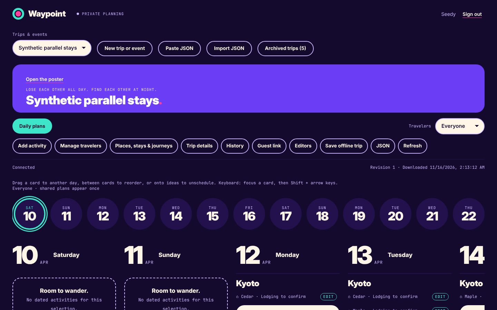
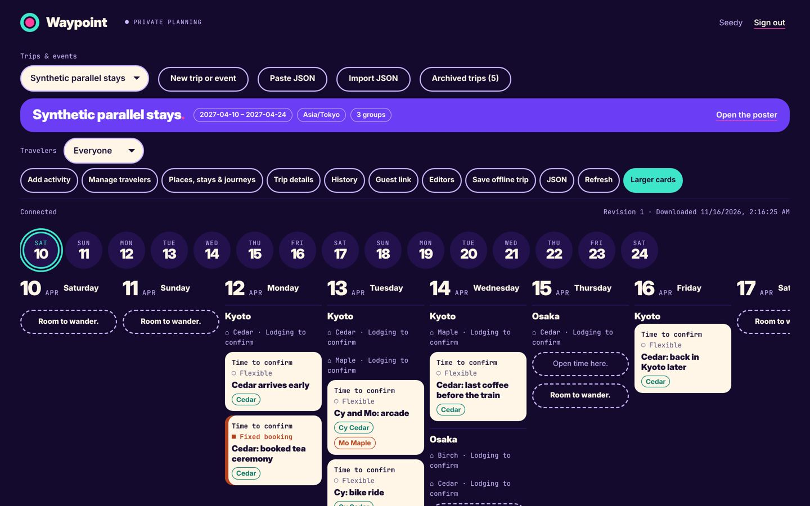

# Layout: schedule on the first screen, no clipped journeys, a week view

Status: November 16, 2026. Built and checked locally with synthetic data; deployed in version 12. Desktop changes only; the schedule-first phone layout is unchanged. See [release history](releases/README.md) for dated live checks and remaining limits.

## What changed

1. **The poster collapses by default once a trip has activities.** It becomes a
   one-line bar with the trip's name, dates, time zone and an **Open the poster**
   link. A trip with no activities still opens with the full poster. Your choice
   is remembered on that device. The drag and filter notes moved below the
   board, and the day medallions are smaller while collapsed.
2. **The board no longer scrolls inside itself.** It used to be capped at 78% of
   the window height with its own vertical scrollbar, which cut off journey
   cards at the foot of a long day. Now the board scrolls sideways only and the
   page scrolls vertically. The day headers therefore no longer stay pinned
   while you scroll down a long day.
3. **A denser week view for long trips.** **Fit a week** shows seven narrower day
   columns instead of three; **Larger cards** switches back. Trips of ten days
   or more open in the week view. Cards keep the time, the Flexible / ■ Fixed
   booking label, the title and traveler names; descriptions are read by opening
   the card. It applies from 1000 px wide.

## Measured (headless Chromium, 1440 × 900, synthetic 15-day trip)

| | Before | After |
| --- | --- | --- |
| Top of the first activity card | 886 px | 626 px |
| Top of the board | 701 px | 494 px |
| Whole day columns visible | 4 (partly) | 7 |
| Journey cards cut off by the board | 2 | 0 |
| Board has its own vertical scrollbar | yes | no |

## Checks

- `npm test`: 103 pass (6 new in `tests/layout.test.mjs`, including the editor
  rule in `tests/editors.test.mjs`).
- Headless Chromium at 1440 × 900 and 390 × 844: measurements above; both
  toggles and their remembered state; phone layout unchanged with no horizontal
  overflow; drag-and-drop still saves (`scripts/check-drag-browser.cjs`).
- Type check, lint (0 errors) and production build pass.

Not verified: real two-week content (long titles wrap in the narrow columns),
browser zoom at 200%, and physical devices.

## Screenshots (synthetic data)

Before and after, first screen at 1440 × 900:

[Larger cards](design/layout/desktop-after-roomy.jpg) ·
[journeys at the foot of a long day](design/layout/desktop-journeys-visible.jpg) ·
[poster open](design/layout/desktop-poster-open.jpg) ·
[phone, unchanged](design/layout/phone-unchanged.jpg).
