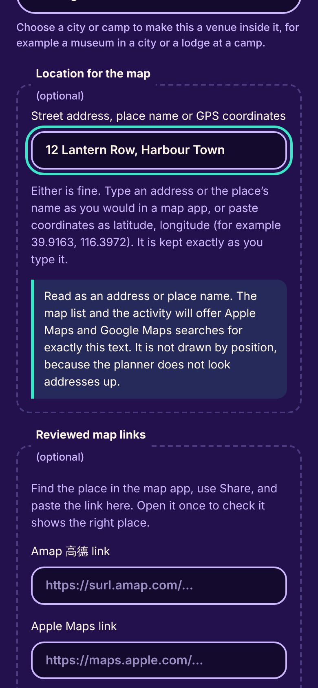
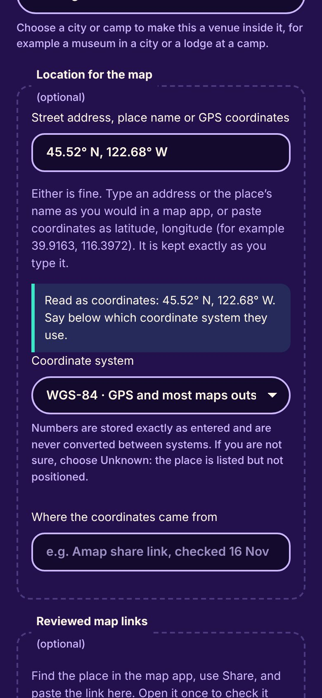
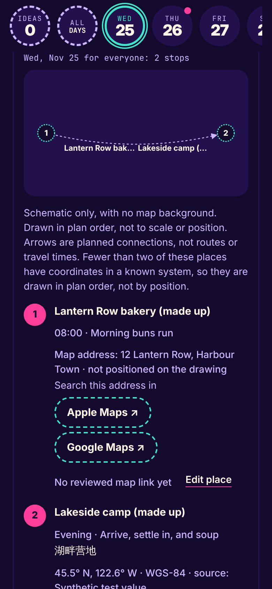
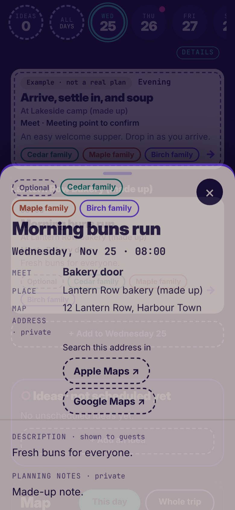

# Location for the map: an address or coordinates

Status: November 17, 2026. Built and checked locally with synthetic data; not
deployed. No database migration. **It makes no claim about China readiness**:
no map link was opened from a phone or from mainland China.

## For planners

**Edit place → Location for the map** is now one box: *Street address, place
name or GPS coordinates*. Either is fine.

- Type an address or the place's name as you would in a map app, for example
  `12 Lantern Row, Harbour Town`.
- Or paste coordinates as latitude, longitude in decimal degrees:
  `39.9163, 116.3972`. `39.9163° N, 116.3972° E`, `N 39.9163 E 116.3972` and a
  space or semicolon instead of the comma are read the same way.

Under the box the form says how it read the text. For coordinates it then asks
for the coordinate system and where the numbers came from, as before. For an
address it asks nothing more.

What you typed is kept exactly as typed and shown back in the form. On the map
list coordinates read as `39.9163° N, 116.3972° E · WGS-84 · source: …`, and an
address reads as `Map address: …`.

An address gives **Search this address in: Apple Maps · Google Maps** on the map
list and in the activity view (signed-in planners only). [maps.md](maps.md) lists
the further links added the same day (directions, and searches by name). These open the map app
or site with exactly the typed text. They have a dashed outline and are worded
as searches, to keep them apart from the reviewed links, which are unchanged.

## Rules

- **Since the Google day map was adopted** (November 17,
  [google-maps-embed.md](google-maps-embed.md)), a day's stop locations are also
  sent to Google when that map is shown, if a key is configured. The rest of
  this section describes the planner without a key.
- **The planner looks nothing up.** An address is never turned into a point, so
  a place with only an address is listed and linked but drawn in plan order (or
  along the bottom edge), not by position. No request leaves the planner; the
  address reaches Apple or Google only when a person follows a search link.
- **Text that is only numbers must be a complete, valid pair.** `45`, `95, 200`
  or degrees-minutes-seconds are refused with a reason rather than searched.
  Anything with a word in it is an address.
- **Coordinates are still never converted** and still need an explicit system.
  No link is built from coordinates. No Amap search link is generated: its link
  format has not been checked.
- **Places saved before this change are untouched.** They keep their two stored
  numbers and system; the box shows them as `lat, lng`. Opening and saving such
  a place without editing the box sends no location at all. A planner page
  still open from before the change can still save latitude and longitude.
- **Private.** The typed location is not in the guest view. The private offline
  HTML file lists it as text.

## How it is stored

A place gains `locationText`: the text as typed (trimmed, up to 500 characters).
When it holds coordinates, `lat`/`lng` are read from it on every save; when it
holds an address, `lat`, `lng` and `coordSystem` are empty. The rules are
`parseLocation()` and `normalizePlaceGeo()` in `public/maps.mjs`, used by the
server and the form. The trip is one JSON document, so no migration is needed;
an older place simply has no `locationText`. To roll back, redeploy the earlier code:
it ignores the extra field and drops it the next time that trip is saved, which
loses typed addresses but no coordinates.

## Owner decision: showing an address as a pin

Putting an address on the drawing by position needs a geocoding service. The
planning documents name none, so none was added. Every option sends the
address (a private planning detail) to a third party, and each returns
coordinates in its own system, which would have to be stored with that system
and never mixed with others. Prices change; check them before choosing.

| Option | Key or account | Cost | Returns | Notes |
| --- | --- | --- | --- | --- |
| Keep as built | none | none | nothing | Addresses open as searches; only typed coordinates are positioned. |
| OpenStreetMap Nominatim (public server) | none | free | WGS-84 | Usage policy limits it to about one request a second and asks for an identifying contact; no uptime promise; weaker on some addresses. |
| A hosted OpenStreetMap geocoder (several vendors) | API key | free tier, then paid | WGS-84 | Same data with a service level. |
| Google Geocoding API | API key with billing enabled | paid per request after a monthly allowance | WGS-84 outside mainland China | Its terms restrict storing results and showing them off a Google map. |
| Mapbox Geocoding | API key | free tier, then paid | WGS-84 | Storing results needs its "permanent" option, billed differently. |
| Apple MapKit JS | Apple Developer membership (annual fee) | included quota | WGS-84 outside mainland China | Token signed on the server. |
| Amap (高德) geocoding | key from a mainland-verified account | free tier | GCJ-02 | The only one aimed at mainland addresses; account rules and reachability not checked. |

If one is chosen, the agreed shape is: look up on save only, store the result
with its source and coordinate system, tell the person when nothing or several
places are found and let them choose, and keep the key in Sites runtime
configuration, never in the repository.

## Checks

- `npm test`: 178 pass (12 new in `tests/map-location.test.mjs`): address or
  coordinates parsing, refusals, round trip as typed, older coordinates
  unchanged, switching forms, search links and their encoding, no positioning
  from an address, no lookup code, guest privacy, and the form wording.
- `npm run test:api`: the server keeps an address as typed, refuses half a
  pair and coordinates without a system, accepts an older page's two numbers,
  and sends none of it to guests.
- `scripts/check-map-location-browser.cjs` (headless Chromium, local dev
  server, synthetic trip): 45 checks at 1440 × 900 and 390 × 844, including
  that no request went to another site.
- Type check, lint (0 errors) and production build pass.

## Not verified

- Whether the Apple Maps and Google Maps search links open the right app, or
  find the right place, on the travelers' phones. Only their text was checked.
- Anything from mainland China: reachability of either search, and how either
  provider resolves a Chinese address.
- A physical phone, a screen reader, the hosted Site, and real trip data.

## Screenshots (synthetic data; the addresses do not exist)

| Address typed | Coordinates typed | Map list | Activity view |
| --- | --- | --- | --- |
|  |  |  |  |

Desktop: [address](design/map-location/desktop-form-address.jpg) ·
[coordinates](design/map-location/desktop-form-coordinates.jpg) ·
[map list](design/map-location/desktop-map-list.jpg) ·
[activity view](design/map-location/desktop-activity-view.jpg).
