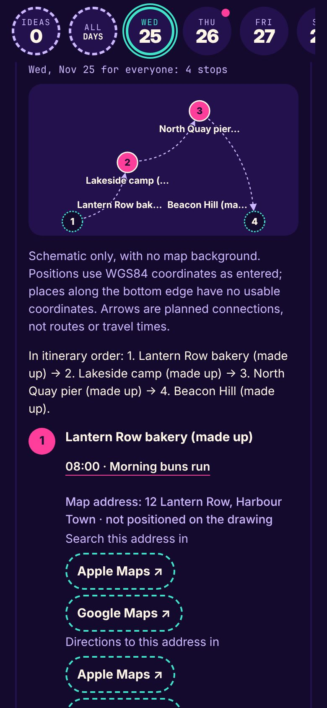
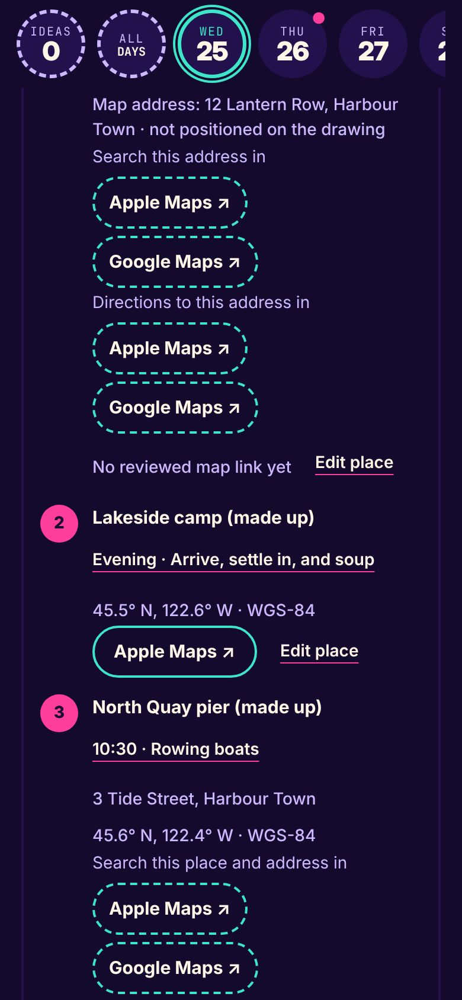
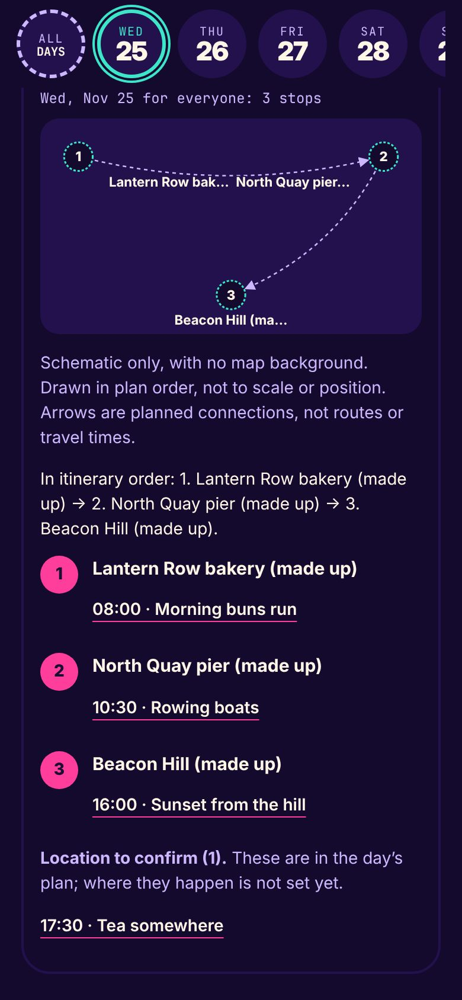
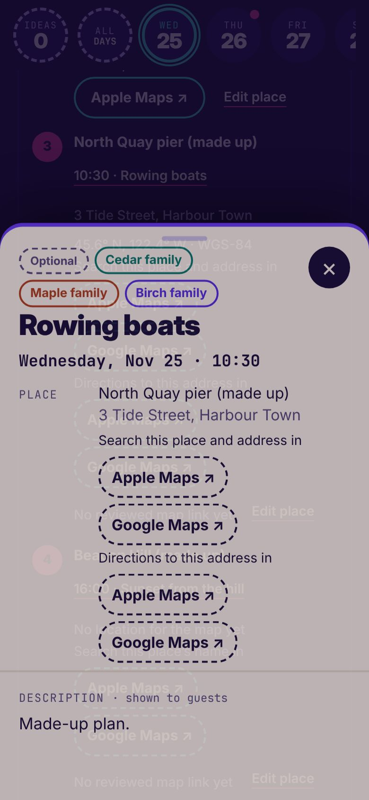
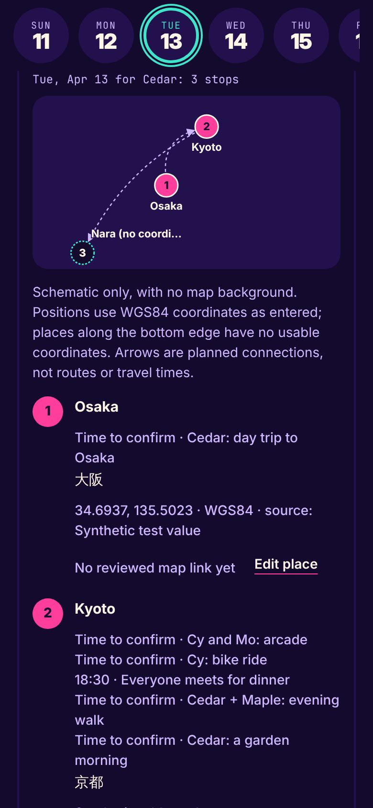
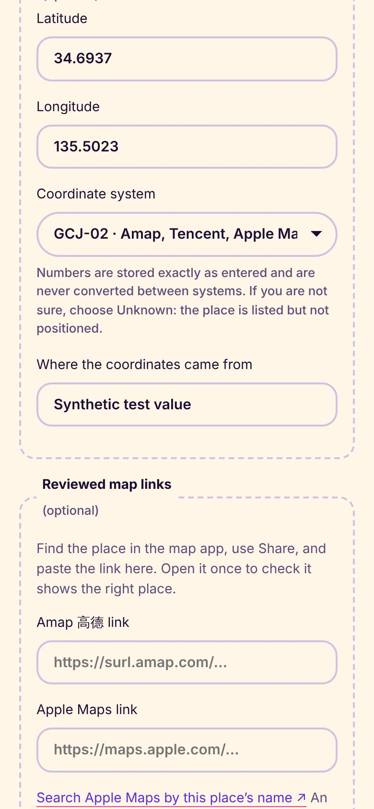

# Maps: schematic trip and day views

Status: November 17 additions deployed November 17, 2026
(America/Los_Angeles), Sites version 18. The first pass was deployed earlier.
See [release provenance](multi-events.md#release-provenance) for checks and limits;
live browser checks were unavailable. Built and checked locally with synthetic data. No database migration. This is the maps part of plan
milestone 4. **It makes no claim about China readiness**: no map provider, link
or network was tested from a phone or from mainland China.

## Added on November 17

- **A way out to a map app from every place.** Reviewed links come first and,
  when a place has one, are the only links offered. Otherwise the list offers a
  labelled search: of the typed map address, else of the place's name and
  address, else of its name alone. With an address there are also **directions
  to this address** in the day view and the activity view. All are built from
  text, open only when followed, and have a dashed outline to set them apart
  from reviewed links. Apple Maps and Google Maps only; no Amap link is
  generated.
- **Plans with no place stay usable.** "Location to confirm" lists each one as a
  button that opens it. One with its own private address gets the same search
  and directions.
- **Markers lead somewhere.** Tapping a numbered marker, or pressing Enter on
  it, moves to that stop in the list. Each activity in the day list opens its
  read-only view.
- **The route in words** under the drawing: stops in itinerary order, or
  journeys in date order.
- **Guests have the map too**, drawn only from what the guest link already
  sends: place names in plan order. See "Rules".
- **If the drawing cannot be made**, the numbered list and its links are still
  shown, with a sentence saying so.
- **Phone held sideways:** the drawing is capped to the screen height.

### What the planning documents describe, and where each stands

| Described in the plan | State |
| --- | --- |
| Whole-trip view of stays and journeys, per traveler selection | First pass |
| Day view in itinerary order with schematic connections, labelled as planned connections | First pass |
| Tile-free schematic; same filtered records as the board | First pass |
| Local-script names and addresses, coordinate system and provenance, never mixed or converted | First pass |
| Reviewed Amap and Apple Maps links | First pass |
| Map below Ideas; one sentence when there is nothing to draw (feedback M1) | First pass |
| "Search this place in a map app" beside an address (feedback M1) | **Now** |
| External directions (core workflow 6, milestone 4) | **Now**, to a typed address, in Apple Maps and Google Maps |
| A usable fallback for unlocated activities (milestone 4) | **Now** |
| The selected travelers' route described in text (design study) | **Now** |
| Keyboard and phone controls on the drawing (AGENTS.md) | **Now** |
| Pins placed from an address | Deferred: needs a geocoding provider; see [map-location.md](map-location.md) |
| Optional background tiles | Deferred: needs a tile provider and its terms; none is named, and reachability from China is untested |
| Richer destination map and route overlay (feedback M2) | Deferred by the requester until the board is settled |
| Actual routes, travel times, turn-by-turn, offline map downloads | Deferred in the plan itself |
| Amap links or directions generated by the planner | Deferred: the link format has not been checked against Amap's documentation or a real device |
| Device and in-country checks of Amap and Apple links (open decision 4) | Not done: needs the travelers' phones and a mainland connection |
| How a person confirms an uncertain location | Owner decision; today it is the "I opened these links" tick |

## For planners

A **Map** panel sits below the schedule, with two views:

- **This day**: the selected day's activities in itinerary order, grouped into
  numbered stops by place. Activities with no place yet are listed under
  "Location to confirm" instead of being dropped.
- **Whole trip**: the places where the selected travelers stay or travel
  between, with their journeys as arrows in date order.

Both follow the **Travelers** filter and the selected day, exactly like the
board. Under each drawing is the same information as a numbered list, with
local-script names, addresses, coordinates and map links.

The drawings are schematic. There is no map background, nothing is downloaded,
and arrows are planned connections, not routes or travel times. The caption
under each drawing says which kind it is:

- If at least two places have coordinates in the **same known system**, those
  places are drawn by position. Places without usable coordinates sit along the
  bottom with a dashed outline.
- Otherwise places are drawn in plan order, and the caption says why.

### Giving a place a location

**Edit place** (from the map list or *Places, stays & journeys*) has:

- One box for a street address, a place name or coordinates in decimal
  degrees, optional. See [Location for the map](map-location.md) (November 17).
- **Coordinate system**, required when coordinates are entered: WGS-84 (GPS and
  most maps outside mainland China), GCJ-02 (Amap, Tencent, Apple Maps in
  mainland China), BD-09 (Baidu), or Unknown.
- Where the coordinates came from.
- A reviewed **Amap** link and a reviewed **Apple Maps** link, pasted from the
  map app's Share button, with a tick box: "I opened these links and they show
  the right place".

## Rules the app follows

- **Coordinates are never converted.** They are stored, shown and exported
  exactly as entered, with their system. The code contains no conversion.
- **Systems are never mixed on one drawing.** If places use different systems,
  the map falls back to plan order and says so. "Unknown" coordinates are kept
  but never used for position.
- **A pasted link is offered only once reviewed.** It appears on the map only
  after the tick box is set, and changing the link clears the tick. Amap links
  must be `https` on `amap.com`; Apple links must be `https://maps.apple.com/`.
- **No link is built from coordinates.** Generated links are searches by text
  only, and are labelled as searches: a helper in the place form (Apple Maps,
  by name and address) and, since November 17, Apple Maps and Google Maps
  searches for an address typed as the map location.
- Coordinates, their source, addresses and map links are private. The guest
  view does not receive them. Since November 17 it has a Map panel drawn from
  what it does receive: place names, in plan order, never by position, with no
  link of any kind. Journeys are not shared, and a stay appears on the guest's
  whole-trip view only if the organizer chose to share it. The private offline
  HTML file lists locations as text.

## Checks

- `npm test`: 188 pass. First pass: `tests/maps.test.mjs`. November 17:
  `tests/map-location.test.mjs` and 10 in `tests/map-features.test.mjs` (link
  choice and encoding, reviewed links first, nothing from coordinates, plans
  with no place, markers and the list, the route in words, the drawing
  fallback, the guest map and its privacy, shared wiring).
- `npm run test:api`: coordinates without a system are refused; a link on
  another site is refused; values are stored as entered; none reach guests.
- `scripts/check-map-features-browser.cjs` (headless Chromium, local dev
  server, synthetic trip): 88 checks at 1440 × 900, 390 × 844 and 844 × 390,
  signed in and through a local guest link, by mouse, touch and keyboard,
  including that nothing was requested from another site.
- Type check, lint (0 errors) and production build pass.

## Not verified

- The Amap documentation could not be reached from this environment, so the
  accepted Amap link shape (`https://…amap.com/…`) is based on general knowledge
  of its share links, not on a check against current documentation or a real
  link. Paste a real one before relying on it.
- Whether Amap or Apple Maps links open correctly on the travelers' phones, in
  or outside China.
- Legibility with a realistic two-week trip of many places; long names are
  shortened on the drawing and shown in full in the list.

- That the Apple Maps and Google Maps search and directions links open the
  right app and find the right place on real phones. Their format follows the
  providers' published link schemes from memory; they were not opened.
- Journey labels can overlap on the drawing when two journeys share a place
  and lie close together. The list and the route sentence carry the same
  information.

## Screenshots, November 17 (synthetic data; the places do not exist)

| Phone: day map | Phone: day list | Phone: guest | Phone: activity |
| --- | --- | --- | --- |
|  |  |  |  |

Phone sideways: [day](design/map-features/landscape-day-map.jpg) ·
[trip](design/map-features/landscape-trip-map.jpg) ·
[guest](design/map-features/landscape-guest-day-map.jpg) ·
[activity](design/map-features/landscape-activity-links.jpg).
Desktop: [day](design/map-features/desktop-day-map.jpg) ·
[trip](design/map-features/desktop-trip-map.jpg) ·
[guest](design/map-features/desktop-guest-day-map.jpg) ·
[activity](design/map-features/desktop-activity-links.jpg).

## Screenshots, first pass (synthetic data; city-centre coordinates used as test values)

| This day, one family | Whole trip | Mixed systems: plan order | Place location |
| --- | --- | --- | --- |
|  |  |  |  |

Desktop: [whole trip](design/maps/desktop-trip-map-everyone.jpg) ·
[day](design/maps/desktop-day-map-everyone.jpg) ·
[mixed systems](design/maps/desktop-trip-map-mixed-systems.jpg) ·
[place form](design/maps/desktop-place-location-form.jpg).
