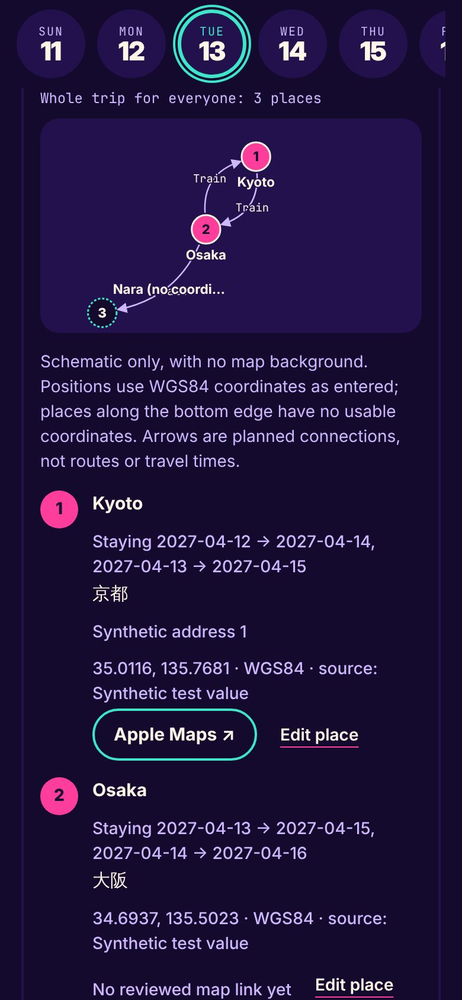
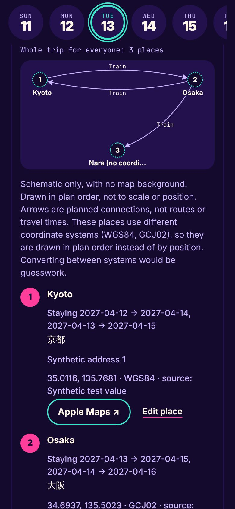

# Maps: schematic trip and day views

Status: November 16, 2026. Built and checked locally with synthetic data; not
deployed. No database migration. This is the maps part of plan milestone 4.
**It makes no claim about China readiness**: no map provider, link or network
was tested from a phone or from mainland China.

## For planners

A **Map** panel sits below the schedule, with two views:

- **This day**: the selected day's activities in itinerary order, grouped into
  numbered stops by place. Activities with no place yet are listed under
  "Location to confirm" instead of being dropped.
- **Whole trip**: the places where the selected travelers stay or travel
  between, with their journeys as arrows in date order.

Both follow the **Travelers** filter and the selected day, exactly like the
board. Under each drawing is the same information as a numbered list, with
local-script names, addresses, coordinates and map links.

The drawings are schematic. There is no map background, nothing is downloaded,
and arrows are planned connections, not routes or travel times. The caption
under each drawing says which kind it is:

- If at least two places have coordinates in the **same known system**, those
  places are drawn by position. Places without usable coordinates sit along the
  bottom with a dashed outline.
- Otherwise places are drawn in plan order, and the caption says why.

### Giving a place a location

**Edit place** (from the map list or *Places, stays & journeys*) has:

- Latitude and longitude in decimal degrees, optional.
- **Coordinate system**, required when coordinates are entered: WGS-84 (GPS and
  most maps outside mainland China), GCJ-02 (Amap, Tencent, Apple Maps in
  mainland China), BD-09 (Baidu), or Unknown.
- Where the coordinates came from.
- A reviewed **Amap** link and a reviewed **Apple Maps** link, pasted from the
  map app's Share button, with a tick box: "I opened these links and they show
  the right place".

## Rules the app follows

- **Coordinates are never converted.** They are stored, shown and exported
  exactly as entered, with their system. The code contains no conversion.
- **Systems are never mixed on one drawing.** If places use different systems,
  the map falls back to plan order and says so. "Unknown" coordinates are kept
  but never used for position.
- **Only reviewed links are offered.** A pasted link appears on the map only
  after the tick box is set, and changing the link clears the tick. Amap links
  must be `https` on `amap.com`; Apple links must be `https://maps.apple.com/`.
- **No link is built from coordinates.** The only generated link is a helper in
  the place form that searches Apple Maps by the place's name and address, and
  it is labelled unreviewed.
- Coordinates, their source and map links are private. The guest view does not
  include them and has no map. The private offline HTML file lists them as text.

## Checks

- `npm test`: 97 pass (10 new in `tests/maps.test.mjs`): filter parity with the
  board, unplaced activities kept visible, single-system positioning, the mixed
  and unknown fallbacks, self-contained escaped SVG, link review rules, guest
  privacy, and old trips unaffected by the new fields.
- `npm run test:api`: coordinates without a system are refused; a link on
  another site is refused; values are stored as entered; none reach guests.
- Headless Chromium at 1440 px and 390 px: both views, the filter, the
  mixed-system fallback, and the place form. No horizontal overflow and no
  network request from the drawing.
- Type check, lint (0 errors) and production build pass.

## Not verified

- The Amap documentation could not be reached from this environment, so the
  accepted Amap link shape (`https://…amap.com/…`) is based on general knowledge
  of its share links, not on a check against current documentation or a real
  link. Paste a real one before relying on it.
- Whether Amap or Apple Maps links open correctly on the travelers' phones, in
  or outside China.
- Legibility with a realistic two-week trip of many places; long names are
  shortened on the drawing and shown in full in the list.

## Screenshots (synthetic data; city-centre coordinates used as test values)

| This day, one family | Whole trip | Mixed systems: plan order | Place location |
| --- | --- | --- | --- |
|  |  |  |  |

Desktop: [whole trip](design/maps/desktop-trip-map-everyone.jpg) ·
[day](design/maps/desktop-day-map-everyone.jpg) ·
[mixed systems](design/maps/desktop-trip-map-mixed-systems.jpg) ·
[place form](design/maps/desktop-place-location-form.jpg).
