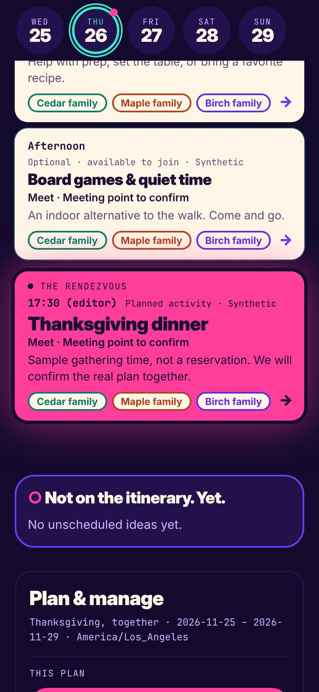
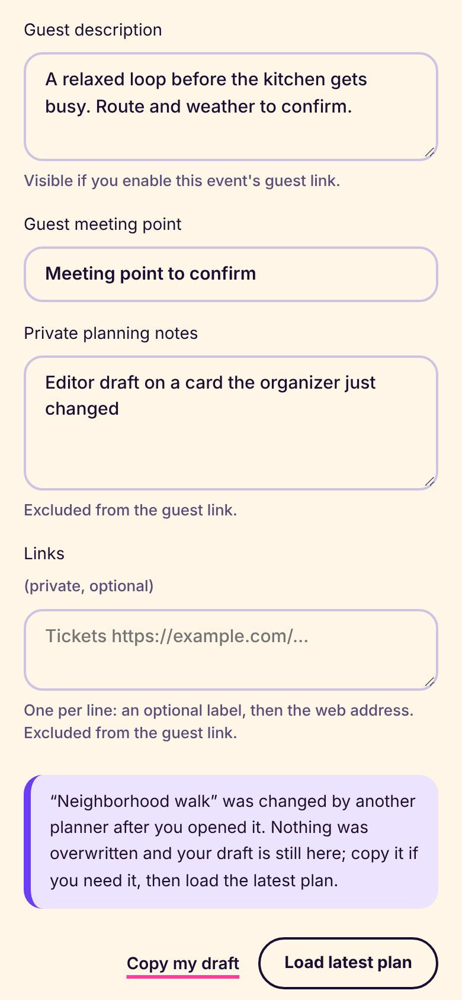

# Per-record revisions: design note

Status: November 16, 2026. Written before the schema change, then updated with
what was built and checked (see the end). Not deployed.

## The problem

A trip had one revision number. Any save by anyone made every other open form
stale, so two people editing two different cards could not both save: the second
got "another planner saved a change" and had to reload and retype. With several
editors during Camp Earnest that would happen often, and for no good reason.

## What changes, in plain language

- Each card (activity), stay, journey, place, traveler and group, plus the trip
  details, has its **own** revision number.
- When you save, the server only asks: *has the record you edited changed since
  you opened it?* Someone else's save to a different card no longer matters.
- If the same record did change, your save is still refused, exactly as before,
  and your draft stays in the form.
- After any save you get the latest whole trip back, so other people's changes
  appear without pressing Refresh.

## Design

**Storage.** The trip stays one JSON document in `planner_trips.document`. A new
column `record_revisions` holds a JSON map from record key to revision, for
example `{"activity:option-5": 3, "trip": 2}`. Keys are `<kind>:<id>` with the
kinds used by the change log (`activity`, `stay`, `journey`, `place`,
`traveler`, `group`), plus `trip` for the trip's own details and `share` for the
guest-link setting.

Splitting the trip into one database row per record was considered and
rejected for now. Validation needs the whole trip anyway (a card must point at
a real place and real travelers), every read would become a join, and it would
be a far larger change to make a week before first real use. The map gives the
behaviour that matters with one added column.

**Migration.** `0003` adds the column with default `'{}'`. A record with no
entry is at revision 1, so every existing trip is valid as it stands and no
document is rewritten.

**Saving.** The client sends `base`: the revisions of the records it is relying
on, as they were when the form opened. The server then:

1. reads the current trip and its revision map;
2. refuses with 409 if any `base` entry differs from the current map, naming
   the record;
3. applies the change to the **current** trip (not the client's older copy) and
   validates the whole result;
4. raises the revision of every record whose content changed;
5. writes document, map and change-log row in one batch, guarded by the
   trip-wide `revision` column, which remains as an internal version counter;
6. if that guard fails because someone else saved between steps 1 and 5,
   starts again from step 1 (a few times). A different-record save then
   succeeds on the retry; a same-record save is refused at step 2.

So stale-write rejection is kept, per record, and two saves can never both
overwrite the same record.

**What counts as a change to a record.**

- Dragging a card renumbers the position of other cards in that day. A change to
  `order` alone does not raise a card's revision, so reordering never
  invalidates someone's open form (the form does not send `order`).
- A deleted record keeps its map entry and its revision is raised, so a record
  restored by undo can never be confused with the earlier one.
- Removing a traveler or group, or deleting a place with reassignment, changes
  other records as a side effect. Those are raised too. The request only needs
  the base revision of the traveler, group or place itself.

**Undo.** Each logged record now carries the revision it was given. Undo is
allowed while the record is still at that revision, which is the rule in
`docs/plan.md`. It restores only the fields that change altered. Cards that a
drag merely renumbered are put back only if their position is unchanged, and
are otherwise left alone rather than blocking the undo. Log rows written before
this change have no revision and fall back to comparing content.

**Older pages.** A planner page loaded before the update sends only the old
trip-wide `revision`. The server still accepts that and applies the old strict
rule to it, so an out-of-date page can never write over newer work.

**Guest link and trip delete.** The guest link has its own `share` revision, so
editing a card no longer blocks enabling a link. Deleting a trip relies on the
`trip` record.

## Limits, stated plainly

- Two people editing the **same** card still conflict; the second must reload.
  Fields are not merged.
- A form saves all of its fields, so within one record the last accepted save
  wins.
- Rules that span records are checked against the latest trip at save time. For
  example, if a place is deleted while you assign it to a card, your save is
  refused with "Choose a place from this trip".

## What was built and checked

Built as designed: `public/revisions.mjs` (rules), `staleCheck()` and
`transact()` in `lib/trip-store.ts` (check and retry), migration
`0003_record_revisions.sql`, and the planner sends `base` with every save.

- `npm test`: 79 pass (10 new in `tests/revisions.test.mjs`).
- `npm run test:api`: eight simultaneous saves to eight different cards all
  succeed with none lost and one History row each; two simultaneous saves to
  one card give exactly one success and one 409 naming the card; a request with
  only the old trip-wide revision is 409 when stale and 400 with none; a drag
  leaves neighbours' revisions alone; the guest link and trip delete use their
  own records.
- `npm run test:access`: organizer and editor accounts save different cards at
  the same moment; the same card has one winner; a non-member is refused.
- Headless Chromium, two signed-in browsers, at 1440 px and 390 px: both save
  different cards and the second sees the first's change without refreshing; a
  save to a card the other just changed shows the conflict with the draft kept.
- Type check, lint (0 errors) and production build pass.

Not verified: the migration on the hosted database, two real accounts on the
hosted Site, and behaviour under real network delay (the local database
answers in milliseconds, so the retry path is exercised but not stressed).

| Different cards: both saved | Same card: refused, draft kept |
| --- | --- |
|  |  |

Desktop: [both saved](design/record-revisions/desktop-both-saved.jpg) ·
[conflict](design/record-revisions/desktop-same-card-conflict.jpg).
