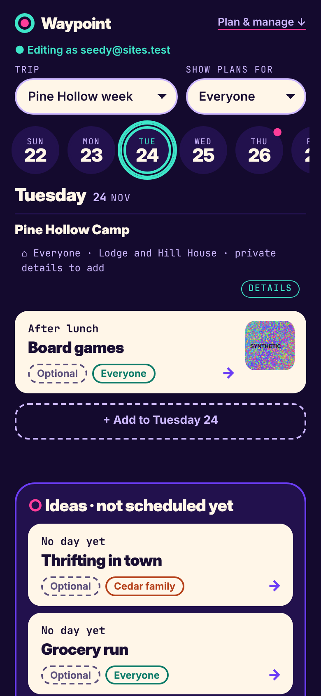
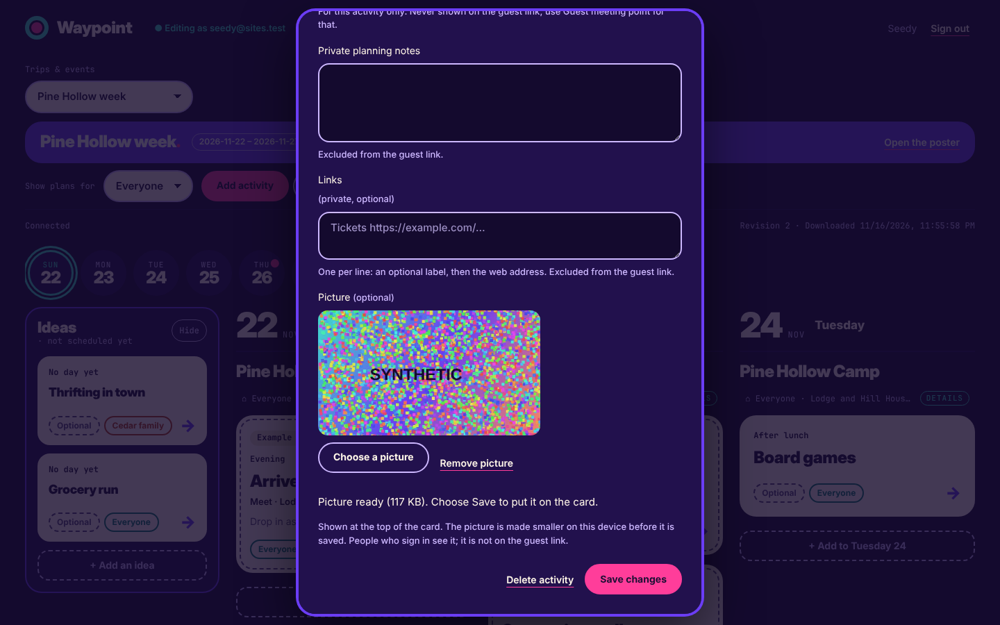
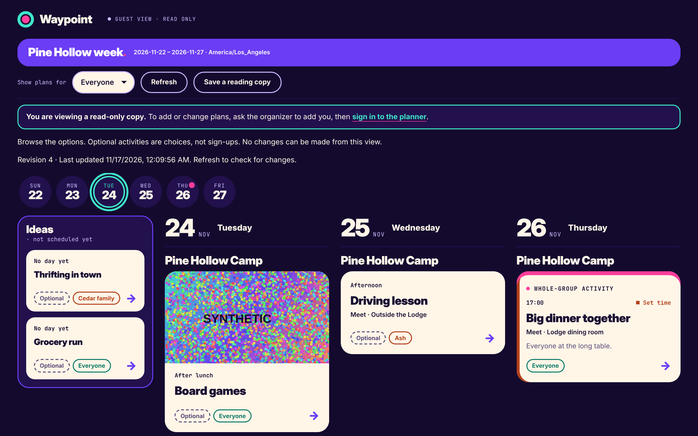

# Pictures on cards

Status: November 17, 2026. Built and checked locally with synthetic data; not
deployed. **Adds a database table (migration `0004_card_pictures.sql`).** No
existing table or stored trip is changed. From the
[feedback plan](feedback-2026-11-15-plan.md), where it was deferred as "a later
design decision, minimized on phones".

The organizer asked for pictures without specifying how. These are the choices
made here; each is easy to revisit:

| Choice | What was built | Why |
| --- | --- | --- |
| Where a picture comes from | Chosen from the device (camera roll or files) | A link to a photo elsewhere would load from another site, and protected galleries would not load at all |
| Size | Shrunk in the browser to at most 800 px on the long side before it is sent, typically 30 to 120 KB | Phone photos are several megabytes; cards do not need that |
| Who sees it | People who sign in, **and guests through the guest link** | Decided by the organizer on November 17. The first build kept pictures off the guest link; that was changed the same day |
| Phones | A 60 px thumbnail at the right of the card | "Minimized on phones" |
| Compact views | Since the laptop update below: a short band across the top of the card in the week view and in the Ideas column beside the days. No pictures on a sideways phone | A band keeps the title at the card's full width; a sideways phone has too little height |

## For planners

In an activity's form, under **More details**, **Choose a picture**. The
picture is shrunk and saved at once and a preview appears; choose **Save** to
put it on the card. **Remove picture** takes it off (again, then Save).

On a laptop the picture fills the top of the card: full height (16:9) with larger cards, a shorter band (2:1) in the week view and the Ideas column. Adding,
changing or removing a picture is in History as "Picture" and can be undone.

## Pictures in the laptop week view and the Ideas column

Status: November 17, 2026. Built and checked locally with synthetic data and
made-up pictures; not deployed. No data, API or schema change.

A trip longer than four days opens in the week view on a laptop, and that view
and the Ideas column left pictures out, so on most real trips a laptop showed
none. Now:

| Where | What shows |
| --- | --- |
| Week view, 1000 px and wider | A 2:1 band across the top of the card, edge to edge (about 172 to 192 px wide, 86 to 96 px tall) |
| Ideas column beside the days | The same 2:1 band, in both the week view and with larger cards |
| Larger cards, tablet upright | Unchanged: the 16:9 picture across the top |
| Phone held sideways (window under 520 px tall) | No picture, as before: the height goes to the schedule |
| Phone upright | Unchanged: the 60 px thumbnail at the right |

A band on top was chosen over a thumbnail at the side because week-view cards
are 172 to 192 px wide: a side thumbnail would take a third of the title's
width, while a band leaves the title, time and names exactly as wide as on a
card with no picture.

- The same `` from `card()` in `board.mjs` and the same
  `/api/image` address are used everywhere. Only `planner.css` changed.
- The shape is fixed (`aspect-ratio` with `object-fit: cover`), so a card is
  the same size before and after its picture arrives. Pictures are lazy-loaded
  and have empty `alt` text: they are decoration, the title names the activity.
- A card with no picture has no image element and no empty box. A picture that
  fails to load is removed by the existing handler in `planner.js`, which
  leaves the same plain card.
- The picture does not take the pointer (`pointer-events: none`), so pressing
  on it is pressing on the card: a click opens the activity, a drag moves the
  card, and the browser never starts dragging the image itself. The card's
  click and drag code is unchanged.
- Pictures are stored once, at up to 800 px, and the picture route has no size
  option, so the band loads the same file as the phone thumbnail (typically 30
  to 120 KB). A smaller rendition would need a route or storage change.
- The offline shell cache is `waypoint-shell-v41`.

Checks: `tests/card-thumbnails.test.mjs` (the layout tests run the real
stylesheet in a browser and are skipped where Playwright is not installed) and
`scripts/check-card-pictures-browser.cjs` against the local dev server at 1440,
1280, 1000, 800 and 844×390 px and on an emulated phone. Before and after
pictures are in `docs/design/card-thumbnails/`.

## Limits and things to know

- JPEG, PNG and WebP only. A file that is not really a picture is refused.
- At most 200 pictures per trip. A picture that is replaced or removed stays
  stored (so Undo can bring it back) and still counts toward the 200.
- Pictures are **not** in the offline file, the JSON download or the full
  backup, and they do not show when the phone is offline. The card simply has
  no picture then.
- A signed-in person can fetch a picture only if they can open that trip and
  the picture belongs to it. A signed-in person who is not on the trip gets
  "unavailable"; someone not signed in gets "sign in".

## Pictures on the guest link

Anyone holding the guest link sees the picture on any card they can see,
including ideas. So **a picture put on a card is shared with guests as soon as
the activity is saved**, by an editor as well as by the organizer, and guests
can save or forward it like anything else on the link. The form says so next
to the button. Choose pictures with that in mind, particularly photos of
children.

What keeps this narrow:

- A guest can fetch a picture only while a card they can see is showing it.
  Take the picture off the card, delete the activity, or mark nothing else: the
  picture stops being available to guests at once. Pictures on items marked as
  examples, which guests do not see, are not available either.
- Disabling or replacing the guest link ends access to pictures as it does to
  the schedule. Pictures are not stored by the guest's browser between visits.
  A copy someone already saved cannot be recalled.
- The guest token is sent in a header, as for the schedule, never in an
  address, and no cookies are sent.
- The reading copy a guest can save from the link has no pictures.
- The Guest link dialog's wording and its "Preview exactly what guests will
  see" include pictures.

## How it works

- New table `planner_images` (id, trip, type, the image as base64 text, size,
  when, who). A row is written once and never changed.
- New route `/api/image`: `POST` to add one (trip members only, same-origin
  only), `GET` to fetch one. Both use the same trip access check as every other
  private route.
- An activity has a new optional field `imageId`. That field is saved through
  the normal logged, per-record-checked path. The picture row itself is not part
  of the trip document and is not in the change log; only the pointer is.
- The guest view's fixed list of fields now includes `imageId`. The guest page
  fetches pictures from a separate route, `/api/shared-image`, which accepts
  only a valid guest token and only a picture that the guest view of that trip
  currently shows. The guest page never calls `/api/image`.
- The guest page's content policy now allows images created in the page
  (`img-src 'self' blob:`), which is how a picture fetched with a header is
  displayed. Scripts, styles and connections are still same-origin only.
- The offline shell cache is `waypoint-shell-v40` in the combined release.

## Checks

- `npm test`: 151 pass (4 new in `tests/pictures.test.mjs`): which files are
  accepted, the activity field, what guests and the offline file get, and the
  route's access rules.
- Headless Chromium against the local server with the migration applied: a
  synthetic 3000 × 2000 picture of 3.1 MB was shrunk to 800 × 533 and 117 KB,
  saved, and shown on the card; hidden in the week view; a 60 px thumbnail on a
  390 px phone with the title clear of it; a text file and an SVG refused; a
  PNG label on non-PNG bytes refused; another trip's id refused (403), a
  non-member refused (403), signed out refused (401); History shows "Picture: —
  → A picture".
- Guest link, same setup: the picture shows on the guest card at 1440 px and
  as a thumbnail at 390 px; the only picture request carries the token in a
  header, no cookie, and no token in any address; the Guest link preview shows
  it. With the guest token: the shown picture is returned; a picture on an
  example item, an unknown id, no token and a wrong token all get "not found";
  the signed-in route refuses the token; after the picture is taken off the
  card the guest gets "not found".

Not verified: a real phone's camera roll (HEIC photos depend on the phone's
browser converting them, which iPhones do when a photo is chosen from the
library), the migration on the hosted database, and how 200 pictures affect
the hosted storage allowance.

## Screenshots (synthetic data)

The guest link:

