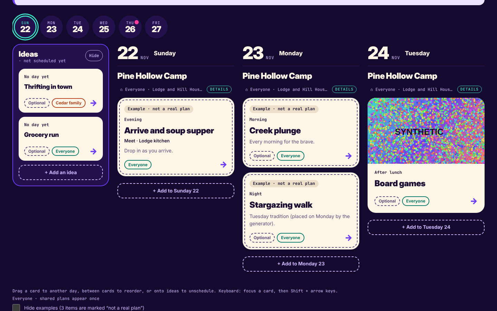

# Pictures on cards

Status: November 17, 2026. Built and checked locally with synthetic data; not
deployed. **Adds a database table (migration `0004_card_pictures.sql`).** No
existing table or stored trip is changed. From the
[feedback plan](feedback-2026-11-15-plan.md), where it was deferred as "a later
design decision, minimized on phones".

The organizer asked for pictures without specifying how. These are the choices
made here; each is easy to revisit:

| Choice | What was built | Why |
| --- | --- | --- |
| Where a picture comes from | Chosen from the device (camera roll or files) | A link to a photo elsewhere would load from another site, and protected galleries would not load at all |
| Size | Shrunk in the browser to at most 800 px on the long side before it is sent, typically 30 to 120 KB | Phone photos are several megabytes; cards do not need that |
| Who sees it | People who sign in. **Not on the guest link** | A forwarded link should not carry family photos by default |
| Phones | A 60 px thumbnail at the right of the card | "Minimized on phones" |
| Compact views | No pictures in the week view, on a sideways phone, or in the Ideas column beside the days | Those cards show titles only |

## For planners

In an activity's form, under **More details**, **Choose a picture**. The
picture is shrunk and saved at once and a preview appears; choose **Save** to
put it on the card. **Remove picture** takes it off (again, then Save).

On a laptop with larger cards the picture fills the top of the card. Adding,
changing or removing a picture is in History as "Picture" and can be undone.

## Limits and things to know

- JPEG, PNG and WebP only. A file that is not really a picture is refused.
- At most 200 pictures per trip. A picture that is replaced or removed stays
  stored (so Undo can bring it back) and still counts toward the 200.
- Pictures are **not** in the offline file, the JSON download or the full
  backup, and they do not show when the phone is offline. The card simply has
  no picture then.
- A picture is fetched only by a signed-in person who can open that trip, and
  only if it belongs to that trip. A signed-in person who is not on the trip
  gets "unavailable"; someone not signed in gets "sign in".

## How it works

- New table `planner_images` (id, trip, type, the image as base64 text, size,
  when, who). A row is written once and never changed.
- New route `/api/image`: `POST` to add one (trip members only, same-origin
  only), `GET` to fetch one. Both use the same trip access check as every other
  private route.
- An activity has a new optional field `imageId`. That field is saved through
  the normal logged, per-record-checked path. The picture row itself is not part
  of the trip document and is not in the change log; only the pointer is.
- The guest view is still built from a fixed list of fields that does not
  include `imageId`, and the guest page never requests `/api/image`.
- The offline shell cache is `waypoint-shell-v38`.

## Checks

- `npm test`: 151 pass (4 new in `tests/pictures.test.mjs`): which files are
  accepted, the activity field, what guests and the offline file get, and the
  route's access rules.
- Headless Chromium against the local server with the migration applied: a
  synthetic 3000 × 2000 picture of 3.1 MB was shrunk to 800 × 533 and 117 KB,
  saved, and shown on the card; hidden in the week view; a 60 px thumbnail on a
  390 px phone with the title clear of it; a text file and an SVG refused; a
  PNG label on non-PNG bytes refused; another trip's id refused (403), a
  non-member refused (403), signed out refused (401); the guest page shows no
  picture and its data contains no picture id; History shows "Picture: — → A
  picture".

Not verified: a real phone's camera roll (HEIC photos depend on the phone's
browser converting them, which iPhones do when a photo is chosen from the
library), the migration on the hosted database, and how 200 pictures affect
the hosted storage allowance.

## Screenshots (synthetic data)

