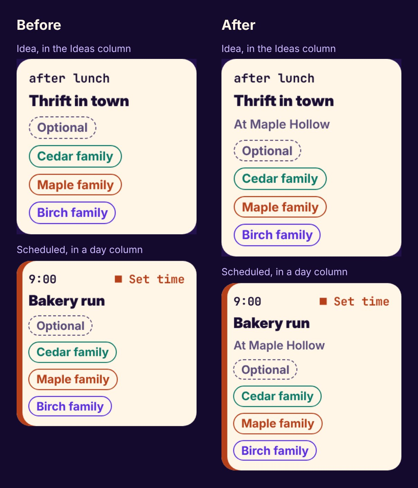

# Two-level places: areas and venues

Status: November 17, 2026. Built and checked locally with synthetic data; not
deployed. Adds one optional field to a place. No database migration; no stored
trip is rewritten. From the [feedback plan](feedback-2026-11-15-plan.md)
(item P2); the organizer confirmed one level of nesting is enough.

## For planners

A place can now sit **inside** another place:

- an **area** is a city or a camp;
- a **venue** is somewhere inside it: a museum in a city, a lodge at a camp.

In **Edit place** (and in "Add new place" inside the activity form) there is an
**Inside** choice. Leave it empty for an area; pick an area to make a venue.
When you add a new place from an activity, Inside starts on the area of the
place that was selected, which is usually what you want.

What changes on screen:

- The board still has one section per area for each day. A plan at a venue sits
  in its area's section and its card says **At (venue)**.
  A plan placed at the area itself says **At (area)** (since November 17; before
  that it had no line, which left such an idea in the Ideas column with no
  location at all). A plan with no place has no line.
  
- Place lists show venues under their area, written "Area › Venue".
- Ideas are grouped by area.
- The guest link shows the same grouping and venue names (names only, as
  before; never addresses or coordinates).

The meeting point is still a separate free-text line on the activity ("Meet ·
outside the main door").

## Rules

- One level only: a venue cannot contain venues, and an area that has venues
  cannot be put inside another area until they are moved out.
- Deleting an area that has venues is never silent. As with plans that use a
  place, you choose where they go: into another area, or "no place", in which
  case each venue becomes an area of its own. Plans at those venues are not
  touched. The deletion can be undone from History.

## Data

New optional place field `parentId`. Every existing place has none and is an
area, so nothing changes for existing trips until a venue is made. A stay or a
journey can point at an area or a venue. Maps are unchanged: each place is
drawn from its own coordinates. The offline shell cache is
`waypoint-shell-v36`.

## Checks

`npm test`: 143 pass (4 new in `tests/place-levels.test.mjs`): the nesting
rules, board grouping and card text, the guest view, deleting an area three
ways with undo, and the forms. Browser checks are recorded with the combined
release in [release-nov17.md](release-nov17.md).
