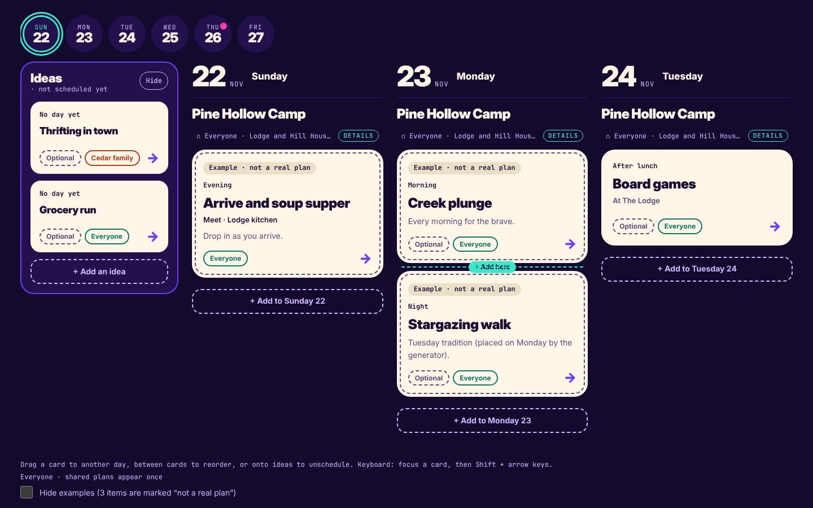
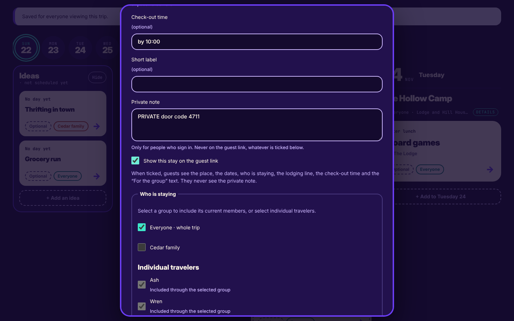
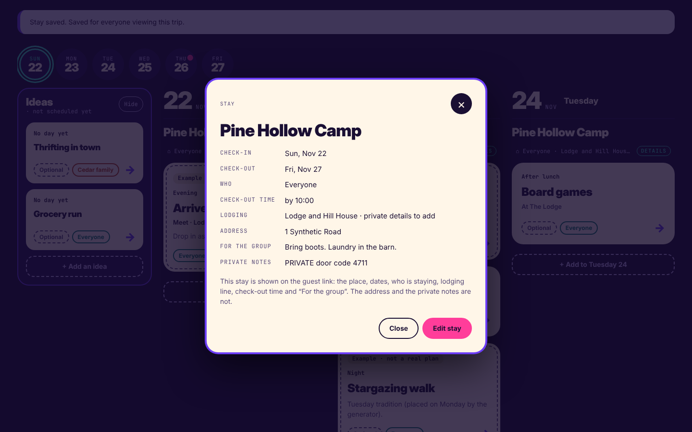
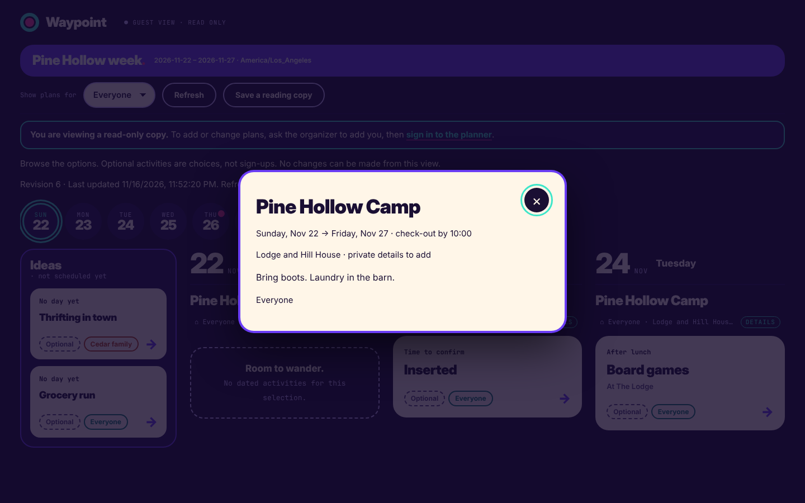

# Five additions, November 17, 2026

Built together after the organizer asked for them; not deployed. Each has its
own note:

| Addition | Note | Stored data |
| --- | --- | --- |
| Stay information for the group, with an organizer-only choice to show a stay to guests | [stay-info.md](stay-info.md) | Three optional stay fields |
| Two-level places: an area with venues inside it | [place-levels.md](place-levels.md) | One optional place field |
| Add an activity between two cards (laptop) | [insert-and-swipe.md](insert-and-swipe.md) | None |
| Flick between days (upright phone) | [insert-and-swipe.md](insert-and-swipe.md) | None |
| Pictures on cards | [pictures.md](pictures.md) | **New table**, migration `0004_card_pictures.sql`; one optional activity field |

## Deploying

- This is the first release since November 15 with a database migration. It
  only creates a new table; nothing existing is altered, and the previous
  version runs unchanged against the new schema, so the migration can be
  applied first and a rollback of the app needs no database rollback.
- No stored trip is rewritten. New fields are optional and read as empty.
- The offline shell cache is `waypoint-shell-v39`.
- **The guest link changes in two ways.** A stay appears only if the organizer
  ticks "Show this stay on the guest link" in it. **A picture on a card that
  guests can see is shown to guests as soon as it is saved** (the organizer's
  decision of November 17). Venue names appear on guest cards once venues
  exist. Private stay notes and addresses never reach guests.

## Combined checks

- `npm test`: 151 pass (16 new across five files). Type check, lint (0 errors)
  and the production build pass.
- `npm run test:api`, `npm run test:access` and
  `scripts/check-drag-browser.cjs` pass against a local database with all five
  migrations applied.
- The even-columns measurement from [even-columns.md](even-columns.md) was
  repeated after these changes at all twelve sizes: still all aligned and no
  column cut off.
- Headless Chromium against the local server:
  - **Stay information.** Filling in "For the group", a check-out time and a
    private note, and ticking the guest-link box; the details view shows all of
    it with a line saying the stay is shared; the guest page then shows the
    stay line on each night and the check-out day, opens place, dates,
    check-out time, lodging line and group text, and contains neither the
    private note nor the address.
  - **Places.** A venue added inside the camp; a card moved to it stays in the
    camp's section and reads "At The Lodge"; the place list reads "Area ›
    Venue"; a new place started from that activity defaults to inside the camp.
  - **Add here.** Covered in [insert-and-swipe.md](insert-and-swipe.md).
  - **Flick.** Covered in [insert-and-swipe.md](insert-and-swipe.md).
  - **Pictures.** Covered in [pictures.md](pictures.md).

Not verified for any of the five: the hosted Site, real trip data, a physical
phone, and a second real account.

## Screenshots (synthetic data)

Add here, between two cards:

A stay's form and its details view, and the same stay as a guest sees it:

