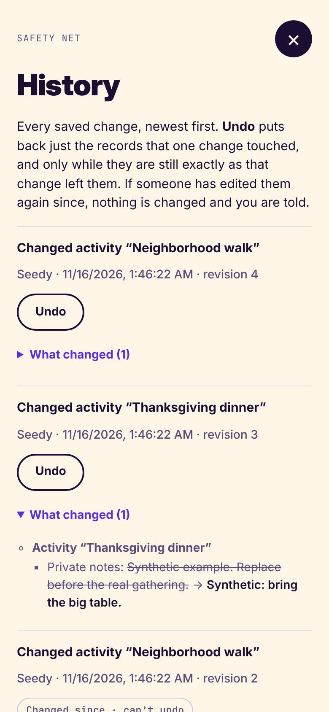
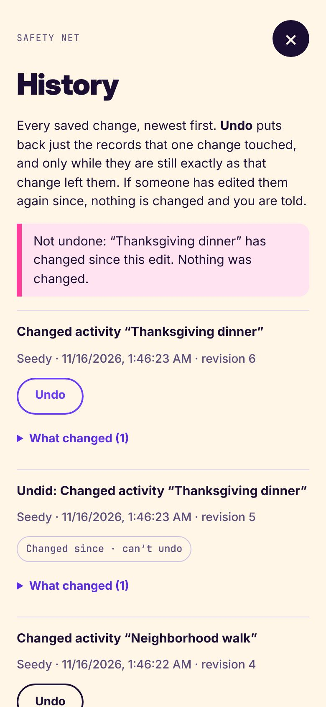
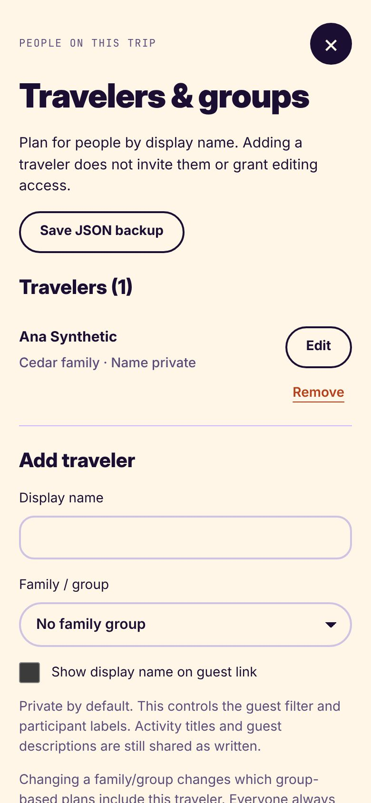
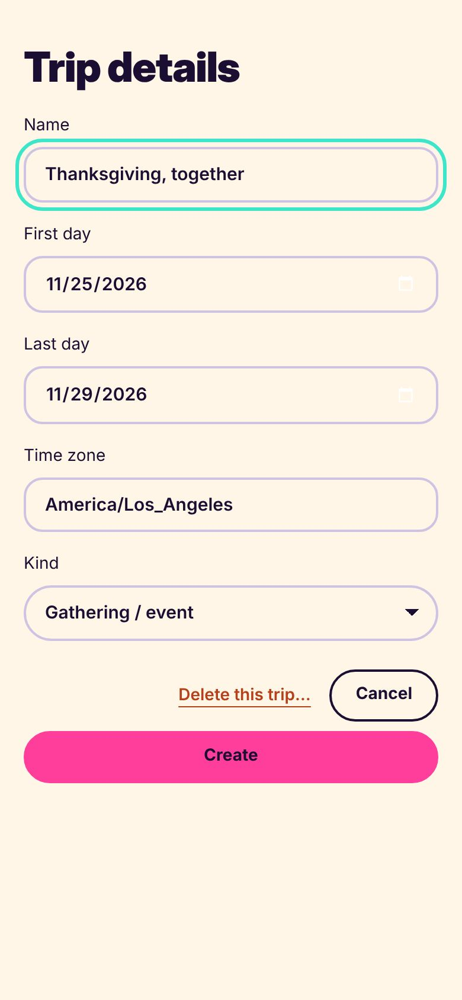
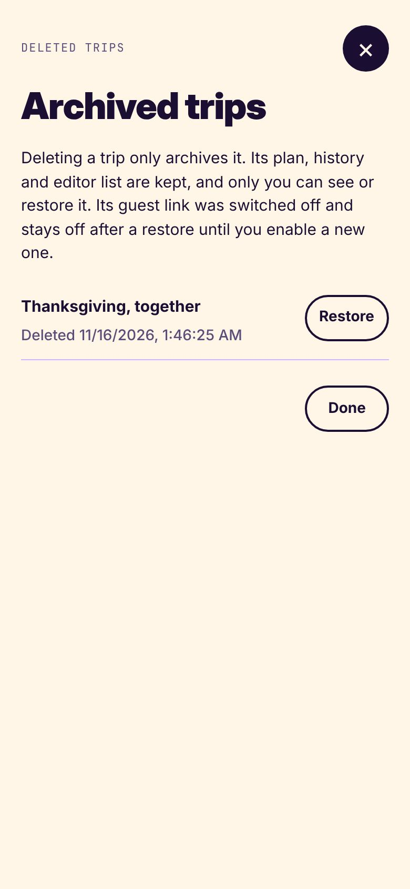

# Safety net: history, undo, remove, delete and backup

Status: November 16, 2026. Built and checked locally with synthetic data; not
deployed. Deploying needs migration `0002_change_log_and_archive.sql`, which only
adds a table and two columns. Existing trips are not rewritten.

## For the organizer, in plain language

- **History** (toolbar; on a phone under **Plan & manage**) lists every saved
  change, newest first: who, when, and what changed, with the before and after.
  History starts with the first change saved after this is deployed. Earlier
  edits were never recorded and cannot be shown.
- **Undo** puts back the records that one change touched, and only if they are
  still exactly as that change left them. If anyone has edited one of them
  again, nothing is changed and you see *"Not undone: … has changed since this
  edit."* Undo the newer change first, or fix the card by hand. An undo is
  itself an entry and can be undone.
- **Remove** a traveler or group from **Manage travelers**. If plans, stays or
  journeys still list them, you are told how many and asked before they are
  taken off those plans. The plans themselves are never deleted. The whole-trip
  group cannot be removed. Removal can be undone from History.
- **Delete this trip…** is in **Trip details**, for the organizer only. It
  archives the trip: it disappears for you and every editor and its guest link
  stops working, but nothing is erased. **Archived trips** (shown once you have
  one) restores it with its plan, history and editors. The old guest link stays
  dead; enable a new one if you want one.
- Since November 17 each activity says who last edited it and links straight to
  that entry here; see [last-edited.md](last-edited.md).
- **Download full backup** (in History, organizer only) saves one file with the
  whole trip and its history. **Import JSON** accepts that file, checks it for
  damage, and restores it as a separate new trip.

Editors can read History, undo ordinary edits and remove travelers and groups.
They cannot delete or restore a trip, download the full backup, or use undo to
change which traveler names guests see.

## How it works

- `planner_changes` is append-only: trip id, the revision the change produced,
  actor id and display name (never an email), timestamp, action, a one-line
  summary, and a JSON list of `{ kind, id, before, after }` for each changed
  record. Nothing updates or deletes its rows.
- Every write goes through `commit()` in `lib/trip-store.ts`: one D1 batch (a
  single transaction) that inserts the log row and updates the trip, both
  guarded by the same expected revision. A stale save writes neither. A unique
  index on `(trip_id, revision)` allows one log row per revision.
- The before/after records come from comparing the trip before and after the
  change (`diffTrips` in `public/history.mjs`), so every kind of edit is logged
  the same way, including the cards a drag renumbers.
- `POST /api/history` undoes one change. It compares each logged record's
  `after` with the current record; any difference is a 409 with the names of
  what changed. The restored trip is validated like any other save.
- Guest-link changes, archive and restore are logged as entries without
  records. The log never contains a guest token, its hash, or an email.
- Archive sets `archived_at` and clears the guest-link hash. Archived trips are
  refused for reads and writes and absent from editors' lists.

Since [per-record revisions](per-record-revisions.md), saves to different cards
no longer conflict, and undo compares each record's revision instead of its
whole content.

## Checks

- `npm test`: 61 pass (17 new in `tests/safety-net.test.mjs` and
  `tests/backup.test.mjs`).
- `npm run test:api` and `npm run test:access` against the local dev server:
  competing saves leave exactly one log row; undo succeeds after an unrelated
  edit and is refused after an edit to the same card, writing nothing; an undo
  through another trip's id is 404; anonymous and non-member requests are
  refused; group removal needs acknowledgement; archive ends the guest link and
  closes the trip to editors; restore brings back the plan and editors; a full
  backup restores record for record into a separate trip and a tampered file is
  refused.
- Type check, lint (0 errors) and production build pass.
- Headless Chromium at 1440 px and 390 px: History, undo, the conflict message,
  traveler removal with its warning, delete and restore.

Not verified: the hosted Site (nothing was deployed), the migration against the
production database, physical phones, and a second real account.

## Screenshots (synthetic data)

| History | Undo refused | Remove a traveler |
| --- | --- | --- |
|  |  |  |

| Delete in Trip details | Archived trips |
| --- | --- |
|  |  |

Desktop: [History](design/safety-net/desktop-history.jpg) ·
[undo refused](design/safety-net/desktop-history-conflict.jpg) ·
[remove a traveler](design/safety-net/desktop-roster-remove.jpg) ·
[delete](design/safety-net/desktop-trip-details-delete.jpg) ·
[archived trips](design/safety-net/desktop-archived.jpg).
