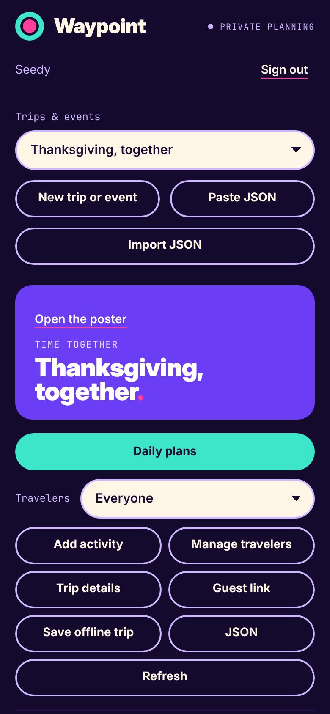
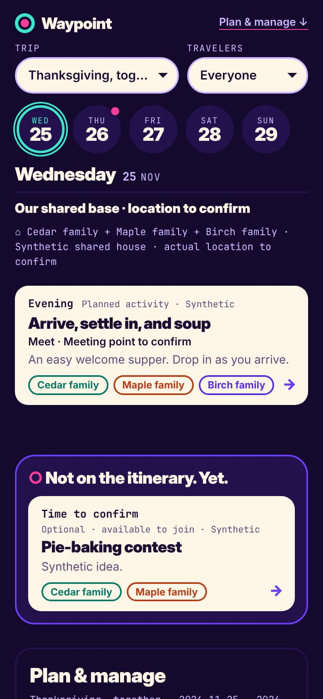
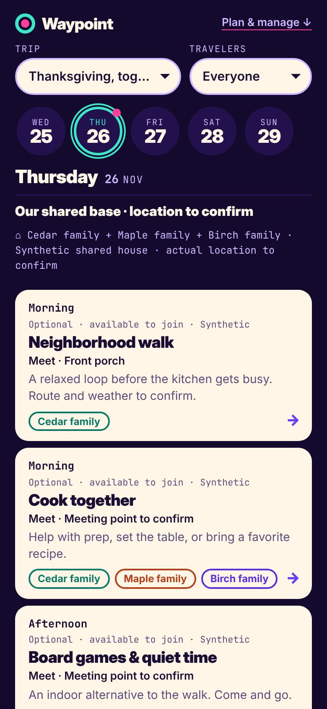
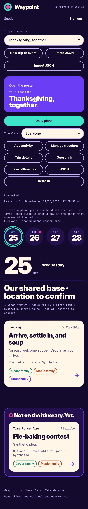
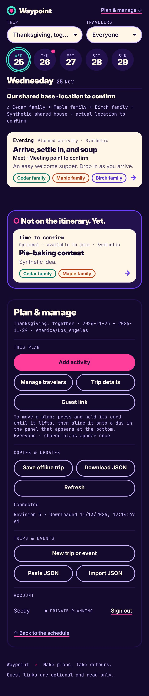
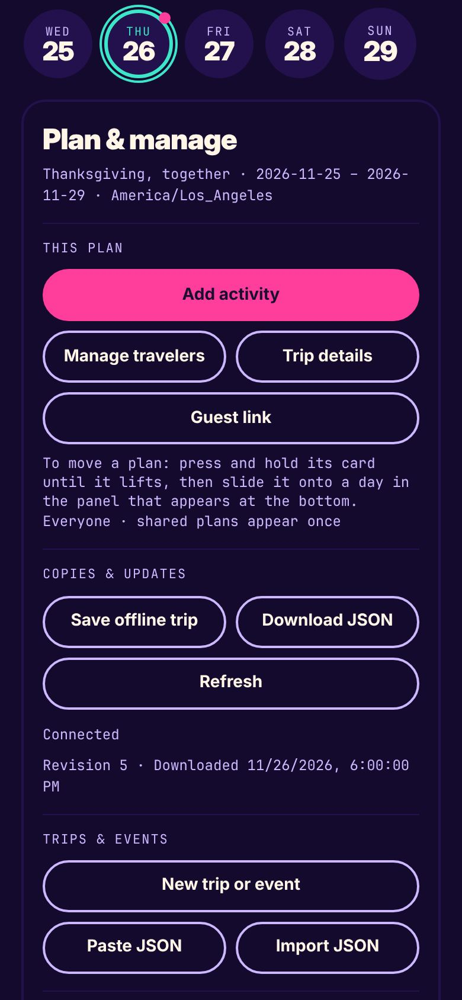
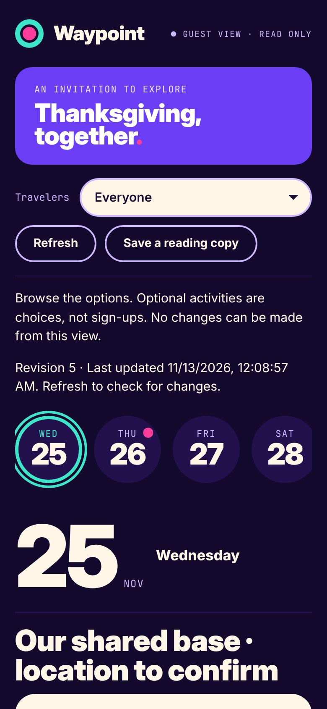
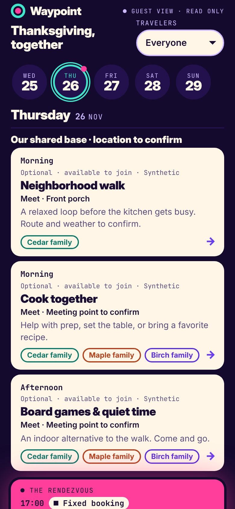
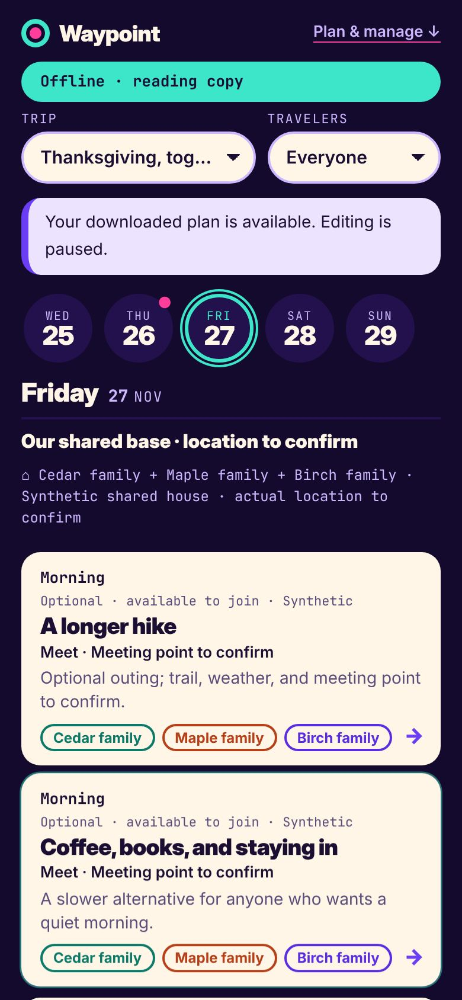

# Schedule-first phone layout

Status: November 13, 2026. Built and checked locally with synthetic data; not yet
deployed to the Site.

Most phone visits are to check what is happening, so on a phone (760 px wide or
less) the signed-in planner and the guest link now lead with the schedule.

## What a phone shows, top to bottom

1. A slim bar: the Waypoint mark and a small **Plan & manage ↓** link.
2. One row with the **Trip** switcher and the **Travelers** filter.
3. The day medallions. They stay pinned to the top while you scroll the day, and
   the selected day is scrolled into view on long trips.
4. The selected day's activities.
5. **Not on the itinerary. Yet.** (unscheduled ideas).
6. **Plan & manage**, grouped as:
   - *This plan*: Add activity, Manage travelers, Trip details, Guest link
     (organizer only), and the how-to-move hint.
   - *Copies & updates*: Save offline trip, Download JSON, Refresh, and the
     connection / revision / downloaded status.
   - *Trips & events* (organizers): New trip or event, Paste JSON, Import JSON.
   - *Account*: who is signed in, and Sign out.

On the synthetic Thanksgiving example at 390 × 844 the first activity card starts
345 px from the top; before this change it started 1,415 px down.

The guest link uses the same order: title and Travelers filter, days, activities,
then **About this schedule** with Refresh and Save a reading copy.

## Details

- **Which day opens.** Each visit opens on today's date while the trip is under
  way (in the trip's own time zone), otherwise on the first day. A day you pick
  is kept while the page stays open. Previously the planner reopened on whichever
  day was last viewed on that device. This also applies on desktop.
- **Denser cards.** Time of day, title, meeting point, two lines of description,
  and the participant labels fit in roughly a third of the previous height. The
  "Flexible" label is dropped on the phone; **Fixed booking** stays, in words.
  The meeting point comes from the activity's *Guest meeting point* field and is
  shown as "Meet · …" on phone cards only.
- **Offline or signed out.** A lagoon strip at the very top says "Offline ·
  reading copy" or "Sign-in expired · reading only"; the full status stays in
  Plan & manage.
- **After saving from the editor** on a phone, the page switches to that
  activity's day and scrolls to its card, since the editor is now opened from
  below the schedule.
- **Drag.** Press-and-hold still lifts a card and opens the **Drop on a day**
  panel. The pinned day rail un-pins during a drag so it cannot cover a drop
  position.
- **Desktop** keeps its existing board, toolbar, and poster. The page is drawn in
  the phone or desktop arrangement according to width, and redraws if the window
  crosses 760 px (after any open dialog is closed).
- Styling uses the existing Night Market tokens in `public/planner.css`; no new
  colours or type were introduced. The offline shell cache is `waypoint-shell-v15`.

## Verification

- `npm test`: 36 pass (4 new in `tests/schedule-first.test.mjs`). Type check,
  lint (0 errors), and production build pass. `npm run test:api` passes locally.
- Headless Chromium at 390 × 844 with touch, and 320 × 640: order of sections, no
  horizontal overflow, all buttons and selects at least 44 px tall, the jump
  link, the pinned day rail, today-by-default with a simulated date inside the
  trip, add-activity landing on the new card, the offline strip with disabled
  editing, and the guest link (no write controls).
- `scripts/check-drag-browser.cjs` passes unchanged: desktop drag, keyboard,
  fixed booking, 409 conflict, guest (no drag), and phone long-press drag between
  days.
- Desktop at 1440 × 900 is pixel-for-pixel the same arrangement as before.

Not verified: a physical phone (iOS Safari's toolbar and the pinned day rail in
particular), the hosted Site, and a real trip's data.

## Screenshots (synthetic data)

| Before | After | After, a busy day |
| --- | --- | --- |
|  |  |  |

| Before, whole page | After, whole page | Plan & manage |
| --- | --- | --- |
|  |  |  |

| Guest before | Guest after | Offline |
| --- | --- | --- |
|  |  |  |

Desktop, unchanged: [before](design/schedule-first/desktop-before.jpg) ·
[after](design/schedule-first/desktop-after.jpg).
