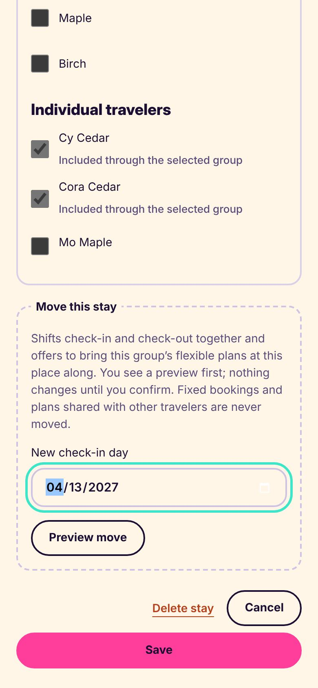
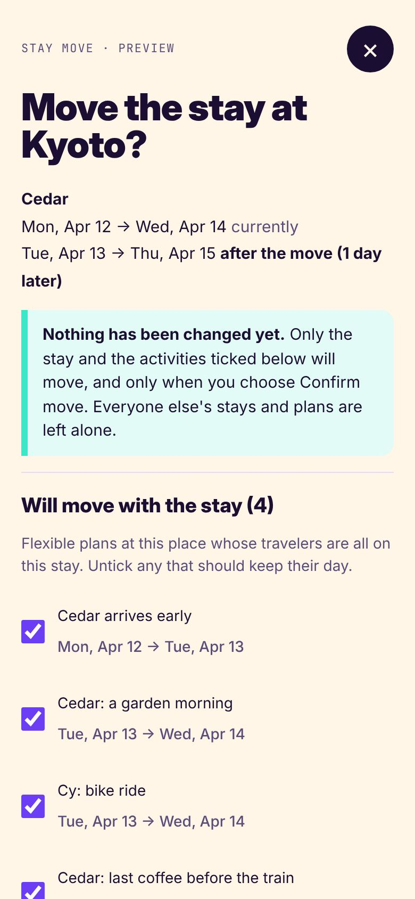
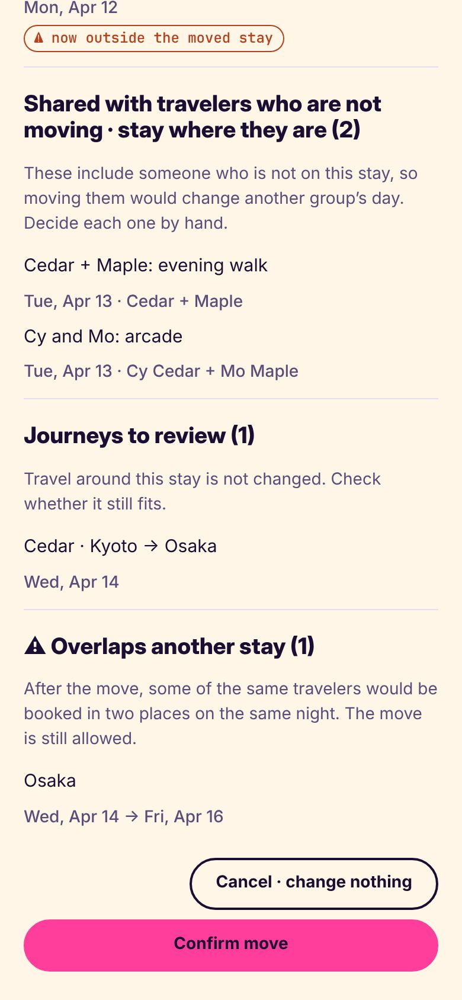
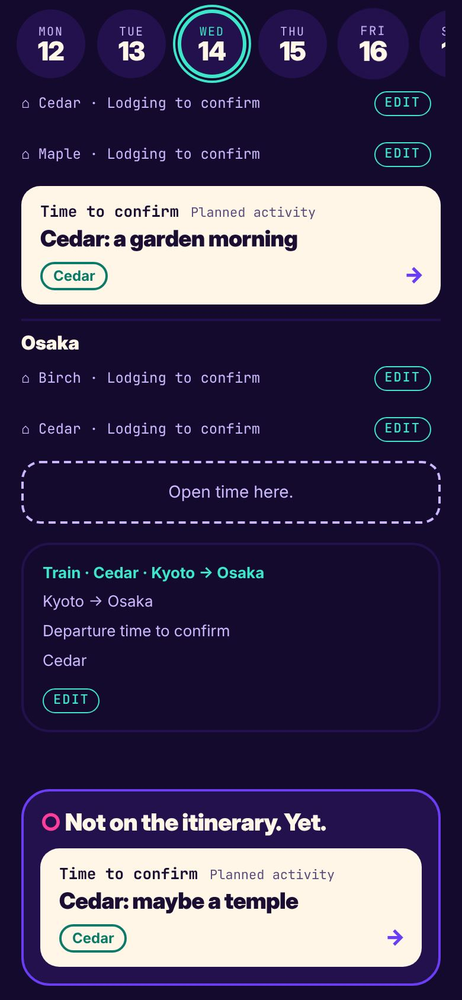

# Moving a stay, with a preview

Status: November 16, 2026. Built and checked locally with synthetic data; not
deployed. No database migration. This is plan milestone 3's stay-move preview,
ported from the read-only study (`public/parallel-preview.mjs`) into the planner.

## For planners

Open a stay (the ⌂ line on the board, or **Places, stays & journeys**). Under
**Move this stay**, pick the new check-in day and choose **Preview move**.
Check-out moves by the same number of days.

The preview changes nothing. It shows:

- **Will move with the stay**: flexible plans at that place, within the stay's
  dates (check-out day included), whose travelers are all on this stay. Each has
  a tick box; untick any that should keep its day.
- **■ Fixed bookings · stay where they are**: never moved, even when they belong
  only to the moving group. One left outside the new dates is flagged.
- **Shared with travelers who are not moving · stay where they are**: for
  example a dinner with another family. Moving it would change someone else's
  day, so it is left for you to decide by hand.
- **Cannot move**: would land outside the trip's dates.
- **Journeys to review**: this group's travel around the stay. Not changed.
- **⚠ Overlaps another stay**: the new nights collide with another stay for
  some of the same travelers. Allowed, but shown.

Travel bridges on the board ([travel-bridge.md](travel-bridge.md)) are read
from the stays, so after a move they appear, shift or disappear to match.

**Confirm move** applies the stay's new dates and only the ticked activities.
**Cancel · change nothing** goes back. The whole move is one History entry and
one Undo.

A stay for one named traveler does not move plans made for their whole family;
those count as shared. Other groups' stays, and all journeys, are never changed.

## How it works

- `previewStayMove(trip, stayId, days)` in `public/stay-move.mjs` is pure and
  returns the groups above. The page calls it locally; previewing sends nothing
  to the server.
- Confirming sends `stay-move` with the stay, the number of days, the ticked
  activity ids, and the revisions of the stay and of each ticked activity.
- The server re-runs the same preview on the latest trip and refuses the whole
  move if any ticked activity is no longer in "will move" (it became a fixed
  booking, gained a non-moving traveler, or was deleted). The revision check
  also refuses it if any of those records changed since the preview.

## Checks

- `npm test`: 87 pass (8 new in `tests/stay-move.test.mjs`, using the synthetic
  parallel-stay fixture in `tests/fixtures/parallel-trip.mjs`).
- `npm run test:api`: fixed, shared and other-group activities cannot be moved
  through a stay move; a move confirmed after another planner booked one of its
  activities is refused (409 by revision, 400 by rule); a confirmed move changes
  only the stay and the ticked activities; undo restores all of them.
- Headless Chromium at 1440 px and 390 px: preview, cancel (revision unchanged),
  untick one, confirm.
- Type check, lint (0 errors) and production build pass.

Not verified: a real two-week itinerary, the hosted Site, and physical phones.
Overnight journeys are listed for review only; the planner does not judge
whether travel still fits.

## Screenshots (synthetic data)

| Start | Preview | Rest of the preview | After |
| --- | --- | --- | --- |
|  |  |  |  |

Desktop: [preview](design/stay-move/desktop-move-preview.jpg) ·
[after](design/stay-move/desktop-move-after.jpg).
