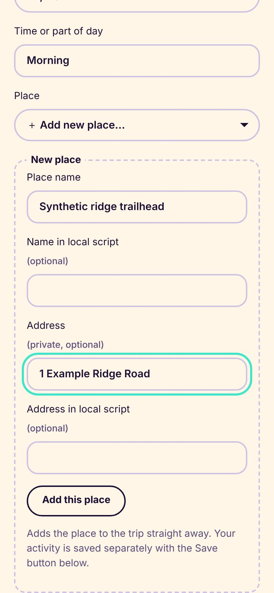
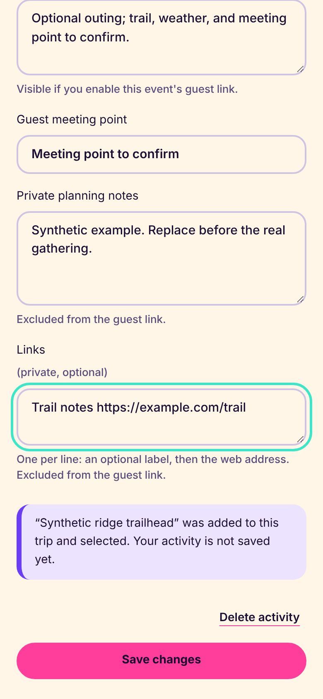
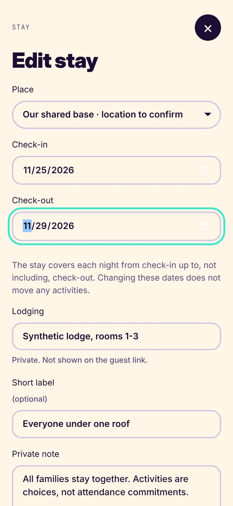
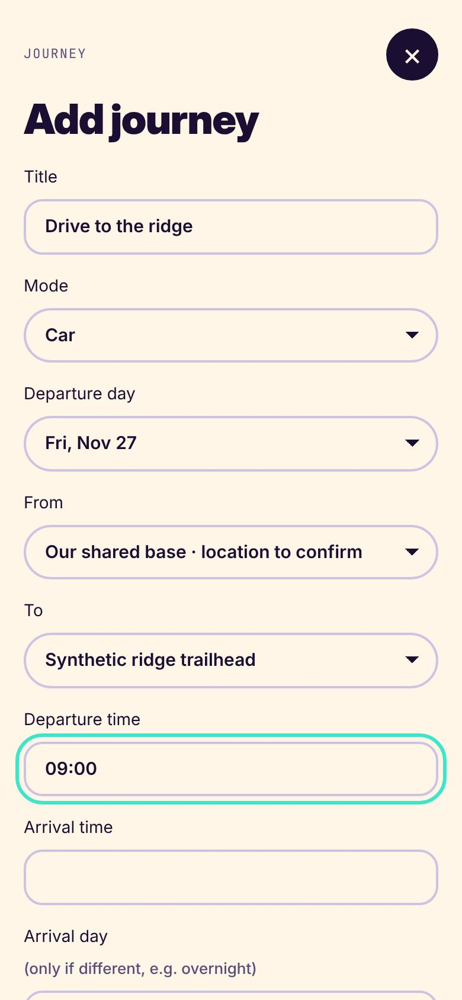
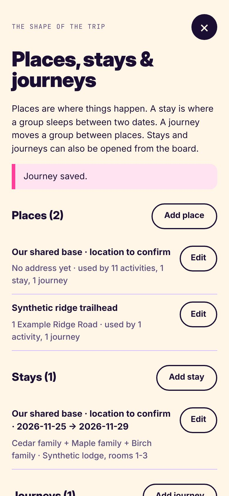
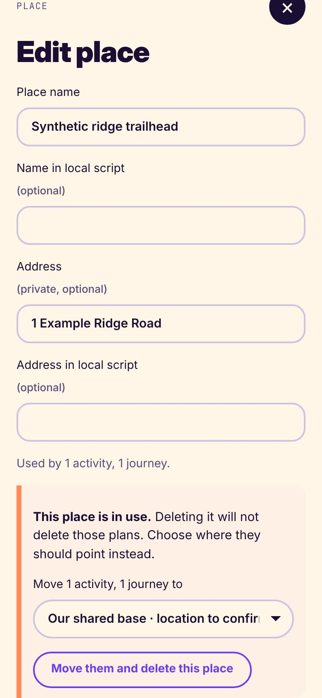

# Editing places, stays and journeys

Status: November 16, 2026. Built and checked locally with synthetic data; deployed in version 12. No database migration is needed for this step. See [release history](releases/README.md) for dated live checks and remaining limits.

## For planners

- **Places, stays & journeys** (toolbar; on a phone under **Plan & manage**)
  lists all three and lets you add, edit and delete them.
- On the board, the **⌂ lodging line** opens that stay and a **journey card**
  opens that journey. Since November 19 a journey that carries a change of
  stay area is shown on a travel bridge between the columns instead; see
  [travel-bridge.md](travel-bridge.md).
- In an activity, the **Place** list ends with **＋ Add new place…**. Fill in the
  name (and optionally the local-script name and addresses), choose **Add this
  place**, and carry on with the activity. What you had typed is kept.
- An activity now has a private **Address** and private **Links** (one per
  line: an optional label, then the web address). Neither is shown on the guest
  link; **Guest meeting point** remains the public location.
- **Trip details** now includes the subtitle, and its button reads **Save**.

Deleting a place that plans still use is never silent. You are shown what uses
it and must choose where those plans should point instead: another place, or
"Location to confirm". Activities, stays and journeys are never deleted along
with a place. Editing a stay's dates does not move any activity; the stay-move
preview is a separate step.

Every one of these saves is in History and can be undone.

## How it works

- `applyTripChange` (`lib/trips.mjs`) gained `place-add/edit/delete`,
  `stay-add/edit/delete` and `leg-add/edit/delete`. Each accepts only its own
  fields, and the whole trip is validated by `normalizeTrip` before saving, so
  unknown places or travelers and bad dates are refused.
- `place-delete` for a place in use returns an error with the references unless
  the request carries an explicit `reassignTo` (a place id, or `null`).
- Activities accept `address` and `links`. Links must be `http`/`https`, at
  most ten. `publicTrip` builds the guest view from a fixed list of fields that
  includes neither.
- Old trips have no `links` field. The change log treats a missing optional
  field as equal to an empty one, so old cards are not reported as edited.

## Checks

- `npm test`: 69 pass (8 new in `tests/structure.test.mjs`).
- `npm run test:api`: structure saves honour the revision check, a stale one is
  409, deleting a used place is 400 until reassigned, the guest view contains no
  address, link, lodging or journey, and undoing a place delete restores the
  place and all four records that pointed at it.
- Type check, lint (0 errors) and production build pass.
- Headless Chromium at 1440 px and 390 px ran every flow above.

Not verified: the hosted Site, physical phones, and local-script input from a
real phone keyboard.

## Screenshots (synthetic data)

| Add a place inline | Address and links | Edit a stay |
| --- | --- | --- |
|  |  |  |

| Add a journey | The list | Delete a place in use |
| --- | --- | --- |
|  |  |  |

Desktop: [list](design/structure/desktop-structure-list.jpg) ·
[stay form](design/structure/desktop-stay-form.jpg) ·
[journey on the board](design/structure/desktop-board-journey.jpg) ·
[inline place](design/structure/desktop-inline-place.jpg).
