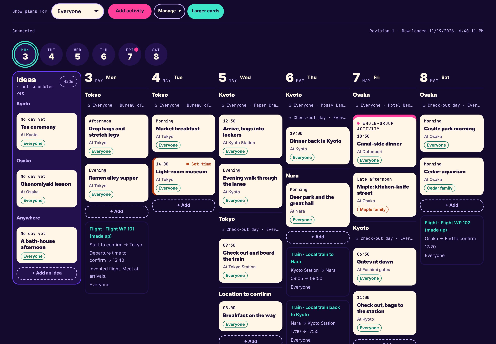
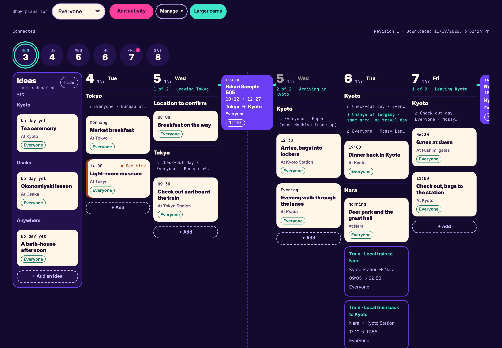
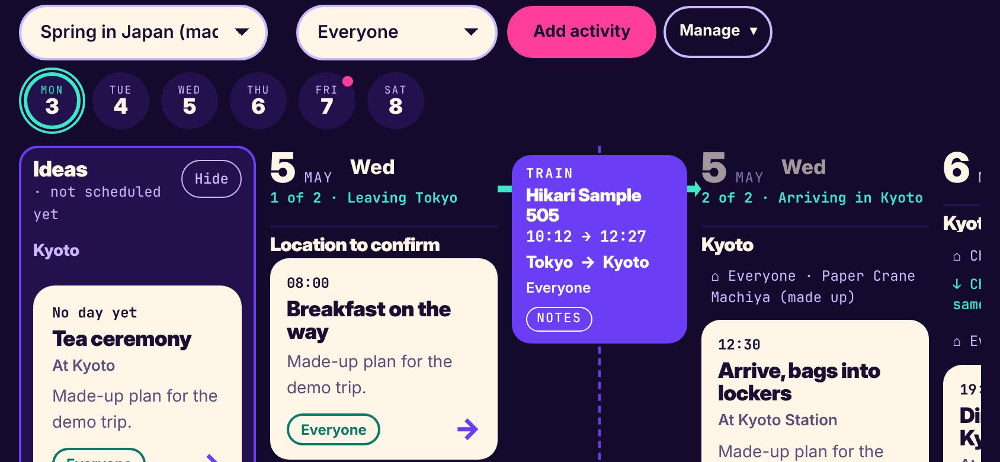
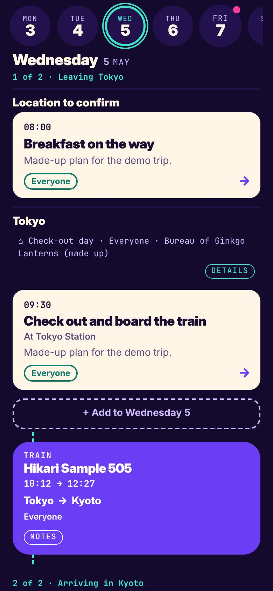
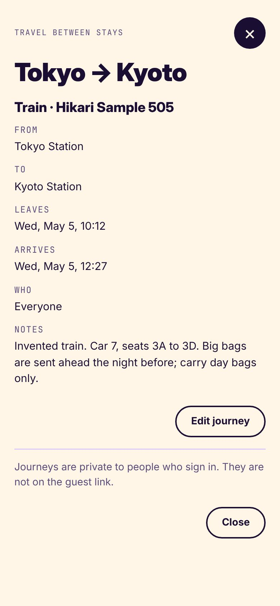

# Travel bridges: showing a change of stay

Status: November 19, 2026. Built and checked locally with made-up data; not
deployed. No database migration and no change to the stored trip: everything
here is read from the stays, places and journeys that already exist.

## For planners

When the group moves from one stay area to another, the board now shows it:

- A **gap** opens between the columns, with a **bridge** in it. The bridge
  carries the transport: mode, name, from → to, departure and arrival times,
  and who is travelling. It is marked **Notes** when the journey has notes.
- The **travel day is shown in two parts**, either side of the bridge:
  "1 of 2 · Leaving Tokyo" (the morning and check-out) and "2 of 2 · Arriving
  in Kyoto" (arrival and the rest of the day). The day now reads left to right
  in time order.
- **Open the bridge** to read the journey, including its notes. **Edit
  journey** goes to the ordinary journey form.
- A move with **no transport entered** keeps the gap and a quiet bridge that
  says "How are we getting there? Not entered yet." Opening it offers **Add
  how we're travelling**, which starts the journey form with the two places,
  the day and the travelers filled in.

| Before | After |
| --- | --- |
|  |  |

### When a bridge appears

| Situation | What the board shows |
| --- | --- |
| The stay changes to a **different area** (another city or camp) | Gap and bridge |
| A **day trip**: out and back to the same stay | Nothing new. Its journeys stay ordinary items in the day |
| **New lodging in the same area** | No gap. One line between the two stay lines: "↓ Change of lodging · same area, no travel day", with check-out first |
| Flight in on the first day, flight out on the last | Ordinary items in the day (arrival first, departure after the day's cards). They are not a change of stay |
| **Overnight travel**: leaves one day, arrives the next | The bridge sits between those two day columns. Neither day is split |
| Two groups moving on the same day | One gap, one bridge card per move, each naming who |
| A flight and then a train to get there | One bridge listing both journeys |

"Same area" is not guessed from names. A place is either an area or a venue
inside one ([place-levels.md](place-levels.md)); two stays are in the same
area exactly when their places share an area. So the model already tells the
two apart and no model change was needed.

### Which part of a travel day a card is in

A card's side comes from its **place**: at the place being left, it is before
the journey; at the place being reached, after. That holds whatever order the
cards were saved in, which is what fixes the old arrival-before-departure
order. A card with no place (or a place somewhere else) goes before the
journey only if it is ordered ahead of a card at the place being left
("Breakfast on the way", then "Check out"); otherwise after.

### Drag and drop

- Both parts of a travel day are drop targets for that day, and so are the
  days either side. The bridge is not a drop target; letting go over it does
  nothing.
- Dragging changes a card's day and order, never its place. So a card placed
  in Kyoto that is dropped on the "Leaving Tokyo" part is shown in the
  "Arriving in Kyoto" part, and the saved message says why.
- A card dropped below the last card of the first part is ordered so that it
  stays in that part when it can. A card with no place then lands just above
  the last card at the place being left, one position higher than where it
  was let go. With no card at the place being left yet, a card with no place
  cannot be kept in the first part; give it that place instead (the first
  part's **+ Add** already does).
- Keyboard moves (Shift + arrows) work within a part and between days as
  before.

### Other layouts

- **Phone, landscape**: Ideas stay fixed; the bridge is a narrow column that
  scrolls past with the days.
- **Phone, portrait**: the travel day lists its first part, then the bridge
  as a divider, then the second part. An overnight bridge is shown at the
  end of the day it leaves and at the top of the day it arrives. All-days
  view shows each bridge between its days.
- **Maps**: the day map of a travel day follows the same before/after order.
  The whole-trip map draws a plain connection for a change of area that has
  no journey entered, so it matches the board.

| Phone, landscape | Phone, portrait | Bridge opened |
| --- | --- | --- |
|  |  |  |

Before, for comparison: [phone landscape](design/travel-bridge/phone-landscape-before.jpg) ·
[phone portrait](design/travel-bridge/phone-portrait-before.jpg). More:
[bridge opened on desktop](design/travel-bridge/desktop-bridge-open.jpg) ·
[no transport entered](design/travel-bridge/desktop-no-transport.jpg) ·
[stay-move preview](design/travel-bridge/desktop-stay-move-preview.jpg).

A trip that stays in one place is unchanged. Compared before and after at
desktop, phone landscape and phone portrait, the screenshots are identical
pixel for pixel apart from the clock in "Downloaded …":
[before](design/travel-bridge/single-stay-desktop-before.jpg) ·
[after](design/travel-bridge/single-stay-desktop-after.jpg).

## Design choices

1. **Mid-day move: split the day, bridge between the parts.** The alternative
   was to keep the travel day as one column and put the bridge in the gap
   before it:

   ```
   Chosen                                   Alternative
   | Wed 5      |          | Wed 5      |   | Tue 4  |          | Wed 5        |
   | 1 of 2     |  TRAIN   | 2 of 2     |   | Tokyo  |  TRAIN   | Tokyo        |
   | Tokyo      | ───────▶ | Kyoto      |   |        | ───────▶ |  check-out   |
   |  check-out | 10:12 →  |  arrive    |   |        |          |  board train |
   |  board     | 12:27    |  evening   |   |        |          | Kyoto        |
   |            |          |            |   |        |          |  arrive      |
   ```

   In the alternative the bridge stands to the left of the Tokyo morning, so
   the eye meets the train before check-out, and the two places are stacked
   in one column with nothing between them. Splitting keeps one rule for the
   whole board: left of a bridge is the old place, right of it is the new
   one. The cost is one extra column on a travel day.
2. **Same-area lodging change: one line, no gap.** The geography did not
   change, so the board does not move. Check-out is listed first.
3. **The bridge is violet with white text** (5.8:1), the Night Market colour
   for arrows and identity, so it cannot be mistaken for a cream activity
   card. The ribbon and seam are lagoon and violet. A bridge with no
   transport is a dusk card with a violet outline.
4. **Stay headers beside a bridge** show the area name in full (it wraps
   instead of being cut), and the stay line may run to two lines. The
   lodging name is what gets cut short, because it is last on the line.
5. **Opening a bridge shows a reading view first**, like stays and
   activities, so someone reading offline or with an expired sign-in can
   still see the notes. Editing is the existing journey form, unchanged.
6. **The forecast line** on a travel day is under the second part only: it
   is the forecast for the stay reached that day ([weather.md](weather.md)).
7. **Ordinary journeys** (day trips, flights in and out) moved above the
   day's "+ Add" button and onto a raised surface with a violet border.

## Guest link

Nothing about what guests receive changed. Journeys are still never sent to
the guest link, so a guest never sees transport details. If the organizer
has shared two stays in different areas, the guest board shows the gap and a
bridge reading "Travel · Kyoto → Osaka" with who, and nothing to open.
Showing transport to guests would be a change to the guest projection and is
left for the organizer to decide.

## How it works

- `public/bridges.mjs` (pure, no page access):
  - `travelPlan(trip, { filter })` pairs consecutive stays that share
    travelers. A pair in different areas is a **move**; in the same area on
    the same day with different lodging it is a **lodging change**. Journeys
    dated between check-out and check-in that connect the two areas (directly,
    or as a chain through other places) belong to the move. A journey that
    goes out and comes back is never on that path.
  - `boardSequence` turns the days into columns, parts and bridges.
  - `splitDay` puts a travel day's cards before or after the journey.
  - `endOfBeforePart` is the drop rule described above.
- `board()` in `public/board.mjs` renders that sequence. A board with no
  bridge produces the same markup as before.
- With a bridge present the board lays out as a row (`display: flex`) so the
  bridge can be narrower than a day; otherwise it is the same grid as before.
- The "Show plans for" filter is applied first, so a person sees only the
  moves of stays they are on.
- Moving a stay ([stay-move.md](stay-move.md)) needs nothing extra: bridges
  are read from the stays, so they appear, move and disappear with them.
- The offline shell caches `bridges.mjs`; the cache is `waypoint-shell-v52`.

## Checks

- `npm test`: 244 pass. Ten new in `tests/bridges.test.mjs`, on the made-up
  Japan trip in `tests/fixtures/japan-trip.mjs`: bridge for a change of area,
  none for a day trip, the lodging-change line, travel-day order, no
  transport, overnight travel, drag and drop around a bridge, stay moves,
  first/last day, chained journeys, separate groups, the person filter, and
  the unchanged single-stay board.
- `node scripts/check-bridge-browser.cjs <dir>` in headless Chromium against
  the local dev server, at 1440 × 1000, 844 × 390 and 390 × 844: 28 checks
  pass, including real mouse drags onto both parts, onto the days either
  side and over the bridge, opening and editing from the bridge, the
  no-transport prompt, and a stay move through the preview dialog.
- Type check, lint (0 errors) and the production build pass.

Not verified: physical phones and touch dragging by hand (the browser check
drags with a mouse; touch uses the same drop code), the hosted Site, a
screen reader, and a real two-week itinerary. The demo trip described in the
task (Tokyo, Kyoto, Osaka, 3–8 May) was not in the repository, so it was
recreated as a made-up fixture; the owner's own copy may differ in detail.
