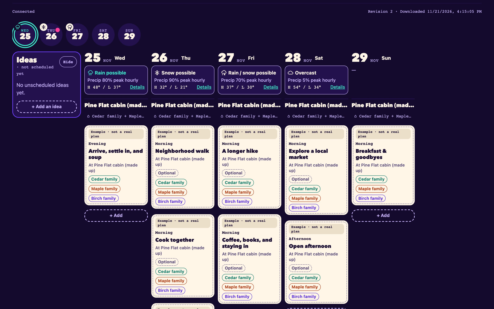
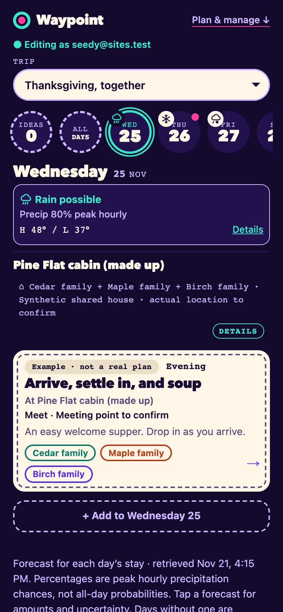
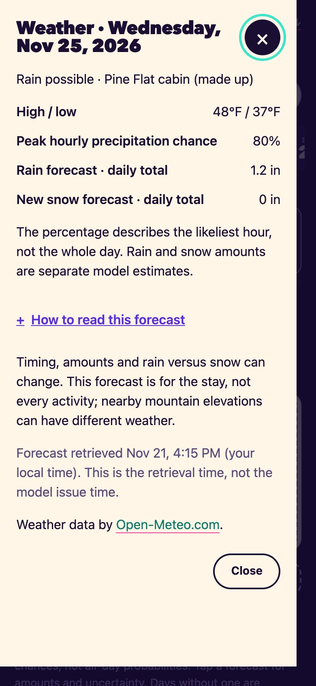

# Weather communication decisions

Research and implementation: November 21, 2026. Requested by the organizer for
outdoor planning, primarily by California families. This is a presentation
update, not a new forecast provider or a claim of improved forecast accuracy.

## November 22 refinement — current presentation

The organizer found the first pass too large and verbose. The board now has a
single quiet line: daily condition/icon plus smaller high/low. Percentages live
only in brief click-through details. Hover is one short forecast sentence.
The details dialog contains the few forecast values, one hourly-probability
explanation, place scope and source/time; the tutorial and extended disclaimers
are removed. The provider's daily weather code leads the condition, so trace
amounts and peak-hour probabilities do not create an alarmist headline that
conflicts with the code's cloudy forecast. Existing fetching and values remain.
Desktop height is 28 px; phone touch height is 44 px. Temperatures use 13 px
secondary text beside the 14 px condition. A long condition can shorten
without hiding temperatures. The details dialog sizes to content on phones too.
This supersedes the information hierarchy described in the November 21 study
below. Its research remains background, not a requirement to show all its text.

Local validation: all 245 Node tests passed (3 unrelated browser tests skipped).
The dedicated weather browser suite passed all 121 assertions at desktop, week,
phone portrait and phone landscape sizes, including single-line bounds, visible
temperatures, compact dialog height, keyboard/focus, guests and saved fallback.
Physical phones, assistive technology and hosted publication remain unverified.

## Evidence and decisions

| Evidence | Waypoint decision |
| --- | --- |
| [Ripberger et al., 2022, systematic review](https://repository.library.noaa.gov/view/noaa/60526) finds well-presented probability information can be understood and improve decisions. | Keep numbers and plain-language context together; do not hide uncertainty behind one categorical icon. |
| [Open-Meteo API documentation](https://open-meteo.com/en/docs) defines hourly probability for more than 0.1 mm precipitation and daily fields as aggregations of hourly values. | Label the existing `precipitation_probability_max` as peak hourly; do not present it as a whole-day event probability. Explain location, threshold and period. Probability applies to precipitation, not a separate snow event. |
| [NWS probability explanation](https://www.weather.gov/media/pah/WeatherEducation/pop.pdf) distinguishes event chance from duration or area covered. Its measurable threshold is 0.01 inches, unlike Open-Meteo's hourly threshold. | Do not copy the NWS definition verbatim onto another provider's numbers. Explain that even high chances do not imply all-day rain; show amount separately. |
| [ECMWF forecast user guide](https://confluence.ecmwf.int/spaces/FUG/pages/673550806/Section%2B7.1%2BConsideration%2Bof%2Bprobability) explains that probabilities over adjacent periods cannot be combined without their dependence structure. | Do not manufacture a daily chance with `1-product(1-p)` or reinterpret the daily maximum as a union probability. Do not adjust the provider's probabilities by intuition. |
| [Met Office on ensemble decisions](https://www.metoffice.gov.uk/research/weather/ensemble-forecasting/decision-making) discusses using quantified uncertainty for user-specific decisions. | Give chance, model amount and temperatures; let the family decide what matters for a hike, campfire or travel day. Avoid blanket good/bad weather judgments. |

## California context

The organizer recalls rain chances seeming higher than experienced after moving
from Boston to California. That recollection is useful usability evidence, not
proof that today's provider is miscalibrated. A brief measurable shower, rain
outside one's outdoor hours, the difference between a point and a wider area,
and provider-specific probability periods can all affect perceived accuracy.
We did not establish which explanation applied twenty years ago, or compare
forecast calibration between then and now.

Accordingly, preserve probabilities and clarify what they mean. Separate a
trace from a substantial accumulation; avoid a bright rain pill implying a
washed-out day. Keep US units from browser locale, explicitly label high/low,
and remind readers that a stay forecast does not cover a ski area's elevation.
Do not suppress freezing rain, thunderstorms, small snow amounts or low chances.
There is no California percentage discount or arbitrary good-weather threshold.

## Interaction and information hierarchy

1. Always-visible summary: possible conditions, peak hourly chance, high/low.
2. Full-width weather button (84 CSS px at default font size), with visible
   Details affordance, native keyboard semantics and focus ring. It replaces
   hover-only disclosure and keeps equal column heights.
3. Native modal reading dialog with an expandable explanation: local forecast date, signed-in location label,
   rain/snow totals, units, probability explanation, model uncertainty and
   retrieval time. Touch and keyboard receive the same content as a mouse.
4. No low/medium/high confidence score, invented interval or timing precision:
   this endpoint does not supply a validated uncertainty range for these values.
   A one-week outlook reminder is advice, not a forecast confidence measure.

Cloud/fog icons use the weather code. Precipitation phase uses the supplied code
or amounts; temperature alone cannot decide phase. Daily accumulation does not
establish heavy hourly intensity. Small positive amounts use a less-than label
and never a minimum rounded-up amount. US rainfall uses 0.01-inch precision;
0.08 inches of rain is measurable and is not described as a trace. Missing numeric data remains unavailable.

## Scope and limits

No hourly timeline, alert feed, UV/wind expansion, schema change, new service,
new location sharing, map behavior or trip writes. Details are for the stay,
not each activity. Weather source request parameters and authentication remain
unchanged. Refresh failure retains the original retrieval time and marks Saved;
existing expiry, guest omission and offline/session rules are preserved.

Automated unit and browser checks use invented trips and intercepted forecasts.
They do not validate forecast skill, mountain microclimates, physical phones,
assistive technology or live production publication. Current check results are
recorded with the PR and deployment prompt; prior release records are historical.

## Validation of this source update

- `npm test`: 245 passed, 0 failed, 3 unrelated card-picture browser tests
  skipped because Playwright is not installed in the app dependency tree.
- Typecheck and production build passed. Lint: 0 errors, 5 existing warnings.
- `check-weather-browser.cjs` passed in installed Chrome with Playwright supplied
  from an isolated temporary directory: 1440 × 900 in normal and week density,
  844 × 390 landscape and 390 × 844 portrait. Intercepted forecasts only.
  All 118 browser assertions passed. Equal header heights, retained temperatures, no sideways page scroll,
  keyboard opening/expansion, Escape/focus return, preserved weather after
  keyboard card moves, cached fallback, guest privacy and refusal behavior
  passed. No page script errors were observed.
- The local fixture database received already-existing migrations 0002–0004
  after a local backup; this update introduces no migration.
- After the final rainfall precision correction, the full unit suite, typecheck
  and production build passed again. A focused Chrome rendering check at
  390 and 1440 px verified 0.08 in measurable rain, <0.1 in trace snow,
  initial dialog scroll position, explanation expansion and Escape/focus return.
- Physical phones, screen readers, live forecast skill and hosted publication
  remain unverified by this PR.

Synthetic layout examples (the forecast and location are made up). These
captures precede the final rainfall precision correction: US rain totals now
use hundredths of an inch, for example 1.22 in rather than 1.2 in:

