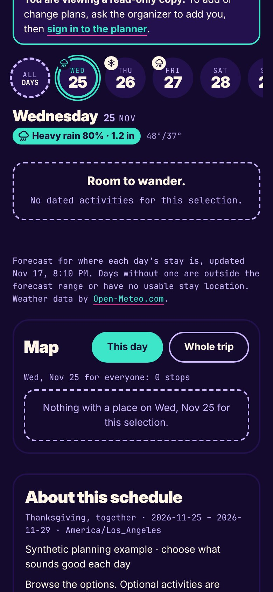
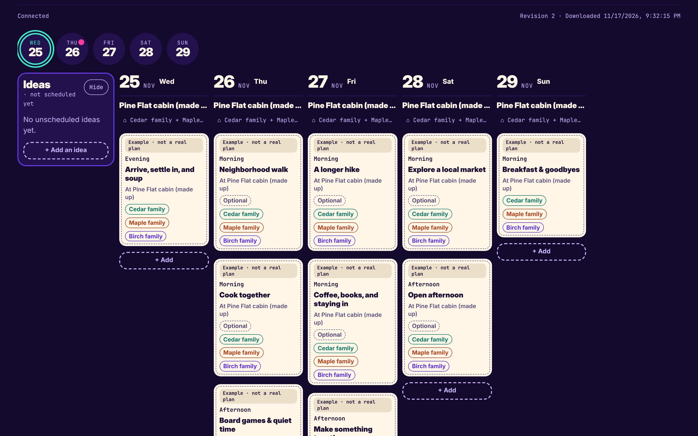

# Weather under each date

Status: browser-side forecasts deployed in version 23 (PR #37); complete
weather title text deployed in version 24 (PR #38), persistence through card
moves in version 25 (PR #41), and travel-day placement in version 26 (PR #43).
A live planner forecast was seen in Chrome after an initial timeout and
automatic retry in version 23, and again in later releases. Guest forecast
rendering and physical-phone behavior remain unverified. See
[release history](releases/README.md). No database migration.

## Weather communication update — November 21, 2026

Implemented in source; publication is a separate release. See the
[research and design decisions](weather-communication.md) and
[deployment prompt](deploy-weather-uncertainty.md). Earlier deployment evidence
below remains dated evidence, not verification of this update.

## Compact weather update — November 22, 2026

This source update supersedes the November 21 three-row presentation. Publication
is a separate step; it does not establish that the hosted Site has this version.

## For planners and guests

- **One line:** a condition icon and short label, followed by smaller high/low
  temperatures. No percentage, card border, or separate Details link on the board.
  The line is 28 px on desktop, with a 44 px touch target on phones. Long labels
  may shorten; temperatures stay visible. The entire line opens details.
- **Use the provider's daily condition.** Clear, cloudy, fog, rain, showers, snow,
  freezing rain and thunderstorms come from the daily weather code. When that
  code is absent, use the available amounts/precipitation indication. Trace
  amounts or an hourly probability do not override a cloudy daily condition.
  Meaningful rain and snow together can still show Rain/snow.
- **Short hover:** condition, high/low with units, and “Click for details.” A saved
  forecast is marked. No explanatory paragraph, private place name or timestamp.
- **Brief click-through:** date, condition, signed-in place name, high/low,
  peak-hour precipitation chance, rain total, new snow when relevant, checked
  time and Open-Meteo credit. One sentence explains the hourly probability and
  stay scope. No weather tutorial, confidence score or long uncertainty text.
- **Preserve accuracy:** forecast provider, coordinates, probability values,
  temperatures and fetching behavior are unchanged. Rain keeps hundredths of an
  inch; tiny positive snow amounts keep the less-than trace label. Missing values
  remain unavailable. Units follow browser locale. Guest details omit the place.
- Weather stays aligned across dates, survives card moves, and takes no space
  when none is available. Saved/older indicators and the existing one-day expiry
  remain. Keyboard opening, Escape/Close and focus return are preserved.

Source offline shell is v55. The source note below the board is now only the
checked time and Open-Meteo credit. See [design decisions](weather-communication.md).

## Where the location comes from

The stay's place is asked first, then the area it sits in. Tried in order:
coordinates of either, an address of either, then the area's name and the
place's name. If one cannot be found, the next is tried.

- **Coordinates** typed in "Location for the map", in any coordinate system.
  They are used as typed and never converted: the difference between systems is
  under a kilometre, far below what a forecast can tell apart.
- **An address or place name**: the typed map location, else the place's
  address fields. It is looked up for the weather only (owner decision,
  November 17). The whole text is tried, then the part after the first comma.
  The result is cached on the server and **never written to the place**, so the
  map rules in [map-location.md](map-location.md) are unchanged: an address is
  still not positioned on the drawing.
- **The place's name**, when there is nothing else ("Twain Harte" is enough).
  For a looked-up address or name, the signed-in details panel names what the lookup matched,
  so a wrong match can be noticed.

When a day has several stays, the first one (in the trip's order) with a
forecast is used; a check-out morning uses the stay being left. The family
filter does not change it.

## Services and what is sent

| | Service | Asked by | Key | Sent | Limits |
| --- | --- | --- | --- | --- | --- |
| Forecast | [Open-Meteo](https://open-meteo.com/) | the reader's browser | none | latitude and longitude rounded to two decimals (about 1 km) | 16 days; free tier is for non-commercial use with a request allowance per address and asks for attribution, which the note gives |
| Address lookup | OpenStreetMap Nominatim public server | the server | none | the typed address text, or the place name when there is no address or coordinates | at most one request a second, no uptime promise, weaker on some addresses |

### Why the browser asks

On the live Site, five out of five forecast requests from the server were
refused with `HTTP 429`, each after three tries. The Site runs on addresses
shared with many other apps, and the forecast service's free allowance is
counted per address. A request from a reader's own connection is not affected.
The owner chose this on November 18, 2026, for signed-in people and guests.

So the work is split:

1. The server (`/api/weather`, `/api/shared-weather`) answers **where**: one
   point per stay location, rounded to two decimals, and which day uses which
   point. It asks no forecast.
2. The browser asks Open-Meteo for each point and draws the lines.

What this means for privacy:

- **Guests now receive each stay's location rounded to about a kilometre**,
  including stays not ticked for the guest link, because their browser needs
  it to ask. They still get no place name, address or exact coordinates.
- Open-Meteo sees the reader's network address, the rounded point and the
  Site's web address (browsers send it as the request's origin). No referrer,
  cookie, trip name, person, note or identifier is sent.
- The guest page's Content-Security-Policy allows a connection to
  `https://api.open-meteo.com` and nothing else new.
- An address or place name is still looked up by the server only, cached there
  for 30 days and never stored on the place. Whether that lookup answers from
  the host has not been seen: the real trip has coordinates and needs none.

Day boundaries are the stay's own: the forecast service is asked to work out the
time zone from the location and answers in that place's local days, and a day
that has already ended there is not shown.

### When the forecast service does not answer a device

- A page asks once an hour per point.
- Each browser keeps the last forecast it saw for a trip and shows it, with its
  own update time and without days that are over, when a request fails. It is
  dropped after a day, or as soon as there is truly no forecast. The page asks
  again every two and a half minutes, up to six times. For signed-in people
  this copy is cleared on sign-out; for guests it holds the forecast only.
- With no forecast at all the line takes no room. Signed-in people get the
  reason under the schedule, including what the service answered; guests are
  told nothing.

## Code

- `lib/weather.mjs`: location of a stay, address lookup and its cache,
  `weatherPlan()` (the points and their days). `lib/weather-cache.ts`: the
  lookup cache used by the routes.
- `app/api/weather/route.ts` (same access check as the trip) and
  `app/api/shared-weather/route.ts` (same token check as the guest schedule).
  Authorization is unchanged.
- `public/weather.mjs`: `fetchWeather()` (the browser's forecast request),
  parsing, classification, words, icons, the kept copy, and filling the lines.
- `public/board.mjs` puts an empty line in every day header; `planner.js` and
  `guest.mjs` fill it in place when the answer arrives.
- Source offline shell cache is `waypoint-shell-v55`; weather persistence
  originally shipped with v51. Offline, a forecast kept by the
  browser is not shown; the lines stay empty.

## Checks

- `npm test`: 226 pass, 17 in `tests/weather.test.mjs` with both services
  mocked: rain, snow, mixed and dry rendering with precipitation first; no
  location; dates outside the range; a failed or refused request; time-zone day
  boundaries; address and name lookup; what is sent and by whom; the guest
  page's policy; guests.
- `scripts/check-weather-browser.cjs` (headless Chromium, local dev server,
  synthetic trip, made-up forecast answered in place of the forecast service):
  desktop three-column and week views, phone landscape and phone portrait. The
  browser asks for the rounded point only, with no referrer or cookie; the
  guest page is allowed to ask; a refused guest sees nothing; a refused
  signed-in person keeps the last forecast or is told why.
- Type check, lint (0 errors) and production build pass.

## Verification and remaining limits

Version 22's server-side forecast requests returned empty days with
forecast-failed / HTTP 429 on all five minute-spaced checks. In version 23, the
reader's browser initially reported TimeoutError, then populated all six
forecast lines automatically during the three-minute no-reload observation.
The tooltip/update text, Open-Meteo credit and desktop column alignment were
checked. Version 24 verified complete wet and Dry title text. Version 25
observed weather lines but did not perform a live drag regression check. These
are dated observations; the historical release records keep their original
limits.

The live Network panel's HTTP status, daily JSON response and actual request
headers were not captured in version 23. Source checks confirmed the permitted
URL parameters, no-referrer policy and omitted credentials; that is not a wire
inspection. Captured console logs contained no CORS or CSP error.

Still unverified:

- Guest forecast rendering, place omission from guest tooltip text and owner-only
  diagnostic suppression during a live forecast check. Guest read-only access
  passed in version 26, but that does not establish its weather behavior.
- Physical phones, phone All days weather, touch interactions and screen reader.
  Viewport overrides repeatedly did not change the observed Chrome dimensions.
- Address/name lookup accuracy from the host, Nominatim policy compliance and
  mainland-China connectivity.

Open-Meteo terms were read on November 17 and recorded as permitting the
described non-commercial private app subject to attribution and usage limits.
That dated reading is preserved in the version 19/21 history; it is not a new
terms review. No China-readiness claim is made.

## Historical screenshots (before the November 21 communication update)

These show the earlier one-line display, with synthetic forecasts.

| Wet | Snowy | Dry | No forecast | Guest |
| --- | --- | --- | --- | --- |
|  |  |  |  |  |

Phone landscape:

Desktop, larger cards and the week view (Nov 29 has no forecast):

No forecast for any day: the line is given back.

