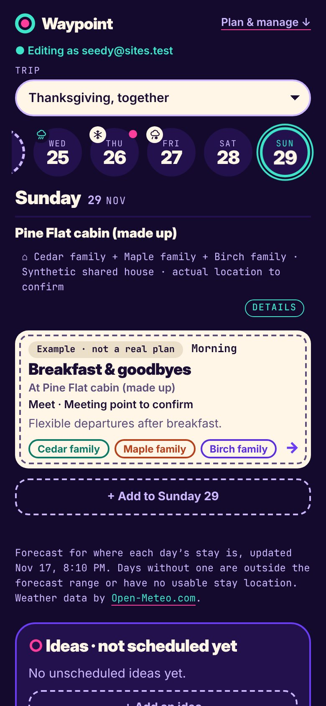
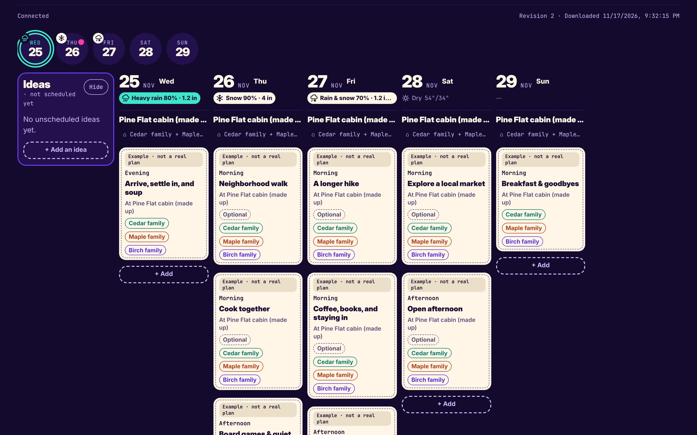

# Weather under each date

Status: November 18, 2026. Version 22 (main `58c1709`) is live; on it the
forecast never arrived, because the forecast service refuses the host (see
"Why the browser asks"). This document describes the change that moves the
forecast request to the reader's browser; it is checked locally with a
synthetic trip and mocked services and is not deployed. No database migration.
It makes no claim about working in China.

## For planners and guests

Every day header has one more line, directly under the date: the forecast for
where that day's stay is.

- **Precipitation first.** An icon and a few words: `Rain 80%`, `Snow 90% · 4 in`,
  `Rain & snow 70% · 1.2 in snow`, or a quiet `Dry`. The percentage is the chance
  of precipitation. The expected amount is shown for snow, and for rain from
  about 0.4 in (10 mm); from about 1 in (25 mm) it reads `Heavy rain`.
- **Temperature second**, smaller: high/low, e.g. `32°/21°`. In a narrow column
  it is the first thing dropped.
- A wet day is a lit pill (teal outline for rain, solid teal for heavy rain,
  cream for snow and mixed); a dry day is plain quiet text.
- Wet and snowy days also get a small icon on their day chip. Dry days and days
  with no forecast leave the chip as it was.
- **The line takes room only when there is a forecast.** If no day of the trip
  has one, the line is given back and the header is as it was before. If some
  days have one, every column keeps the line so cards stay level, and a day
  without one shows a faint dash. One day at a time (phone, upright), a day
  without a forecast gives its line back too.
- A day has no forecast when the date is past the 16-day range or already over,
  the stay has no usable location, or the lookup failed. Nothing is invented
  and no averages are shown.
- When the whole trip has none, signed-in people get one sentence under the
  schedule saying why: nothing to look up, a name or address that was not
  found, a service that did not answer (with what it answered, e.g.
  `HTTP 429`), or dates out of range. Guests are told nothing.
- Hovering a line shows all of it in words (a narrow column cuts it short),
  then where and when. Nothing more than the line itself is added.
- Under the schedule a note says when the forecast was updated and credits the
  source. The same time is in each line's tooltip, and for signed-in people the
  tooltip also names the place the forecast is for.
- Units follow the reader's browser: °F and inches for a United States locale,
  otherwise °C, mm and cm.
- Guests see the same line. They are not shown the place, and their browser
  receives only the stay's location rounded to about a kilometre.

## Where the location comes from

The stay's place is asked first, then the area it sits in. Tried in order:
coordinates of either, an address of either, then the area's name and the
place's name. If one cannot be found, the next is tried.

- **Coordinates** typed in "Location for the map", in any coordinate system.
  They are used as typed and never converted: the difference between systems is
  under a kilometre, far below what a forecast can tell apart.
- **An address or place name**: the typed map location, else the place's
  address fields. It is looked up for the weather only (owner decision,
  November 17). The whole text is tried, then the part after the first comma.
  The result is cached on the server and **never written to the place**, so the
  map rules in [map-location.md](map-location.md) are unchanged: an address is
  still not positioned on the drawing.
- **The place's name**, when there is nothing else ("Twain Harte" is enough).
  For a looked-up address or name, the tooltip names what the lookup matched,
  so a wrong match can be noticed.

When a day has several stays, the first one (in the trip's order) with a
forecast is used; a check-out morning uses the stay being left. The family
filter does not change it.

## Services and what is sent

| | Service | Asked by | Key | Sent | Limits |
| --- | --- | --- | --- | --- | --- |
| Forecast | [Open-Meteo](https://open-meteo.com/) | the reader's browser | none | latitude and longitude rounded to two decimals (about 1 km) | 16 days; free tier is for non-commercial use with a request allowance per address and asks for attribution, which the note gives |
| Address lookup | OpenStreetMap Nominatim public server | the server | none | the typed address text, or the place name when there is no address or coordinates | at most one request a second, no uptime promise, weaker on some addresses |

### Why the browser asks

On the live Site, five out of five forecast requests from the server were
refused with `HTTP 429`, each after three tries. The Site runs on addresses
shared with many other apps, and the forecast service's free allowance is
counted per address. A request from a reader's own connection is not affected.
The owner chose this on November 18, 2026, for signed-in people and guests.

So the work is split:

1. The server (`/api/weather`, `/api/shared-weather`) answers **where**: one
   point per stay location, rounded to two decimals, and which day uses which
   point. It asks no forecast.
2. The browser asks Open-Meteo for each point and draws the lines.

What this means for privacy:

- **Guests now receive each stay's location rounded to about a kilometre**,
  including stays not ticked for the guest link, because their browser needs
  it to ask. They still get no place name, address or exact coordinates.
- Open-Meteo sees the reader's network address, the rounded point and the
  Site's web address (browsers send it as the request's origin). No referrer,
  cookie, trip name, person, note or identifier is sent.
- The guest page's Content-Security-Policy allows a connection to
  `https://api.open-meteo.com` and nothing else new.
- An address or place name is still looked up by the server only, cached there
  for 30 days and never stored on the place. Whether that lookup answers from
  the host has not been seen: the real trip has coordinates and needs none.

Day boundaries are the stay's own: the forecast service is asked to work out the
time zone from the location and answers in that place's local days, and a day
that has already ended there is not shown.

### When the forecast service does not answer a device

- A page asks once an hour per point.
- Each browser keeps the last forecast it saw for a trip and shows it, with its
  own update time and without days that are over, when a request fails. It is
  dropped after a day, or as soon as there is truly no forecast. The page asks
  again every two and a half minutes, up to six times. For signed-in people
  this copy is cleared on sign-out; for guests it holds the forecast only.
- With no forecast at all the line takes no room. Signed-in people get the
  reason under the schedule, including what the service answered; guests are
  told nothing.

## Code

- `lib/weather.mjs`: location of a stay, address lookup and its cache,
  `weatherPlan()` (the points and their days). `lib/weather-cache.ts`: the
  lookup cache used by the routes.
- `app/api/weather/route.ts` (same access check as the trip) and
  `app/api/shared-weather/route.ts` (same token check as the guest schedule).
  Authorization is unchanged.
- `public/weather.mjs`: `fetchWeather()` (the browser's forecast request),
  parsing, classification, words, icons, the kept copy, and filling the lines.
- `public/board.mjs` puts an empty line in every day header; `planner.js` and
  `guest.mjs` fill it in place when the answer arrives.
- Offline shell cache is `waypoint-shell-v51`. Offline, a forecast kept by the
  browser is not shown; the lines stay empty.

## Checks

- `npm test`: 226 pass, 17 in `tests/weather.test.mjs` with both services
  mocked: rain, snow, mixed and dry rendering with precipitation first; no
  location; dates outside the range; a failed or refused request; time-zone day
  boundaries; address and name lookup; what is sent and by whom; the guest
  page's policy; guests.
- `scripts/check-weather-browser.cjs` (headless Chromium, local dev server,
  synthetic trip, made-up forecast answered in place of the forecast service):
  desktop three-column and week views, phone landscape and phone portrait. The
  browser asks for the rounded point only, with no referrer or cookie; the
  guest page is allowed to ask; a refused guest sees nothing; a refused
  signed-in person keeps the last forecast or is told why.
- Type check, lint (0 errors) and production build pass.

## Not verified

- **A live forecast in a browser.** The build environment cannot reach
  Open-Meteo, so its real answer and its cross-origin headers were not seen.
  If a browser is refused, the sentence under the schedule says what it got.
- **Open-Meteo's terms**: the terms page could not be opened. Confirm that a
  private family planner counts as non-commercial use.
- **The address lookup from the host**, including how well it finds rural
  addresses.
- A physical phone, a screen reader, real trip data, and anything from
  mainland China, where the forecast service may not be reachable.

## Screenshots (synthetic trip; the forecast is made up)

| Wet | Snowy | Dry | No forecast | Guest |
| --- | --- | --- | --- | --- |
|  |  |  |  |  |

Phone landscape:

Desktop, larger cards and the week view (Nov 29 has no forecast):

No forecast for any day: the line is given back.

