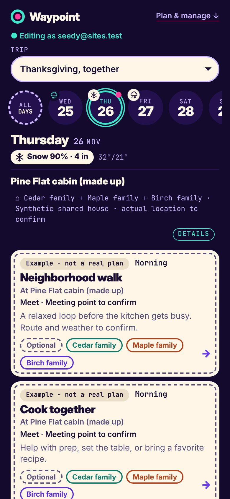
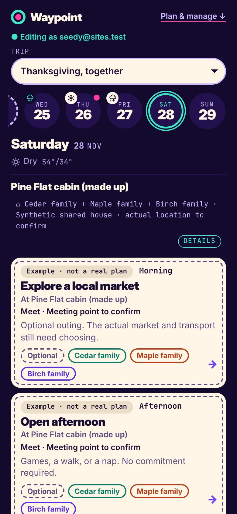
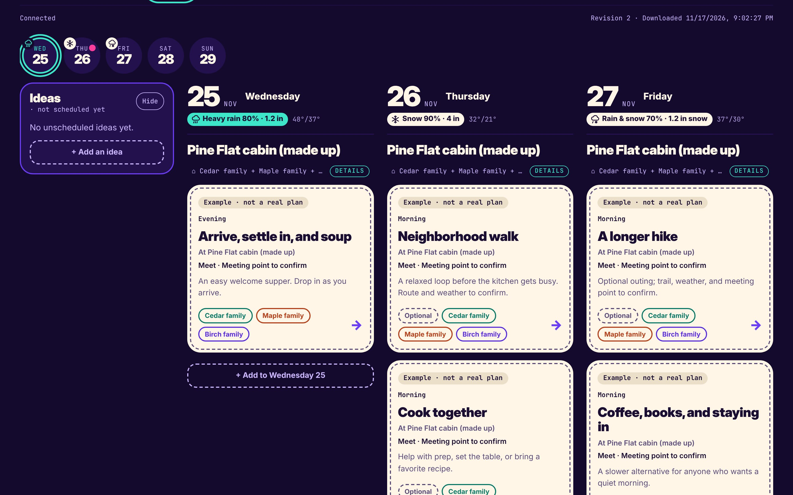

# Weather under each date

Status: deployed November 17, 2026 (America/Los_Angeles), Sites version 19,
from main `d3387edbfcb85fc9d81b4268ba8bd52d7f7cfce8`. See
[release provenance](multi-events.md#release-provenance). No database migration.
The live forecast and address lookup remain unverified: browser controls were
unavailable for an authenticated hosted check. Local tests used synthetic data
and mocked services; neither outside service was reachable from that build
environment. No claim is made about working in China.

## For planners and guests

Every day header has one more line, directly under the date: the forecast for
where that day's stay is.

- **Precipitation first.** An icon and a few words: `Rain 80%`, `Snow 90% · 4 in`,
  `Rain & snow 70% · 1.2 in snow`, or a quiet `Dry`. The percentage is the chance
  of precipitation. The expected amount is shown for snow, and for rain from
  about 0.4 in (10 mm); from about 1 in (25 mm) it reads `Heavy rain`.
- **Temperature second**, smaller: high/low, e.g. `32°/21°`. In a narrow column
  it is the first thing dropped.
- A wet day is a lit pill (teal outline for rain, solid teal for heavy rain,
  cream for snow and mixed); a dry day is plain quiet text.
- Wet and snowy days also get a small icon on their day chip. Dry days and days
  with no forecast leave the chip as it was.
- A day with no forecast shows a faint dash. That happens when the date is past
  the 16-day forecast range or already over, the stay has no usable location,
  or the lookup failed. Nothing is invented and no averages are shown.
- Under the schedule a note says when the forecast was updated and credits the
  source. The same time is in each line's tooltip, and for signed-in people the
  tooltip also names the place the forecast is for.
- Units follow the reader's browser: °F and inches for a United States locale,
  otherwise °C, mm and cm.
- Guests see the same line. They are not told the place, address or coordinates.

## Where the location comes from

The stay's place is asked first, then the area it sits in. Either can give:

- **Coordinates** typed in "Location for the map", in any coordinate system.
  They are used as typed and never converted: the difference between systems is
  under a kilometre, far below what a forecast can tell apart.
- **An address or place name**: the typed map location, else the place's
  address fields. It is looked up for the weather only (owner decision,
  November 17). The whole text is tried, then the part after the first comma.
  The result is cached on the server and **never written to the place**, so the
  map rules in [map-location.md](map-location.md) are unchanged: an address is
  still not positioned on the drawing.

When a day has several stays, the first one (in the trip's order) with a
forecast is used; a check-out morning uses the stay being left. The family
filter does not change it.

## Services and what is sent

| | Service | Key | Sent | Limits |
| --- | --- | --- | --- | --- |
| Forecast | [Open-Meteo](https://open-meteo.com/) | none | latitude and longitude rounded to two decimals (about 1 km) | 16 days; free tier is for non-commercial use with a daily request allowance and asks for attribution, which the note gives |
| Address lookup | OpenStreetMap Nominatim public server | none | the typed address text | at most one request a second, no uptime promise, weaker on some addresses; an identifying User-Agent is asked for |

Nothing else leaves the planner: no trip name, people, notes or identifiers.
Requests are made by the server (`lib/weather.mjs`), never by the browser.
A forecast is reused for an hour per location, a looked-up address for 30 days,
and a failure is not retried for five minutes. The cache is the worker's memory
plus the platform's edge cache where available; nothing is stored in the trip
or the database, and nothing goes through `commit()`/`transact()`.

Day boundaries are the stay's own: the forecast service is asked to work out the
time zone from the location and answers in that place's local days, and a day
that has already ended there is not shown.

## Code

- `lib/weather.mjs`: location of a stay, address lookup, forecast, caching,
  `tripWeather()`. `lib/weather-cache.ts`: the cache used by the routes.
- `app/api/weather/route.ts` (same access check as the trip) and
  `app/api/shared-weather/route.ts` (same token check as the guest schedule).
  Authorization is unchanged.
- `public/weather.mjs`: classification, words, icons, and filling the lines.
- `public/board.mjs` puts an empty fixed-height line in every day header;
  `planner.js` and `guest.mjs` fill it in place when the answer arrives.
- Offline shell cache is `waypoint-shell-v45` and includes the new module. The
  reading copy does not keep weather: offline, the lines stay empty.

## Checks

- `npm test`: 212 pass, 14 new in `tests/weather.test.mjs`, with the weather
  service mocked: rain, snow, mixed and dry rendering with precipitation first;
  no location; dates outside the range; a failed lookup; time-zone day
  boundaries; address lookup; caching; what is sent; guests.
- `scripts/check-weather-browser.cjs` (headless Chromium, local dev server,
  synthetic trip, made-up forecast): desktop three-column and week views, phone
  landscape and phone portrait. Header and first card are at the same height
  loading, with and without a forecast; no sideways scroll; guest view.
- Type check, lint (0 errors) and production build pass.

## Not verified

Deployment observation, November 17, 2026: Sites reported successful version 19
publication. Published weather assets match the pinned source, shell v45 includes
the weather module, and signed-out private weather access returns 401 (the
shared route without a token returns 404). These checks do not call either
outside service. No owner or guest browser session was available and no live
trip edit was made.

[Open-Meteo's terms](https://open-meteo.com/en/terms) were read successfully on
November 17. They explicitly include private apps without subscriptions or
advertising as non-commercial use, so the described private family planner
fits the free API category. Usage limits and CC-BY 4.0 attribution still apply:
less than 10,000 requests/day, 5,000/hour and 600/minute; the terms table also
lists 300,000/month. Availability and accuracy are not guaranteed.

Still not verified:

- **A live forecast from the hosted Worker.** No authenticated weather request
  was made; no success, failed response or faint-dash behavior was observed.
- **A live address lookup**, including resolution to the correct town, rural
  address quality and whether Nominatim's usage policy is satisfied by the
  generic User-Agent.
- Outbound access from the Sites Worker to either service, or the platform
  edge cache. Without the cache, each Worker instance keeps its own.
- Owner trip loading and saving, Ready to read offline, forecast tooltips,
  update note and attribution rendering, and desktop/phone column alignment
  for this release.
- The existing guest link's weather and absence of place names in tooltips.
  No guest link was created, replaced, disabled or opened for this check.
- A physical phone, a screen reader, real-trip weather behavior and anything
  from mainland China.

## Screenshots (synthetic trip; the forecast is made up)

| Wet | Snowy | Dry | No forecast | Guest |
| --- | --- | --- | --- | --- |
|  |  |  |  |  |

Phone landscape:

Desktop, larger cards and the week view (Nov 29 has no forecast):

