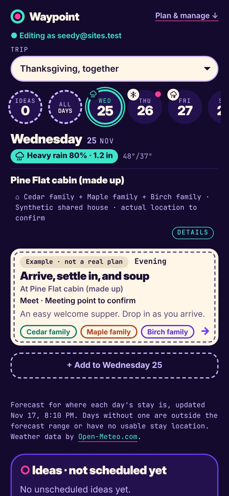
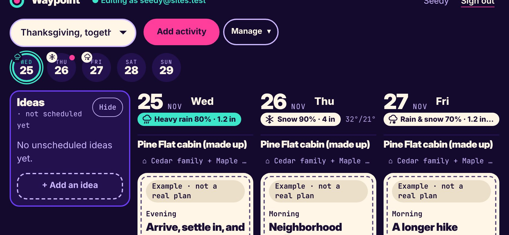

# Weather under each date

Status: deployed November 17, 2026 (America/Los_Angeles), Sites version 21,
from main `9de4d3f1ed1fd54f0b5079c8a9c2e141dfa4891f`. See
[release provenance](multi-events.md#release-provenance). No database migration.
Live forecast success and the cause of the earlier missing weather remain
unverified: browser controls were unavailable for the owner-session check.
Local weather tests use synthetic data and mocked responses. No claim is made
about working in China.

## For planners and guests

Every day header has one more line, directly under the date: the forecast for
where that day's stay is.

- **Precipitation first.** An icon and a few words: `Rain 80%`, `Snow 90% · 4 in`,
  `Rain & snow 70% · 1.2 in snow`, or a quiet `Dry`. The percentage is the chance
  of precipitation. The expected amount is shown for snow, and for rain from
  about 0.4 in (10 mm); from about 1 in (25 mm) it reads `Heavy rain`.
- **Temperature second**, smaller: high/low, e.g. `32°/21°`. In a narrow column
  it is the first thing dropped.
- A wet day is a lit pill (teal outline for rain, solid teal for heavy rain,
  cream for snow and mixed); a dry day is plain quiet text.
- Wet and snowy days also get a small icon on their day chip. Dry days and days
  with no forecast leave the chip as it was.
- **The line takes room only when there is a forecast.** If no day of the trip
  has one, the line is given back and the header is as it was before. If some
  days have one, every column keeps the line so cards stay level, and a day
  without one shows a faint dash. One day at a time (phone, upright), a day
  without a forecast gives its line back too.
- A day has no forecast when the date is past the 16-day range or already over,
  the stay has no usable location, or the lookup failed. Nothing is invented
  and no averages are shown.
- When the whole trip has none, signed-in people get one sentence under the
  schedule saying why: nothing to look up, a name or address that was not
  found, a service that did not answer (with what it answered, e.g.
  `HTTP 429`), or dates out of range. Guests are told nothing.
- Under the schedule a note says when the forecast was updated and credits the
  source. The same time is in each line's tooltip, and for signed-in people the
  tooltip also names the place the forecast is for.
- Units follow the reader's browser: °F and inches for a United States locale,
  otherwise °C, mm and cm.
- Guests see the same line. They are not told the place, address or coordinates.

## Where the location comes from

The stay's place is asked first, then the area it sits in. Tried in order:
coordinates of either, an address of either, then the area's name and the
place's name. If one cannot be found, the next is tried.

- **Coordinates** typed in "Location for the map", in any coordinate system.
  They are used as typed and never converted: the difference between systems is
  under a kilometre, far below what a forecast can tell apart.
- **An address or place name**: the typed map location, else the place's
  address fields. It is looked up for the weather only (owner decision,
  November 17). The whole text is tried, then the part after the first comma.
  The result is cached on the server and **never written to the place**, so the
  map rules in [map-location.md](map-location.md) are unchanged: an address is
  still not positioned on the drawing.
- **The place's name**, when there is nothing else ("Twain Harte" is enough).
  For a looked-up address or name, the tooltip names what the lookup matched,
  so a wrong match can be noticed.

When a day has several stays, the first one (in the trip's order) with a
forecast is used; a check-out morning uses the stay being left. The family
filter does not change it.

## Services and what is sent

| | Service | Key | Sent | Limits |
| --- | --- | --- | --- | --- |
| Forecast | [Open-Meteo](https://open-meteo.com/) | none | latitude and longitude rounded to two decimals (about 1 km) | 16 days; free tier is for non-commercial use with a daily request allowance and asks for attribution, which the note gives |
| Address lookup | OpenStreetMap Nominatim public server | none | the typed address text, or the place name when there is no address or coordinates | at most one request a second, no uptime promise, weaker on some addresses; an identifying User-Agent is asked for |

Nothing else leaves the planner: no trip name, people, notes or identifiers.
Requests are made by the server (`lib/weather.mjs`), never by the browser.
A forecast is reused for an hour per location, a looked-up address for 30 days,
and a failure is not retried for five minutes. The cache is the worker's memory
plus the platform's edge cache where available; nothing is stored in the trip
or the database, and nothing goes through `commit()`/`transact()`.

Day boundaries are the stay's own: the forecast service is asked to work out the
time zone from the location and answers in that place's local days, and a day
that has already ended there is not shown.

## Code

- `lib/weather.mjs`: location of a stay, address lookup, forecast, caching,
  `tripWeather()`. `lib/weather-cache.ts`: the cache used by the routes.
- `app/api/weather/route.ts` (same access check as the trip) and
  `app/api/shared-weather/route.ts` (same token check as the guest schedule).
  Authorization is unchanged.
- `public/weather.mjs`: classification, words, icons, and filling the lines.
- `public/board.mjs` puts an empty fixed-height line in every day header;
  `planner.js` and `guest.mjs` fill it in place when the answer arrives.
- Offline shell cache is `waypoint-shell-v46` and includes the new module. The
  reading copy does not keep weather: offline, the lines stay empty.

## Checks

- `npm test`: 213 pass, 15 new in `tests/weather.test.mjs`, with the weather
  service mocked: rain, snow, mixed and dry rendering with precipitation first;
  no location; dates outside the range; a failed lookup; time-zone day
  boundaries; address lookup; caching; what is sent; guests.
- `scripts/check-weather-browser.cjs` (headless Chromium, local dev server,
  synthetic trip, made-up forecast): desktop three-column and week views, phone
  landscape and phone portrait. No room is taken before the first forecast or
  when there is none; with one, header and first card are at the same height
  in every column, also while loading on a later visit; no sideways scroll;
  guest view.
- Type check, lint (0 errors) and production build pass.

## Not verified

Deployment observation, November 17, 2026: version 21 publication succeeded.
Published weather assets match main, shell v46 is served, the private weather
route refuses signed-out requests with 401, and the shared route without a
token returns 404. These checks do not call either outside service.

Browser controls were unavailable. No authenticated owner weather response,
exact No forecast sentence or `why` value was obtained, so none is quoted.
The diagnostic was requested from the owner after deployment, but no observation
was available when this record was prepared. No trip, place or stay was edited
to make weather appear. The earlier absence of weather is still unexplained;
the coordinates-first change is a candidate fix, not a verified resolution.

[Open-Meteo terms](https://open-meteo.com/en/terms) were successfully read on
November 17. A private app without subscriptions or advertising fits their
non-commercial free category, subject to attribution and usage limits (less
than 10,000 calls/day, 5,000/hour, 600/minute; 300,000/month in the table).

Still not verified:

- A live forecast from the Sites Worker and whether PR 31 fixes the earlier
  missing-weather report.
- The exact owner-only diagnostic and `why` field if no forecast is available.
- Whether the Worker can reach Open-Meteo or Nominatim, and whether edge caching
  is available. No outbound-permission cause, service error or timeout was
  established; no workaround was attempted.
- Live address/name lookup accuracy and Nominatim User-Agent policy compliance.
- Existing-trip loading/saving, offline-ready status, forecast tooltip/update
  note, and column alignment at desktop and phone widths.
- Existing guest weather or absence, omission of place names and omission of the
  owner-only diagnostic. No guest link was created, replaced or disabled.
- A physical phone, a screen reader and mainland-China connectivity.

## Screenshots (synthetic trip; the forecast is made up)

| Wet | Snowy | Dry | No forecast | Guest |
| --- | --- | --- | --- | --- |
|  |  |  |  |  |

Phone landscape:

Desktop, larger cards and the week view (Nov 29 has no forecast):

No forecast for any day: the line is given back.

